# Kiến Trúc Phân Rã Domain & Subdomain (Domain-Driven Architecture Blueprint)
## Hệ Sinh Thái Agent Tài Chính (Northstar Finance Lab)

> **Mục tiêu**: Chuẩn hóa toàn bộ hệ thống theo mô hình **Domain-Driven Design (DDD)**. Mỗi Tab lớn là một **Core Domain / Primary Subdomain**, bên trong mỗi Tab lớn được phân rã thành các **Subdomain con (Bounded Contexts / Micro-features)** độc lập về nghiệp vụ, giao diện, dữ liệu và AI Agent, giúp các nhóm phát triển (hoặc các AI subagents) có thể code song song mà không bị xung đột.

---

## 1. Sơ Đồ Tổng Quan 5 Core Domains & Platform Hub

```mermaid
graph TD
    App[App Shell & Product Registry]
    
    App --> D1["1. Market & Portfolio (Thị trường & Danh mục)"]
    App --> D2["2. Learn Hub (Học viện Tài chính & AI Tutor)"]
    App --> D3["3. BCTC Analysis (Phân tích Báo cáo Tài chính)"]
    App --> D4["4. News & Intelligence (Tin tức & Vĩ mô)"]
    App --> D5["5. Simulation Lab (Mô phỏng & Backtest)"]
    App --> D0["0. Platform Core (Home, Onboarding & Auth)"]

    %% D1 Subdomains
    D1 --> D1_1[1.1 Market Overview & Sparklines]
    D1 --> D1_2[1.2 Priceboard & Technical Screener]
    D1 --> D1_3[1.3 Ticker Deep-Dive & Charts]
    D1 --> D1_4[1.4 Portfolio Tracker & Watchlist]

    %% D2 Subdomains
    D2 --> D2_1[2.1 Academy & Hierarchical Courses]
    D2 --> D2_2[2.2 Document & Ebook Reader]
    D2 --> D2_3[2.3 Mock Exam & Assessment]
    D2 --> D2_4[2.4 Socratic AI Companion]

    %% D3 Subdomains
    D3 --> D3_1[3.1 Financial Statements Multi-Period]
    D3 --> D3_2[3.2 Ratios & Financial Cockpit]
    D3 --> D3_3[3.3 Valuation Workbench DCF/PE]
    D3 --> D3_4[3.4 Forensic Health & DuPont Analyzer]

    %% D4 Subdomains
    D4 --> D4_1[4.1 Real-Time News Feed]
    D4 --> D4_2[4.2 Sentiment Radar & Sentiment AI]
    D4 --> D4_3[4.3 Macro & Economic Calendar]
    D4 --> D4_4[4.4 Corporate Actions & Dividend Calendar]

    %% D5 Subdomains
    D5 --> D5_1[5.1 Strategy Builder Studio]
    D5 --> D5_2[5.2 Backtest Engine & Analytics]
    D5 --> D5_3[5.3 Real-Time Paper Trading]
    D5 --> D5_4[5.4 Risk Matrix & Stress Testing]
```



---

## 2. Chi Tiết Phân Rã Từng Tab Lớn Thành Các Subdomain Con

### TAB 1: MARKET & PORTFOLIO (`market_portfolio`)
*Mã route: `/markets`, `/market`, `/portfolio` | Trọng tâm: Bảng điện realtime, chỉ số, phân tích dòng tiền & danh mục*

| Subdomain Con | Tên Chức Năng | Trách Nhiệm Nghiệp Vụ (Scope) | Frontend Components | Backend Module / Services | AI Subagent Phụ Trách |
|---|---|---|---|---|---|
| **1.1 `market_overview`** | **Tổng quan & Diễn biến thị trường** | 4 Index cards thời gian thực (VNINDEX, VN30, HNX30, UPCOM), độ rộng thị trường (Breadth: Tăng/Giảm/Trần/Sàn), Cánh bướm khối ngoại, Tác động chỉ số, Bản đồ nhiệt ngành (Sector Heat Grid). | `MarketOverview`, `IndexSparklineCard`, `ForeignFlowButterfly`, `VnIndexImpactWidget`, `SectorHeatGrid` | `modules/market_portfolio/services/market_snapshot.py`, `market_summary` | `MarketSentimentAgent` |
| **1.2 `priceboard_screener`** | **Bảng giá trực tuyến & Bộ lọc tín hiệu** | Bảng giá streaming đa sàn (HOSE, HNX, UPCoM), Bộ lọc tín hiệu sinh viên/pro (Breakout, VCP, Dòng tiền vào, Dò đáy, Cổ tức, Cảnh báo đỉnh), Lọc 31 nhóm ngành, chỉ báo kỹ thuật (MA, RSI, Vol). | `UnifiedFilterBar`, `VnOverviewTable`, `VnPriceBoard`, `FilterPresetData` | `modules/market_portfolio/api/screener_routes.py`, `filter_engine.py` | `ScreenerFilterAgent` |
| **1.3 `ticker_deepdive`** | **Chi tiết mã & Phân tích kỹ thuật** | Xem biểu đồ nến kỹ thuật (TradingView / Lightweight Chart), Sổ lệnh Order Book (3 mức giá mua/bán), Khớp lệnh bước giá Time & Sales, Hồ sơ doanh nghiệp & Cổ đông lớn. | `VnDetailedTickerPage`, `LightweightChartPanel`, `VnOrderBookWidget`, `CompanyProfileCard` | `modules/market_portfolio/services/ticker_detail.py`, `orderbook_service.py` | `TechnicalAnalysisAgent` |
| **1.4 `portfolio_tracker`** | **Quản lý danh mục & Watchlist** | Theo dõi danh mục đầu tư cá nhân, tính toán Lãi/Lỗ (PnL) chưa chốt và đã chốt, tỷ trọng phân bổ tài sản, Danh sách theo dõi yêu thích (Watchlist). | `PortfolioDashboardView`, `WatchlistRail`, `AssetAllocationDonut`, `PnLSummaryCard` | `modules/portfolio_product/`, `watchlist_service.py` | `PortfolioRiskAgent` |

---

### TAB 2: LEARN HUB (`learn_hub`)
*Mã route: `/learn`, `/learning` | Trọng tâm: Học viện tài chính tương tác & Trợ lý gia sư AI Socratic*

| Subdomain Con | Tên Chức Năng | Trách Nhiệm Nghiệp Vụ (Scope) | Frontend Components | Backend Module / Services | AI Subagent Phụ Trách |
|---|---|---|---|---|---|
| **2.1 `course_academy`** | **Học viện & Khóa học đa cấp** | Danh mục khóa học phân cấp (Course $\rightarrow$ Module $\rightarrow$ Lesson $\rightarrow$ Checkpoint), theo dõi tiến độ học tập có hóa đơn xác thực (Receipt checksum), bài giảng video timestamped. | `CourseCatalog`, `CourseOutlineTree`, `VideoLecturePlayer`, `LessonBreadcrumb` | `modules/learning/services/course_engine.py`, `progress_receipts.py` | `CurriculumAgent` |
| **2.2 `reader_library`** | **Thư viện sách & Ebook Reader** | Đọc tài liệu PDF & Ebook học thuật (Intelligent Investor, Security Analysis...), đánh dấu trang (Bookmarks), trích dẫn highlighted text, ghi chú học tập (Study Notes). | `BookDocumentPane`, `PdfBookPane`, `StudyNotesDrawer`, `HighlightPopover` | `modules/learning/api/reader_proxy.py`, `document_storage.py` | `DocContextAgent` |
| **2.3 `mock_exam`** | **Phòng thi sát hạch & Bài tập** | Trắc nghiệm kiến thức chứng khoán, chứng chỉ hành nghề/CFA, chấm điểm server-side không lộ đáp án ở client (Zero-Leakage), giải thích chi tiết câu sai. | `MockExamRoom`, `CheckpointQuizCard`, `ExamTimerBar`, `ScoreReportModal` | `modules/learning/services/exam_service.py`, `quiz_validator.py` | `AssessmentAgent` |
| **2.4 `socratic_mentor`** | **Gia sư AI Socratic tương tác** | Hộp trò chuyện AI theo phương pháp Socratic (dẫn dắt bằng câu hỏi gợi mở, không đưa ngay đáp án), hỗ trợ Context Grounding bám sát tài liệu/video/BCTC đang đọc qua SSE stream. | `LearnHubDualPaneLayout`, `AiSocraticChatPane`, `GroundingPillList` | `modules/ai_tutor/specialists/socratic_engine.py`, SSE streaming API | `SocraticTutorAgent` |

---

### TAB 3: BCTC ANALYSIS (`bctc`)
*Mã route: `/bctc`, `/guided-investing` | Trọng tâm: Bóc tách BCTC, định giá cổ phiếu & chuẩn đoán sức khỏe tài chính*

| Subdomain Con | Tên Chức Năng | Trách Nhiệm Nghiệp Vụ (Scope) | Frontend Components | Backend Module / Services | AI Subagent Phụ Trách |
|---|---|---|---|---|---|
| **3.1 `statements_viewer`** | **Bảng tài chính đa kỳ** | Bảng cân đối kế toán, Báo cáo kết quả kinh doanh, Báo cáo lưu chuyển tiền tệ (theo Quý/Năm), chuẩn hóa số liệu theo chuẩn mực kế toán VAS. | `FinancialStatementsTable`, `QuarterlyBarChart`, `StatementExportCsv` | `modules/financials_product/services/statements_service.py` | `AccountingParserAgent` |
| **3.2 `ratios_cockpit`** | **Buồng lái chỉ số tài chính** | Tính toán tự động và trực quan hóa các chỉ số quan trọng: ROE, ROA, Biên lợi nhuận gộp/ròng, EPS, P/E, P/B, Vòng quay vốn lưu động, Khả năng thanh toán hiện hành. | `RatiosCockpitGrid`, `RatioMetricCard`, `IndustryPeerBenchmark` | `modules/financials_product/services/ratios_calculator.py` | `FinancialMetricsAgent` |
| **3.3 `valuation_workbench`** | **Mô hình định giá chuyên sâu** | Định giá chiết khấu dòng tiền (DCF 2-3 giai đoạn), Định giá P/E lịch sử & P/B, Mô hình cổ tức DDM, Biên an toàn (Margin of Safety theo Benjamin Graham). | `ValuationDcfCalculator`, `HistoricalPeBandChart`, `SensitivityMatrixTable` | `modules/financials_product/services/valuation_models.py` | `ValuationSpecialistAgent`|
| **3.4 `forensic_health`** | **Phân tích DuPont & Cảnh báo gian lận** | Cây phân tích DuPont 3 nhân tố và 5 nhân tố, Điểm số sức khỏe Altman Z-Score, Beneish M-Score (phát hiện xào nấu số liệu), Piotroski F-Score (chọn lọc cổ phiếu giá trị). | `DuPontDecompositionTree`, `AltmanZScoreGauge`, `FinancialRedFlagsCard` | `modules/financial_health/services/forensic_engine.py` | `ForensicAuditAgent` |

---

### TAB 4: NEWS & INTELLIGENCE (`news`)
*Mã route: `/news`, `/news/economic-calendar` | Trọng tâm: Dòng tin thị trường realtime, phân tích cảm xúc AI & vĩ mô*

| Subdomain Con | Tên Chức Năng | Trách Nhiệm Nghiệp Vụ (Scope) | Frontend Components | Backend Module / Services | AI Subagent Phụ Trách |
|---|---|---|---|---|---|
| **4.1 `realtime_feed`** | **Dòng tin tức tức thời** | Tổng hợp tin tức tài chính, báo chí chính thống (VnExpress, CafeF, Vietstock), gắn nhãn ngành và mã cổ phiếu tự động, tìm kiếm tin theo từ khóa. | `NewsFeedStream`, `NewsArticleCard`, `StockMentionBadge` | `modules/news_intelligence/services/rss_crawler.py`, `news_filter.py` | `NewsIngestionAgent` |
| **4.2 `sentiment_radar`** | **Radar cảm xúc AI** | AI chấm điểm cảm xúc (Bullish: Tích cực / Bearish: Tiêu cực / Neutral) của từng bản tin, đo lường nhiệt kế tâm lý thị trường, cảnh báo tin đột biến gây sốc giá. | `SentimentMeterWidget`, `TickerSentimentTag`, `ImpactPredictorBadge` | `modules/news_intelligence/services/sentiment_analyzer.py` | `SentimentClassifierAgent`|
| **4.3 `macro_calendar`** | **Lịch sự kiện kinh tế vĩ mô** | Lịch công bố chỉ số vĩ mô trong nước & quốc tế: CPI, GDP, Lãi suất FED/Ngân hàng Nhà nước, Tỷ giá USD/VND, PMI sản xuất. | `EconomicCalendarTable`, `MacroEventDetailDrawer`, `ImportancePill` | `modules/news_intelligence/services/economic_calendar.py` | `MacroEconomicAgent` |
| **4.4 `corporate_events`** | **Lịch sự kiện doanh nghiệp** | Lịch trả cổ tức bằng tiền/cổ phiếu, Ngày giao dịch không hưởng quyền (GDKHQ), Đại hội đồng cổ đông thường niên/bất thường, Phát hành tăng vốn. | `CorporateEventsTimeline`, `DividendDateCard`, `ExDateCountdown` | `modules/news_intelligence/services/corporate_actions.py` | `CorporateEventAgent` |

---

### TAB 5: SIMULATION LAB (`simulation_lab`)
*Mã route: `/simulation-lab`, `/simulations`, `/pro-lab`, `/backtest-studio` | Trọng tâm: Phòng Lab kiểm thử định lượng & Sàn giao dịch ảo*

| Subdomain Con | Tên Chức Năng | Trách Nhiệm Nghiệp Vụ (Scope) | Frontend Components | Backend Module / Services | AI Subagent Phụ Trách |
|---|---|---|---|---|---|
| **5.1 `strategy_studio`** | **Phòng chế tạo chiến lược** | Trình soạn thảo và cấu hình chiến lược giao dịch bằng Python / Quy tắc đồ họa (Visual Rule Builder / Indicator Signals). | `StrategyEditorPane`, `IndicatorConfigForm`, `RuleBuilderFlow` | `modules/simulation_lab/services/strategy_manager.py` | `StrategyDesignerAgent` |
| **5.2 `backtest_engine`** | **Engine chạy thử nghiệm lịch sử** | Chạy kiểm thử chiến lược trên dữ liệu giá quá khứ VN-Index (Tick/Phút/Ngày), tính toán chỉ số hiệu năng: Sharpe Ratio, Max Drawdown, Tỷ lệ Thắng (Win Rate), Profit Factor. | `BacktestRunPanel`, `EquityCurveChart`, `DrawdownUnderwaterChart`, `TradeHistoryTable`| `modules/simulation_lab/services/backtest_executor.py`, `engines/quant/` | `QuantitativeBacktestAgent`|
| **5.3 `paper_trading`** | **Giao dịch ảo thời gian thực** | Sàn giao dịch chứng khoán ảo khớp lệnh theo giá realtime thị trường, mô phỏng phí giao dịch, thuế, tiền mặt ảo $1.000.000.000$ VNĐ, bảng xếp hạng nhà đầu tư. | `PaperTradingOrderForm`, `VirtualPortfolioPositions`, `LeaderboardWidget` | `modules/simulation_lab/services/paper_broker.py`, `order_matching.py` | `VirtualExecutionAgent` |
| **5.4 `risk_matrix`** | **Ma trận quản trị rủi ro & Stress Test** | Đo lường rủi ro danh mục: Value at Risk (VaR), Stress test kịch bản khủng hoảng (COVID-19, sụp đổ 2022), kiểm soát quy mô vị thế và đòn bẩy. | `RiskMatrixHeatmap`, `VaRHistogramChart`, `StressScenarioSelector` | `modules/quant_risk/services/risk_engine.py` | `RiskGuardAgent` |

---

## 3. Cấu Trúc Thư Mục Chuẩn Hóa Theo Subdomain (Architecture Code Layout)

Để hỗ trợ phát triển song song và tuân thủ nguyên tắc **Hard Limit < 200 dòng**, cấu trúc Frontend và Backend được ánh xạ 1-1 với kiến trúc Subdomain:

### Frontend Layout (`frontend/src/features/`)
```
features/
├── market-portfolio/             # TAB 1: Core Domain
│   ├── subdomains/
│   │   ├── market-overview/      # 1.1 Tổng quan & Sparklines
│   │   ├── priceboard-screener/  # 1.2 Bảng giá & Bộ lọc tín hiệu
│   │   ├── ticker-deepdive/      # 1.3 Chi tiết mã & Biểu đồ
│   │   └── portfolio-tracker/    # 1.4 Danh mục & Watchlist
│   ├── pages/                    # Route endpoints
│   ├── services/                 # API data fetchers
│   └── index.js                  # Public exports
│
├── learn-hub/                    # TAB 2: Core Domain
│   ├── subdomains/
│   │   ├── course-academy/       # 2.1 Khóa học phân cấp
│   │   ├── reader-library/       # 2.2 Đọc sách & Ebook
│   │   ├── mock-exam/            # 2.3 Phòng thi sát hạch
│   │   └── socratic-mentor/      # 2.4 Gia sư AI Socratic
│   └── ...
│
├── bctc/                         # TAB 3: Core Domain
│   ├── subdomains/
│   │   ├── statements-viewer/    # 3.1 Báo cáo tài chính
│   │   ├── ratios-cockpit/       # 3.2 Chỉ số tài chính
│   │   ├── valuation-workbench/  # 3.3 Mô hình định giá
│   │   └── forensic-health/      # 3.4 Sức khỏe & DuPont
│   └── ...
│
├── news/                         # TAB 4: Core Domain
│   ├── subdomains/
│   │   ├── realtime-feed/        # 4.1 Dòng tin thời gian thực
│   │   ├── sentiment-radar/      # 4.2 Cảm xúc thị trường AI
│   │   ├── macro-calendar/       # 4.3 Lịch sự kiện vĩ mô
│   │   └── corporate-events/     # 4.4 Lịch sự kiện doanh nghiệp
│   └── ...
│
└── simulation-lab/               # TAB 5: Core Domain
    ├── subdomains/
    │   ├── strategy-studio/      # 5.1 Xây dựng chiến lược
    │   ├── backtest-engine/      # 5.2 Backtest lịch sử
    │   ├── paper-trading/        # 5.3 Giao dịch ảo realtime
    │   └── risk-matrix/          # 5.4 Quản trị rủi ro & VaR
    └── ...
```

---

## 4. Lợi Ích Cốt Lõi Của Mô Hình Phân Chia Này

1. **Phát triển song song (Parallel Velocity)**: Các lập trình viên hoặc AI subagents có thể cùng lúc phụ trách từng subdomain con (ví dụ: Dev A làm `1.2 priceboard-screener`, Dev B làm `2.4 socratic-mentor`, Dev C làm `3.3 valuation-workbench`) mà hoàn toàn không bị chồng chéo code hay xung đột merge conflict.
2. **Deterministic & Isolated Testing**: Mỗi subdomain con sở hữu bộ Unit Test và Mock Data riêng biệt (ví dụ: test định giá DCF độc lập hoàn toàn với test bảng giá hay test trắc nghiệm).
3. **Hard Limit < 200 dòng**: Mỗi component hoặc service trong subdomain con có phạm vi trách nhiệm duy nhất (Single Responsibility Principle), đảm bảo code ngắn gọn, dễ debug và bảo trì lâu dài.
4. **Tích hợp AI Subagent chuyên biệt**: Mỗi subdomain được kết nối với đúng 1 Subagent chuyên môn nghiệp vụ (ví dụ: `ValuationSpecialistAgent`, `TechnicalAnalysisAgent`, `SocraticTutorAgent`), tối ưu hóa token và độ chính xác của LLM.
