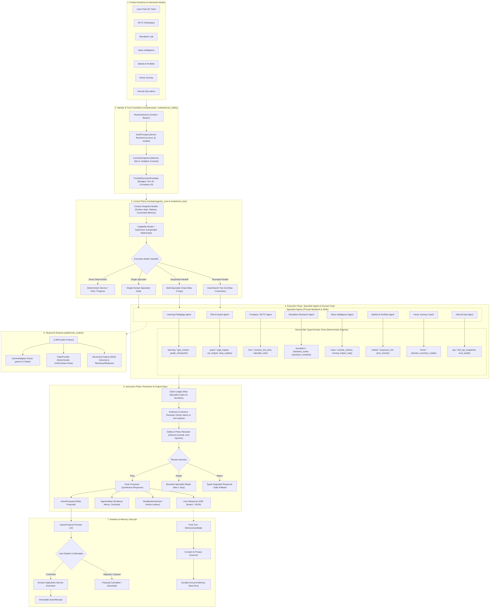
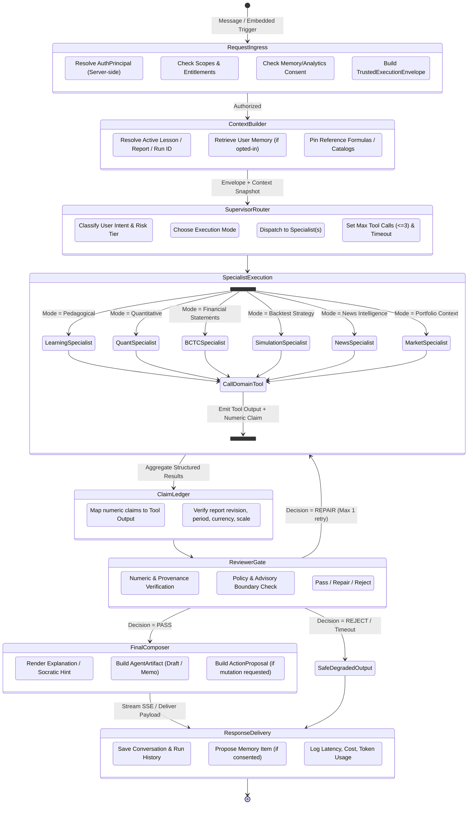

# Kiến trúc Hệ thống Multi-Agent (Agentic Quantum)

> **Tài liệu:** Sơ đồ Cấu trúc & Luồng Điều phối Hệ sinh thái Multi-Agent  
> **Dự án:** `agent_financial` / `Northstar Finance Lab`  
> **Tài liệu nguồn cao nhất:** [`AGENTIC_QUANTUM_MASTER_PLAN.md`](AGENTIC_QUANTUM_MASTER_PLAN.md)  
> **Tài liệu định hướng chiến lược:** [`AI_AGENT_PRODUCT_UPGRADE_STRATEGY.md`](AI_AGENT_PRODUCT_UPGRADE_STRATEGY.md)  
> **Bộ kế hoạch triển khai chi tiết:** [`agentic-quantum/README.md`](agentic-quantum/README.md)  

---

## 1. Tổng quan & Định vị Hệ thống

* **Internal Program:** `Agentic Quantum`
* **Internal Ecosystem:** `Northstar Agentic Finance Workspace`
* **External MVP Positioning:** `Northstar AI Quant Finance Tutor`
* **Làm rõ cốt lõi:** "Quantum" ở đây là **Quantitative Finance & Econometrics** (Tài chính định lượng: rủi ro, phân tích BCTC, mô phỏng kịch bản vĩ mô, backtest), hoàn toàn **không phải Quantum Computing**.
* **Hai chế độ tương tác (Dual Interaction Modes):**
  1. **Conversational Mode:** AI Tutor (`modules/ai_tutor`) hỗ trợ hỏi đáp, giải thích, gợi ý Socratic và kiểm tra hiểu bài qua checkpoints.
  2. **Embedded Workflow Mode:** Các Agent chuyên môn tích hợp ngay trong từng màn hình nghiệp vụ (*Learn, BCTC, Simulation, News, Market/Portfolio, Home Journey, Internal Ops*).

---

## 2. Sơ đồ Kiến trúc 3 Tầng Tổng thể (System-Wide Architecture)

---

## 3. Sơ đồ Luồng Điều Phối StateGraph (LangGraph Supervisor Orchestration)

---

## 4. Ma trận Ranh giới Chuyên môn & Tools của Từng Agent

| Specialist Agent | Module sở hữu | Bộ Tools chính (Server-Side Deterministic) | Nhiệm vụ chính | Ranh giới cấm (Forbidden) |
|---|---|---|---|---|
| **Supervisor / Orchestrator** | `modules/agentic_core` | `router.classify_intent`, `tool_grants.authorize`, `run_manager.budget` | Điều phối StateGraph, cấp quyền tool, phân xử handoff | Không sở hữu công thức tài chính hay dữ liệu người dùng |
| **AI Tutor (Conversational)** | `modules/ai_tutor` | `tutor.create_conversation`, `tutor.send_message`, `tutor.feedback` | Quản lý trải nghiệm học tập hội thoại, gợi ý Socratic, giải thích khái niệm | Không lưu dữ liệu tài chính nội bộ; giao tiếp model qua AI Runtime |
| **Learning Pedagogy Agent** | `modules/learning` | `learning.get_context`, `learning.get_progress`, `learning.grade_checkpoint`, `learning.recommend_next` | Giải thích bài học, hướng dẫn giải bài, kiểm tra hiểu bài qua checkpoint, đề xuất bài học tiếp theo | Không xuất đáp án quiz thô (`correct_answer`); không tự nâng level khi chưa qua checkpoint |
| **Risk & Quant Specialist** | `engines/quant`, `quant_risk` | `quant.explain_risk`, `quant.get_run`, `quant.calculate_metric`, `quant.compare_scenarios` | Giải thích xác suất rủi ro VN-Index, SHAP drivers, VaR/CVaR, HMM regimes | Không đưa ra khuyến nghị mua/bán cổ phiếu; không tự ý chỉnh sửa thuật toán mô hình |
| **Company & BCTC Agent** | `financials_product` | `bctc.resolve_line_item`, `bctc.calculate_ratio`, `bctc.compare_periods`, `bctc.trace_provenance` | Đọc BCTC theo dòng mục, giải thích công thức tỉ số (DuPont, Altman, Piotroski), lập Research Memo | Cấm truy vấn database tùy ý (raw SQL); mọi số liệu phải đính kèm `ProvenanceRef` |
| **Simulation Research Agent** | `pro_lab`, `simulation_lab` | `simulation.get_strategy_spec`, `simulation.validate_experiment`, `simulation.critique_backtest` | Thiết kế giả thuyết chiến lược, phản biện lỗi look-ahead/overfitting, kiểm tra tính tái lập | **Tuyệt đối cấm kết nối broker, cấm đặt lệnh thật**, chỉ hoạt động trên môi trường paper trading |
| **News Intelligence Agent** | `news_intelligence` | `news.get_cluster`, `news.get_enrichment`, `news.compare_sources`, `news.get_market_context` | Tóm tắt cụm tin, phân tách Fact vs Hypothesis, đánh giá độ tin cậy nguồn tin, bản đồ tác động | Không tự fetch web tùy tiện; không coi nội dung bài báo là chỉ thị điều khiển prompt |
| **Market & Portfolio Agent** | `market_portfolio`, `data_hub` | `market.get_snapshot`, `market.get_portfolio_summary`, `market.simulate_shocks` | Đánh giá phân bổ tài sản paper, đo lường độ tập trung (HHI), phân tích kịch bản sốc giá | **Read-only 100%**: Cấm sửa danh mục, cấm đặt/hủy lệnh, cấm sửa watchlist |
| **Home Journey Coach** | `home_onboarding` | `home.read_domain_summaries`, `home.evaluate_candidate`, `home.rank_next_action` | Tổng hợp compact summary đã duyệt từ các domain, sinh **đúng 1** `NextBestActionCard` tại trang chủ | Không đọc raw data/báo cáo nhạy cảm; chỉ hiển thị khi có sự đồng ý của người dùng |
| **Internal Ops Agent** | `internal_ops` | `ops.list_kpi_snapshots`, `ops.list_ops_metrics`, `ops.list_alerts`, `ops.list_trust_audits` | Triage sự cố, phân tích độ tươi dữ liệu, QA chất lượng nội dung, soạn đề xuất xử lý | **Chỉ xuất Draft/Proposal**: Cấm tự động sửa cấu hình, cấm tự động publish nội dung |
| **Quant Research Agent** | `quant_research` | `quant_research.eod_analysis`, `quant_research.scenario_compare`, `quant_research.model_report` | Tự động hóa phân tích rủi ro cuối ngày (EOD), chạy kịch bản vĩ mô (USD/VND, lãi suất) | Bọc trên engine canonical sẵn có; không hỗ trợ quantum computing phần cứng |

---

## 5. Ranh giới Bất biến & Quy chuẩn An toàn (Normative Invariants)

1. **Anti-Hallucination Gate (Numeric Evidence):**
   * Mọi phát biểu có chứa số liệu trong câu trả lời của Agent bắt buộc phải đối chiếu khớp 100% với output từ Tool (`ClaimLedger`). Nếu có số liệu bịa đặt $\rightarrow$ Reviewer lập tức từ chối (`REJECT`) hoặc yêu cầu sửa đổi (`REPAIR`).
2. **Provider & Model Neutrality:**
   * Tầng AI hoàn toàn tách biệt qua `platform/ai_runtime`. Model production được cố định là **Google Gemini `gemini-3.5-flash`**. Domain modules không được import trực tiếp OpenAI/Gemini SDK.
3. **Action Confirmation Boundary:**
   * Mọi hành động ghi (`confirmed_write`) phải trải qua luồng: `Agent tạo ActionProposal` $\rightarrow$ `Giao diện hiển thị Preview chính xác` $\rightarrow$ `User bấm Xác nhận` $\rightarrow$ `Server re-authenticate & kiểm tra quyền` $\rightarrow$ `Domain Service thực thi và xuất ActionReceipt`.
4. **Data Isolation & Zero IDOR:**
   * Định danh người dùng luôn là `AuthPrincipal` được resolve phía server từ session token; cấm nhận `account_id` hoặc `scopes` từ payload phía client.
5. **No Quantum Computing Claims:**
   * Dự án chỉ tập trung vào Quantitative Finance (Kinh tế lượng & Tài chính định lượng). Không sử dụng thuật toán hay tuyên bố về máy tính lượng tử.

