# MODULE 5: BCTC / FINANCIAL STATEMENT AGENT — TECHNICAL SPECIFICATION & UNIFIED IMPLEMENTATION PLAN

> **Tài liệu Duy nhất & Chính thức cho Module 5 (Financials Product / BCTC Agent)**  
> *Đã hợp nhất và đồng bộ toàn bộ nội dung từ `05_BCTC_AGENT_PLAN.md` và `05_BCTC_AGENT_TECHNICAL_SPEC.md`.*  
> Domain owner: `src/risk_dashboard/modules/financials_product`  
> Agent consumer: `modules/ai_tutor` và panel nhúng `BctcAnalysisWorkspace` (Frontend)  
> Dependencies: Agentic Core (doc 00), AI Runtime (doc 02), Identity/Trust (doc 01)  
> Roadmap liên quan: AT1, AT5, EA2  
> Master plan gate: AT5 / VP-AT5 ([`../AGENTIC_QUANTUM_MASTER_PLAN.md`](../AGENTIC_QUANTUM_MASTER_PLAN.md) §2171)  
> Interaction contract: [`../qa/USER_INTERACTION_GUIDE.md`](../qa/USER_INTERACTION_GUIDE.md) §2.3, §3.1–3.3  
> Spec date: 2026-09-14 — verified against branch `feat/module6-simulation-agent`

---

## 0. TỔNG QUAN, KHẢ NĂNG CỐT LÕI & TRẠNG THÁI VERIFY

### 0.1 Sứ mệnh & Năng lực Cốt lõi (Core Capability & Mission)

BCTC Agent giúp người dùng (học viên, nhà đầu tư, chuyên viên phân tích) đọc và thẩm định báo cáo tài chính bằng **bằng chứng số liệu có thể kiểm chứng (verifiable evidence)**:
- Tra cứu chỉ tiêu báo cáo tài chính (`bctc.resolve_line_item`), giải thích công thức cấu thành, đối chiếu đa kỳ (`bctc.compare_periods`), nhận diện biến động bất thường.
- Tạo báo cáo thẩm định chất lượng lợi nhuận và nghiên cứu chuyên sâu (`BCTCEvidenceMemo`) với bảng bằng chứng xác thực (`bctc.build_evidence_table`).
- **Nguyên tắc bất biến**: Mọi con số model nhìn thấy hoặc trả về người dùng bắt buộc phải xuất phát từ typed tool, gắn chặt với định danh báo cáo (`report_id`), phiên bản revision (`revision_id`), kỳ báo cáo (`period`), đơn vị tiền tệ (`currency`), quy mô đơn vị (`unit`), và nguồn gốc dữ liệu (`source`/`fetched_at`).
- **Zero Buy/Sell**: Agent tuyệt đối **không** đưa ra khuyến nghị mua/bán, không phán đoán giá cổ phiếu tương lai, và không thay thế ý kiến kiểm toán độc lập hay chuyên gia tài chính được cấp phép. `financials_product` sở hữu dữ liệu và compute; agent chỉ điều phối đọc-hiểu có kiểm chứng.

### 0.2 Bối cảnh Bề mặt Bắt buộc (Required Surface Context)

Mọi thao tác của BCTC Agent yêu cầu các thành phần ngữ cảnh định danh nghiêm ngặt:
- Mã cổ phiếu / Công ty (`ticker`, canonical company ID).
- Định danh báo cáo (`report_id`), kỳ báo cáo (`period`) và **active revision (`revision_id`)**.
- Loại báo cáo (`statement_type`: `income_statement`, `balance_sheet`, `cash_flow`) và mã chỉ tiêu (`line_item`).
- Đơn vị tiền tệ (`VND`), đơn vị hiển thị (`VND`, `VND_bn`, `pct`, `x`, `ratio`) và hệ số quy đổi (`scale`).
- Thời điểm thu thập dữ liệu (`fetched_at`), nguồn dữ liệu (`source`) và ghi chú bản quyền (`license_note`).
- Quyền sở hữu và phạm vi tài khoản (`AuthPrincipal.account_id`) đối với các báo cáo tải lên riêng tư (`upload_id`).
- Client có thể gửi tham chiếu tài nguyên, nhưng server bắt buộc phải tự resolve và xác thực revision thực tế. `AuthPrincipal` được resolve phía server qua `ResolveSession.execute(*, session_id)`.

### 0.3 Các Luồng Tác vụ Người dùng (User Workflows)

| Luồng tác vụ (Workflow) | Cơ chế kích hoạt (Trigger) | Đầu ra của Agent (Agent Output) | Ranh giới ghi (Write Boundary) |
|---|---|---|---|
| **Explain line item** | Người dùng click vào một hàng chỉ tiêu trên bảng BCTC | Định nghĩa chuẩn mực kế toán, công thức cấu thành, các lưu ý (caveats), tham chiếu nguồn gốc | Read-only |
| **Compare periods** | Chọn công ty + chỉ tiêu + các kỳ so sánh (2-8 kỳ) | Bảng so sánh chuẩn hóa, biến động tuyệt đối, % tăng trưởng YoY/QoQ, yếu tố dẫn dắt | Read-only |
| **Ratio walkthrough** | Chọn công thức từ Formula Registry | Công thức chuẩn, số liệu thay thế, đơn vị, kết quả tính toán, giới hạn phân tích | Read-only |
| **Earnings-quality review** | Chọn báo cáo cần thẩm định | Bảng bằng chứng số liệu (`EvidenceTable`), các giả thuyết phân tích, danh sách cảnh báo đỏ (Red Flags) | Proposal artifact (`BCTCEvidenceMemo`) |
| **Research checklist** | Chọn công ty / báo cáo | Danh sách câu hỏi nghi vấn cần kiểm tra tiếp + bằng chứng tương ứng cần thu thập | Read-only |
| **Cross-link to Learn** | Khái niệm tài chính / chỉ số phức tạp | Gợi ý bài học tiếp theo (kết nối Module 4 `learning.recommend_next`) | Không ghi đè tiến độ học |

### 0.4 Ma trận Ánh xạ Work Packages Master Plan (BCTC0–BCTC9) sang Thực thi (S1–S11)

Bảng đối chiếu 10 Work Packages ban đầu của Master Plan sang hiện trạng thực tế trên codebase và thứ tự triển khai kỹ thuật:

| Mã WP Master | Tên Work Package ban đầu | Trạng thái hiện tại | Ánh xạ Implementation Sequence | Bằng chứng mã nguồn |
|---|---|---|---|---|
| **BCTC0** | Data Contract & Provenance | **DONE** | Nền tảng cho S1–S4 | `ProvenanceRef`, `NumericValue` tại `schemas/agent_tools.py:9,22`; scopes tại `module.py` |
| **BCTC1** | 6 Read Domain Tools | **DONE (Lõi)** / Wire S1 | **S1** (Đăng ký ToolRegistry) | 6 tools tại `agent_tools/{report_tools,analysis_tools,evidence_tools,helpers}.py` |
| **BCTC2** | Versioned Formula Registry | **DONE** | Nền tảng cho S1 | `domain/formula_registry.py` (7 formulas chuẩn hóa, versioned, governance approval) |
| **BCTC3** | Agent Skills & Intent Routing | **DONE** | **S5** (Orchestrated Runs) | 5 skill manifests tại `skills/manifests.py`, prompts tại `skills/prompts/` |
| **BCTC4** | Numeric Reviewer Grounding Gate | **DONE (Lõi)** / Wire S6 | **S6** (Wire vào Response Path) | `application/numeric_reviewer.py:30`, chặn 100% claim bịa/unsupported |
| **BCTC5** | Evidence Memo & Artifact UI | **DONE (Lõi)** / Wire S7 | **S7** (Memo HTTP Surface) | `application/memo_service.py`, `infrastructure/sqlite_memo_repository.py` |
| **BCTC6** | Private Data Controls & IDOR Guard | **DONE (Lõi)** / Wire S3 | **S3** (Vá IDOR HTTP Layer) | `upload_ownership_repository.py:19`, `validate_upload_path()` |
| **BCTC7** | Rollout & Feature Flags | **SẴN SÀNG** | **S11** (Rollout 4 cohorts) | Flags `module.financials_product.enabled`, `bctc_agent.enabled` tại `module.py` |
| **BCTC8** | Numeric Reviewer Thresholds | **DONE** | S6 / §5.2 Exit Criteria | Zero unsupported claims tolerated (`unsupported_count == 0`) |
| **BCTC9** | Formula Governance Workflow | **DONE** | Nền tảng cho BCTC2 | `FormulaEntry.approved/approved_by/approved_at`, `get_formula()` reject unapproved |

### 0.5 Nguyên tắc An toàn, Bảo mật & Tuân thủ Bất biến (Security & Compliance Invariants)

Tích hợp toàn bộ rào chắn an toàn từ kế hoạch gốc:
1. **Read-only tools trong initial release**: Không cung cấp bất kỳ công cụ ghi (`confirmed_write`) nào cho model trong giai đoạn đầu. `BCTCEvidenceMemo` được tạo qua cơ chế artifact proposal của Agentic Core.
2. **Cấm tuyệt đối công cụ SQL/DataFrame tự do**: Model không được cung cấp công cụ chạy câu lệnh SQL hoặc thao tác DataFrame trực tiếp trên cơ sở dữ liệu tài chính.
3. **Kiểm soát sở hữu tài nguyên nghiêm ngặt (Zero IDOR)**: Mọi báo cáo tải lên riêng tư (`upload_id`) chỉ resolve được khi `AuthPrincipal.account_id` trùng khớp với chủ sở hữu. Model tuyệt đối không được truyền hoặc giả lập `principal`.
4. **Cô lập bộ nhớ dài hạn (Memory Privacy)**: Nội dung chi tiết của các BCTC riêng tư do người dùng tải lên không bao giờ được lưu vào bộ nhớ dài hạn dùng chung (`durable memory`).
5. **Dữ liệu là Data, không phải Instructions**: Mọi nội dung báo cáo tài chính tải lên hoặc kết quả trích xuất từ văn bản PDF được xử lý thuần túy là dữ liệu đầu vào, không bao giờ được chuyển hóa thành câu lệnh điều khiển hệ thống (phòng chống triệt để Indirect Prompt Injection).
6. **Không khuyến nghị giao dịch cá nhân hóa**: Không phát sinh các từ ngữ thúc giục mua/bán cổ phiếu.
7. **Bảo mật nhật ký (Log Redaction)**: Log chỉ ghi nhận IDs, mã chỉ tiêu, thời gian xử lý và mã băm SHA-256 của account; không log toàn bộ payload báo cáo tài chính thô ở level INFO.
8. **Chặn tấn công duyệt đường dẫn (Path Traversal)**: Mọi thao tác đọc file tải lên phải đi qua `validate_upload_path()`, giải mã URL unquote, chặn ký tự `..`, `/`, `\` và kiểm tra realpath prefix.

---

### 0.6 Reality Check — Trạng thái đã verify trên Disk

**Điểm quan trọng nhất:** Kế hoạch ban đầu từng ghi `domain/`, `schemas/`, `agent_tools.py` "chưa tồn tại". Thực tế BCTC0–BCTC5 và BCTC8–BCTC9 đã được implement. Spec này viết trên trạng thái code thực, không viết lại từ đầu.

#### Bảng thành phần đã tồn tại (verified on disk)

| Thành phần | Đường dẫn | Bằng chứng |
|---|---|---|
| Tool contracts | `financials_product/schemas/agent_tools.py` | `ProvenanceRef:9`, `NumericValue:22` (`provenance` REQUIRED, `frozen=True`) |
| Evidence memo schema | `financials_product/schemas/evidence.py` | `BCTCEvidenceMemo` |
| 6 typed tools | `agent_tools/{report_tools,analysis_tools,evidence_tools,helpers}.py` | `get_bctc_tool_manifests()` trả đủ 6 manifest (`agent_tools/__init__.py:24`) |
| Revision pinning | `application/report_resolver.py:17` | `derive_revision_id(source, fetched_at, periods)`, `report_id = f"report:{ticker.lower()}"` |
| Formula registry | `domain/formula_registry.py:8` | `FormulaEntry` có `version/unit/applicability/limitations/approved/approved_by/approved_at`; `get_formula():117` reject unapproved |
| Numeric reviewer | `application/numeric_reviewer.py:30` | Match theo `unit + period + report_id + revision_id + tolerance`; `verdict="reject"` khi có `unsupported` |
| Memo lifecycle | `application/memo_service.py:19` | `create_memo` (TTL 30 ngày), `check_staleness` theo `current_revision_id` |
| Persistence | `infrastructure/sqlite_memo_repository.py`, `upload_ownership_repository.py` | Migration `010_bctc_evidence_memos`, `011_bctc_upload_ownership` (`platform/database/migrate.py:253,274,532`) |
| Path traversal guard | `upload_ownership_repository.py:19` | `validate_upload_path()` — unquote, chặn `..`/`/`/`\`, realpath prefix check |
| 5 skill manifests | `skills/manifests.py`, `skills/prompts/*.py` | `bctc.{explain_line_item,compare_periods,ratio_walkthrough,earnings_quality_review,research_checklist}.v1` |
| Offline eval | `evals/{eval_runner,gold_set}.py` | `BCTCEvalRunner.run()` đo `grounded_rate`, p50/p95, `buy_sell_leaks` |
| Scopes + flags | `financials_product/module.py` | `bctc:report:read`, `bctc:formula:read`, `bctc:evidence:read`; flags `module.financials_product.enabled`, `module.financials_product.bctc_agent.enabled` |
| Evidence drawer UI | `frontend/src/features/bctc/components/EvidenceSourceDrawer.jsx` | Escape-to-close, focus management, stale detect qua `revision_id` mismatch |

**Test status (chạy 2026-09-12):** 69/69 BCTC test pass, exit 0.
Lệnh: `.venv/bin/python -m pytest tests/ -k bctc -q --ignore=tests/modules/community --ignore=tests/test_community.py`

> Pre-existing (KHÔNG thuộc module 5, chỉ báo cáo — không sửa trong scope này): `tests/test_community.py` fail collection với `NameError: name 'Query' is not defined`, gốc tại `src/risk_dashboard/modules/community/api/public.py:146`.

### 0.7 Gap thực sự còn lại — đây là toàn bộ scope của spec này

| # | Gap | Bằng chứng | Mức độ |
|---|---|---|---|
| **G1** | **Không có HTTP endpoint agent nào cho BCTC.** 6 tool chỉ gọi được từ Python/test. `api/public.py` chỉ có REST deterministic (`/financials/*`, `/api/bctc/income-statement/*`) | `grep '^@router' financials_product/api/public.py` → 24 route, 0 route agent | **P0 blocker** |
| **G2** | **IDOR trên upload vẫn mở tại HTTP layer.** `analyze_uploaded_file(upload_id: str)` không có `principal`, không check ownership. Repo ownership đã viết nhưng **chưa wire** vào API | `api/public.py:387-388`; `grep 'upload_ownership\|AuthPrincipal' api/public.py` → 0 hit | **P0 security** |
| **G3** | **6 tool chưa đăng ký vào `ToolRegistry`.** `_CANONICAL_MANIFESTS` chỉ có `bctc.resolve_line_item`; `get_bctc_tool_manifests()` chỉ được gọi từ test | `agentic_core/application/tool_registry.py:66`; `grep -rn get_bctc_tool_manifests src/` → chỉ định nghĩa, không caller runtime | **P0 blocker** |
| **G4** | **Tool giả trả số hardcode.** `agentic_core/infrastructure/domain_tools.py` `BctcResolveLineItemTool.execute()` trả `{"value": "52618"}` khi `service is None` — trùng tên tool thật, có thể che tool thật | `domain_tools.py:25,73` | **P0 correctness** |
| **G5** | Memo không tạo được từ UI — `MemoService` không có HTTP surface | `memo_service.py:19`, không route nào import | P1 |
| **G6** | Không có metric Prometheus. `analytics_monitoring` dùng `collections.Counter` + SQLite snapshot, không phải exposition format | `analytics_monitoring/application/services.py:4` | P1 |
| **G7** | Frontend chưa gọi agent. `financialsApi.js` không có endpoint agent nào | `frontend/src/features/bctc/services/financialsApi.js` | P1 |
| **G8** | Không có structured logging chuẩn cho tool call / reviewer verdict | không có logger trong `agent_tools/*` | P1 |

### 0.8 Uncertainty — CẦN NGƯỜI QUYẾT, không tự suy diễn

| ID | Câu hỏi | Vì sao không tự quyết được | Cách thu thập |
|---|---|---|---|
| U1 | `analyze_uploaded_file` hiện public. Vá IDOR có phá client đang dùng không? | Không có analytics/access-log trong repo cho route này | Bật access log 7 ngày → đếm caller; hoặc hỏi PO trực tiếp |
| U2 | Grounded-rate threshold cuối cho BCTC8 | `eval_runner` đo được nhưng threshold chưa chốt trong code lẫn doc | Chạy `BCTCEvalRunner` trên gold set hiện tại → lấy baseline → PO chốt |
| U3 | Ai sign-off formula (BCTC9)? `FormulaEntry.approved_by` là `str \| None`, chưa có owner thật | Không có bảng owner/approval workflow trong repo | Cần tên domain expert từ PO |
| U4 | Retention cho `bctc_evidence_memos` — TTL hard-code 30 ngày trong `memo_service.py:44` | Chưa rõ yêu cầu pháp lý/licensing | Hỏi legal/data-licensing |
| U5 | Có deploy Prometheus không, hay dùng `analytics_monitoring` sẵn có? | Repo không có `prometheus_client` dependency | Kiểm tra infra stack với DevOps |

---

## 1. BACKEND IMPLEMENTATION

### 1.1 Implementation Sequence

Thứ tự dưới đây theo **dependency thật**, không theo số WP trong plan cũ (nhiều WP đã done). Effort là man-day của 1 backend dev.

| # | Work item | Effort | Depends on | Gap đóng | DoD |
|---|---|---|---|---|---|
| **S1** | Đăng ký 6 tool vào `ToolRegistry`: gọi `get_bctc_tool_manifests()` khi bootstrap registry | 0.5d | — | G3 | `registry.get_manifest("bctc.calculate_ratio")` trả manifest thật; test assert đủ 6 |
| **S2** | Xoá/vô hiệu `BctcResolveLineItemTool` stub trong `agentic_core/infrastructure/domain_tools.py` | 0.5d | S1 | G4 | `grep '52618' src/` → 0 hit; test assert tool trả `NumericValue` có `provenance` |
| **S3** | **Vá IDOR**: thêm `principal: AuthPrincipal = Depends(resolve_principal)` vào `upload_financials` + `analyze_uploaded_file`; gọi `validate_upload_path()`; check `UploadOwnershipRepository.is_owner(upload_id, account_id)` | 1.5d | — (song song S1) | G2 | `tests/test_idor_matrix.py` thêm case: account B gọi `upload_id` của A → 404 (không phải 403, tránh oracle) |
| **S4** | `POST /api/v1/public/bctc/agent/tools/{tool_id}:invoke` — thin HTTP wrapper quanh 6 tool đã có | 2d | S1, S2 | G1 | Invoke `bctc.calculate_ratio` qua HTTP trả `CalculateRatioOutput` nguyên vẹn |
| **S5** | `POST /api/v1/public/bctc/agent/runs` + `GET .../runs/{run_id}` — orchestrated run qua `agentic_core` | 3d | S4 | G1 | Run tạo được, `GET` trả trạng thái + citations |
| **S6** | Wire `NumericReviewer` vào response path: reject khi `unsupported_claims` không rỗng | 1.5d | S5 | — | Test: inject claim bịa → HTTP 422 `GROUNDING_FAILED`, không leak số |
| **S7** | Memo HTTP surface: `POST /memos`, `GET /memos/{id}`, `GET /memos`, `DELETE /memos/{id}` | 2d | S5 | G5 | Memo persist, account-scoped, `is_stale` đúng khi revision đổi |
| **S8** | Structured JSON logging + request-id propagation cho toàn bộ tool call & reviewer verdict | 1d | S4 | G8 | Mỗi tool call phát đúng 1 dòng `bctc.tool.completed` có `run_id`, `tool_id`, `duration_ms` |
| **S9** | Metrics + `/health/bctc-agent` | 1d | S8 | G6 | `/metrics` expose `bctc_tool_calls_total`; health trả `degraded` khi report source down |
| **S10** | Frontend: `financialsApi.js` agent methods + `<BctcAgentPanel />` | 3d | S5, S7 | G7 | User chạy được 1 skill và mở Evidence drawer từ citation |
| **S11** | Rollout: flag cohort internal → 5% → 25% → 100%, theo dõi `grounded_rate` | 1d + soak | S6, S9, S10 | — | 7 ngày ở 25% không có unsupported claim critical |

**Critical path:** S1 → S2 → S4 → S5 → S6 → S10 ≈ **13.5d**. S3 song song, không block nhưng là **release gate** (không bật flag cho cohort ngoài internal khi IDOR còn mở).

**Trade-off — thin tool endpoint (S4) trước hay orchestrated run (S5) trước?**

| Lựa chọn | Ưu | Nhược | Quyết định |
|---|---|---|---|
| S4 trước (đã chọn) | Test được tool qua HTTP ngay; frontend có thể render deterministic trước khi LLM sẵn sàng; surface nhỏ, dễ rollback | Phải maintain 2 API surface song song | ✅ Chọn — rủi ro thấp hơn, unblock frontend sớm |
| Chỉ S5 (bỏ S4) | 1 surface duy nhất, ít code | Không debug được tool riêng lẻ khi run fail; mọi lỗi lẫn giữa LLM và tool | ❌ |

### 1.2 API Specification

#### 1.2.1 Surface overview

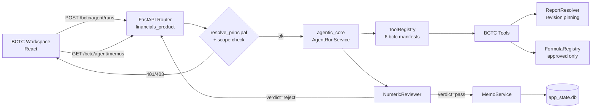

#### 1.2.2 Common contract

- **Base path:** `/api/v1/public/bctc/agent` (mount trong `financials_product`, giữ cùng module ownership với tools)
- **Auth:** Bearer JWT → `resolve_principal`. Anonymous → `401`.
- **Scope model (RBAC):** scope đã khai báo sẵn tại `financials_product/module.py`

  | Scope | Cho phép |
  |---|---|
  | `bctc:report:read` | `resolve_line_item`, `list_periods`, `get_statement_slice` |
  | `bctc:formula:read` | `get_formula`, `calculate_ratio` |
  | `bctc:evidence:read` | `build_evidence_table`, memo read/write |
  | `public:financials:write` | upload / analyze |

- **Feature flag:** `module.financials_product.bctc_agent.enabled` — tắt ⇒ `404` (không phải `503`, tránh lộ sự tồn tại của feature).
- **Idempotency:** `POST /runs` và `POST /memos` nhận header `Idempotency-Key`; key trùng trong 24h trả lại kết quả cũ.

**Error envelope (dùng chung mọi endpoint):**

```json
{
  "error": {
    "code": "GROUNDING_FAILED",
    "message": "Response contains numeric claims not supported by tool evidence.",
    "request_id": "req_01J8XYZ",
    "details": {
      "unsupported_claims": [
        {"raw_text": "biên lợi nhuận 31%", "value": 31.0, "unit": "pct"}
      ]
    }
  }
}
```

| Code | HTTP | Nguyên nhân | Client xử lý |
|---|---|---|---|
| `UNAUTHENTICATED` | 401 | Không có/ hết hạn token | Redirect login |
| `SCOPE_DENIED` | 403 | Thiếu scope | Ẩn chức năng |
| `REPORT_NOT_FOUND` | 404 | Ticker không có dataset | Gợi ý ticker khác |
| `UPLOAD_NOT_FOUND` | 404 | Không tồn tại **hoặc** không sở hữu (cố ý gộp) | Thông báo chung |
| `FORMULA_NOT_APPROVED` | 409 | `get_formula()` reject | Hiện "công thức chưa duyệt" |
| `INSUFFICIENT_DATA` | 200 + `calculation_status` | Mẫu số null/0 | Render "n/a" + lý do |
| `GROUNDING_FAILED` | 422 | Reviewer verdict `reject` | Hiện fallback, **không** render số |
| `RATE_LIMITED` | 429 | Vượt quota | Backoff theo `Retry-After` |
| `UPSTREAM_UNAVAILABLE` | 503 | Data source down / breaker open | Retry hoặc dùng memo cached |

> Ghi chú thiết kế: `INSUFFICIENT_DATA` trả **200** chứ không 4xx, vì đây là kết quả hợp lệ của phép tính — `NumericValue.calculation_status` đã model hoá sẵn (`schemas/agent_tools.py`). Trả 4xx sẽ buộc frontend phân biệt "lỗi hệ thống" với "dữ liệu thiếu", vốn là 2 UX khác hẳn nhau.

#### 1.2.3 OpenAPI 3.0 — endpoints cần xây

```yaml
openapi: 3.0.3
info:
  title: BCTC Agent API
  version: 1.0.0
  description: >
    Agent surface cho Module 5. Mọi số trong response PHẢI kèm provenance.
    Endpoint chỉ là HTTP wrapper; business logic nằm ở agent_tools/ và application/.
servers:
  - url: /api/v1/public/bctc/agent

security:
  - bearerAuth: []

paths:
  /tools:
    get:
      summary: Liệt kê tool manifest khả dụng cho principal hiện tại
      operationId: listBctcTools
      security: [{ bearerAuth: [bctc:report:read] }]
      responses:
        '200':
          description: Danh sách manifest đã lọc theo scope
          content:
            application/json:
              schema:
                type: object
                required: [tools]
                properties:
                  tools:
                    type: array
                    items: { $ref: '#/components/schemas/ToolManifest' }

  /tools/{tool_id}:invoke:
    post:
      summary: Gọi trực tiếp 1 BCTC tool (deterministic, không qua LLM)
      operationId: invokeBctcTool
      parameters:
        - name: tool_id
          in: path
          required: true
          schema:
            type: string
            enum:
              - bctc.resolve_line_item
              - bctc.list_periods
              - bctc.get_statement_slice
              - bctc.get_formula
              - bctc.calculate_ratio
              - bctc.build_evidence_table
        - name: Idempotency-Key
          in: header
          required: false
          schema: { type: string, maxLength: 128 }
      requestBody:
        required: true
        content:
          application/json:
            schema:
              type: object
              required: [input]
              properties:
                input:
                  type: object
                  description: >
                    Payload khớp Input model của tool tương ứng trong
                    schemas/agent_tools.py. Validate bằng chính Pydantic model,
                    không tự viết validator song song.
      responses:
        '200':
          description: Kết quả tool, mọi numeric kèm provenance
          content:
            application/json:
              schema:
                type: object
                required: [tool_id, output, latency_ms]
                properties:
                  tool_id: { type: string }
                  output:
                    oneOf:
                      - $ref: '#/components/schemas/ResolveLineItemOutput'
                      - $ref: '#/components/schemas/CalculateRatioOutput'
                      - $ref: '#/components/schemas/BuildEvidenceTableOutput'
                  latency_ms: { type: integer }
        '403': { $ref: '#/components/responses/ScopeDenied' }
        '409': { $ref: '#/components/responses/FormulaNotApproved' }
        '429': { $ref: '#/components/responses/RateLimited' }

  /runs:
    post:
      summary: Chạy 1 BCTC skill qua orchestrator (có LLM + grounding gate)
      operationId: createBctcRun
      requestBody:
        required: true
        content:
          application/json:
            schema:
              type: object
              required: [skill_id, ticker]
              properties:
                skill_id:
                  type: string
                  enum:
                    - bctc.explain_line_item.v1
                    - bctc.compare_periods.v1
                    - bctc.ratio_walkthrough.v1
                    - bctc.earnings_quality_review.v1
                    - bctc.research_checklist.v1
                ticker: { type: string, pattern: '^[A-Z0-9]{3,10}$' }
                periods:
                  type: array
                  maxItems: 8
                  items: { type: string, pattern: '^[0-9]{4}(Q[1-4])?$' }
                line_item: { type: string, maxLength: 128 }
                upload_id:
                  type: string
                  description: Nếu có, dùng private upload — bắt buộc ownership check
      responses:
        '202':
          description: Run đã nhận, poll qua GET /runs/{run_id}
          content:
            application/json:
              schema: { $ref: '#/components/schemas/AgentRun' }
        '422': { $ref: '#/components/responses/GroundingFailed' }
        '503': { $ref: '#/components/responses/UpstreamUnavailable' }

  /runs/{run_id}:
    get:
      summary: Trạng thái + kết quả run
      operationId: getBctcRun
      parameters:
        - name: run_id
          in: path
          required: true
          schema: { type: string }
      responses:
        '200':
          content:
            application/json:
              schema: { $ref: '#/components/schemas/AgentRun' }
        '404': { description: Không tồn tại hoặc không thuộc account hiện tại }

  /memos:
    post:
      summary: Tạo evidence memo từ 1 run đã pass grounding gate
      operationId: createBctcMemo
      requestBody:
        required: true
        content:
          application/json:
            schema:
              type: object
              required: [run_id, subject]
              properties:
                run_id: { type: string }
                subject: { type: string, maxLength: 256 }
                ttl_days: { type: integer, minimum: 1, maximum: 365, default: 30 }
      responses:
        '201':
          content:
            application/json:
              schema: { $ref: '#/components/schemas/BCTCEvidenceMemo' }
    get:
      summary: Liệt kê memo của account hiện tại
      operationId: listBctcMemos
      responses:
        '200':
          content:
            application/json:
              schema:
                type: object
                properties:
                  memos:
                    type: array
                    items: { $ref: '#/components/schemas/BCTCEvidenceMemo' }

  /memos/{memo_id}:
    get:
      operationId: getBctcMemo
      parameters:
        - { name: memo_id, in: path, required: true, schema: { type: string } }
      responses:
        '200':
          content:
            application/json:
              schema: { $ref: '#/components/schemas/BCTCEvidenceMemo' }
        '404': { description: Không tồn tại hoặc khác account }
    delete:
      operationId: deleteBctcMemo
      parameters:
        - { name: memo_id, in: path, required: true, schema: { type: string } }
      responses:
        '204': { description: Đã xoá }

components:
  securitySchemes:
    bearerAuth:
      type: http
      scheme: bearer
      bearerFormat: JWT

  schemas:
    ProvenanceRef:
      type: object
      required: [report_id, revision_id, period, source, fetched_at]
      properties:
        report_id:   { type: string, example: "report:fpt" }
        revision_id: { type: string, example: "rev_9f2c1a4b" }
        period:      { type: string, example: "2024Q4" }
        source:      { type: string, example: "vndirect" }
        fetched_at:  { type: string, format: date-time }
        statement:
          type: string
          enum: [income_statement, balance_sheet, cash_flow]
          nullable: true
        line_item: { type: string, nullable: true }

    NumericValue:
      type: object
      required: [unit, provenance]
      properties:
        value: { type: number, nullable: true }
        unit:  { type: string, enum: [VND, VND_bn, pct, x, ratio] }
        scale: { type: integer, minimum: 1, default: 1 }
        calculation_status:
          type: string
          enum: [ok, insufficient_data, undefined, out_of_range]
          default: ok
        provenance: { $ref: '#/components/schemas/ProvenanceRef' }

    CalculateRatioOutput:
      type: object
      required: [formula_id, formula_version, result, transform_steps]
      properties:
        formula_id:      { type: string, example: "gross_margin" }
        formula_version: { type: string, example: "1.0.0" }
        result:          { $ref: '#/components/schemas/NumericValue' }
        transform_steps:
          type: array
          items:
            type: object
            required: [description, expression]
            properties:
              description: { type: string }
              expression:  { type: string }
        limitations:
          type: array
          items: { type: string }

    AgentRun:
      type: object
      required: [run_id, status, skill_id, created_at]
      properties:
        run_id:   { type: string }
        status:   { type: string, enum: [queued, running, awaiting_review, completed, rejected, failed] }
        skill_id: { type: string }
        created_at: { type: string, format: date-time }
        answer:   { type: string, nullable: true }
        citations:
          type: array
          items: { $ref: '#/components/schemas/ProvenanceRef' }
        review_verdict:
          type: string
          enum: [pass, repair, reject]
          nullable: true

  responses:
    ScopeDenied:
      description: Thiếu scope
      content: { application/json: { schema: { $ref: '#/components/schemas/Error' } } }
    FormulaNotApproved:
      description: Công thức chưa được duyệt
      content: { application/json: { schema: { $ref: '#/components/schemas/Error' } } }
    GroundingFailed:
      description: Có numeric claim không map được về tool evidence
      content: { application/json: { schema: { $ref: '#/components/schemas/Error' } } }
    RateLimited:
      description: Vượt quota
      headers:
        Retry-After: { schema: { type: integer } }
      content: { application/json: { schema: { $ref: '#/components/schemas/Error' } } }
    UpstreamUnavailable:
      description: Data source down hoặc circuit breaker mở
      content: { application/json: { schema: { $ref: '#/components/schemas/Error' } } }
```

> **Không lặp schema:** `ToolManifest`, `BCTCEvidenceMemo`, `ResolveLineItemOutput`, `BuildEvidenceTableOutput`, `Error` sinh tự động từ Pydantic model đã tồn tại (`schemas/agent_tools.py`, `schemas/evidence.py`). Viết tay lần 2 sẽ drift — đây là lý do spec chỉ khai báo `$ref`.

#### 1.2.4 Rate limiting

Bucket theo `(account_id, endpoint_class)`, token bucket, lưu in-process (single instance hiện tại).

| Endpoint class | Limit | Burst | Lý do |
|---|---|---|---|
| `tools:invoke` (read-only, deterministic) | 60 req/min | 20 | Rẻ, có cache dataset; siết chặt không lợi ích |
| `runs:create` (có LLM) | 10 req/min, 200/ngày | 3 | Chi phí LLM; exit criteria plan cho memo ≤ $0.03 |
| `memos:*` | 30 req/min | 10 | Chỉ I/O SQLite |
| `financials/upload` | 5 req/min, 50/ngày | 2 | Chống abuse storage |

**Trade-off — in-process vs Redis:**

| Lựa chọn | Ưu | Nhược | Quyết định |
|---|---|---|---|
| In-process token bucket | Không thêm dependency, đúng với deployment 1 instance hiện tại | Sai khi scale ngang (mỗi instance đếm riêng) | ✅ Chọn cho v1 — deployment hiện là single instance |
| Redis (`redis-py` + Lua) | Chính xác khi multi-instance | Thêm infra, thêm failure mode (Redis down = fail-open hay fail-closed?) | ⏸ Khi nào scale ngang thì chuyển |

> `# ponytail: in-process bucket, chuyển Redis khi deploy >1 instance`

#### 1.2.5 Circuit breaker

Áp cho 2 dependency ngoài: **report data source** (`ReportResolver` → dataset loader) và **LLM provider**.

```yaml
# Cấu hình (thuộc config, không hardcode trong tool)
bctc_agent:
  circuit_breaker:
    report_source:
      failure_threshold: 5          # 5 lỗi liên tiếp
      failure_rate_threshold: 0.5   # hoặc >50% trong window
      window_seconds: 60
      open_duration_seconds: 30
      half_open_max_calls: 2
      fallback: cached_dataset      # data/financials/cache/{TICKER}.json
    llm_provider:
      failure_threshold: 3
      timeout_ms: 20000
      open_duration_seconds: 60
      half_open_max_calls: 1
      fallback: deterministic_only   # trả bảng số, KHÔNG narrative
```

**Fallback quan trọng:** khi LLM breaker mở, **vẫn trả được kết quả** — vì `calculate_ratio` / `build_evidence_table` là deterministic, không cần LLM. Client nhận `answer: null` + `citations` + bảng số. Đây là lý do S4 (tool endpoint) tách khỏi S5 (run endpoint).

**Không fallback nào được phép bịa số.** Breaker mở cho report source ⇒ dùng cached dataset, nhưng `ProvenanceRef.fetched_at` giữ nguyên timestamp của cache (không ghi `now()`), và response gắn `data_freshness: "stale"`.

### 1.3 Logging Strategy

#### 1.3.1 Format

JSON structured, một dòng một event, stdout. Không log giá trị tài chính thô ở level INFO (tránh leak qua log aggregator).

```json
{
  "ts": "2026-09-12T08:14:22.913Z",
  "level": "INFO",
  "event": "bctc.tool.completed",
  "request_id": "req_01J8XYZ",
  "run_id": "run_7c4e19",
  "account_id_hash": "sha256:4f1a...",
  "tool_id": "bctc.calculate_ratio",
  "formula_id": "gross_margin",
  "report_id": "report:fpt",
  "revision_id": "rev_9f2c1a4b",
  "duration_ms": 34,
  "calculation_status": "ok"
}
```

- `account_id_hash` — hash chứ không log raw account id (PII hygiene).
- `value` **không** xuất hiện ở INFO; chỉ có ở DEBUG khi bật thủ công cho 1 request.

#### 1.3.2 Event catalogue

| Event | Level | Khi nào | Field bắt buộc thêm | Sampling |
|---|---|---|---|---|
| `bctc.tool.started` | DEBUG | Trước mỗi tool call | `tool_id`, `run_id` | 1% |
| `bctc.tool.completed` | INFO | Tool xong | `duration_ms`, `calculation_status` | 10% khi `status=ok`, **100%** khi `!= ok` |
| `bctc.tool.failed` | ERROR | Tool raise | `error_type`, `error_message` | 100% |
| `bctc.formula.rejected` | WARN | `get_formula()` reject (unapproved / version mismatch) | `formula_id`, `requested_version`, `reason` | 100% |
| `bctc.review.verdict` | INFO | Reviewer xong | `verdict`, `accepted_count`, `unsupported_count` | 100% khi `verdict != pass`, 10% khi pass |
| `bctc.review.unsupported_claim` | **ERROR** | Có claim không map được | `claim_unit`, `claim_value`, `run_id` | 100% |
| `bctc.memo.created` | INFO | Memo lưu | `memo_id`, `expires_at`, `report_refs_count` | 100% |
| `bctc.memo.stale_detected` | WARN | `check_staleness` → true | `memo_id`, `old_revision`, `new_revision` | 100% |
| `bctc.upload.ownership_denied` | **ERROR** | Account gọi upload không sở hữu | `upload_id`, `account_id_hash` | 100% |
| `bctc.upload.path_rejected` | **ERROR** | `validate_upload_path()` chặn | `raw_upload_id` (đã truncate 64 ký tự) | 100% |
| `bctc.breaker.opened` | ERROR | Breaker chuyển open | `dependency`, `failure_count` | 100% |
| `bctc.run.completed` | INFO | Run kết thúc | `status`, `total_duration_ms`, `tool_call_count` | 100% |

**Nguyên tắc sampling:** *đường thành công thì sample, đường lỗi thì không bao giờ sample.* Lý do: `bctc.tool.completed` là high-volume (mỗi run gọi tới 3 tool × N user), trong khi `unsupported_claim` là KPI critical của master plan §1977 ("unsupported numeric claim = 0 critical") — mất 1 dòng là mất 1 sự cố.

**Trade-off — sampling vs full logging:**

| Lựa chọn | Ưu | Nhược | Quyết định |
|---|---|---|---|
| Sample 10% happy path (đã chọn) | Giảm ~85% volume log; giữ 100% tín hiệu lỗi | Không dựng được audit trail đầy đủ cho mọi phép tính | ✅ — memo đã là audit trail bền cho phép tính quan trọng |
| Log 100% mọi thứ | Audit trail hoàn hảo | Volume lớn; có nguy cơ leak số tài chính qua log sink | ❌ |
| Không log tool call | Rẻ nhất | Không debug được run fail | ❌ |

### 1.4 System Design

#### 1.4.1 Component diagram (boundary context)

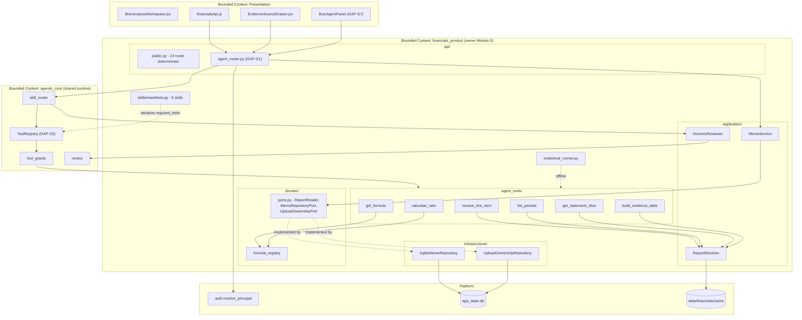

**Quy tắc boundary (bất biến):**
1. `agent_tools/` chỉ phụ thuộc `domain/` + `application/`, **không bao giờ** import `api/`.
2. `agentic_core` **không** import `financials_product` — chỉ biết tool qua `ToolRegistry`. Đây là lý do G4 (stub `BctcResolveLineItemTool` sống trong `agentic_core/infrastructure/domain_tools.py`) là vi phạm: nó duplicate domain logic sang shared runtime.
3. Mọi truy cập DB đi qua `domain/ports.py`. Không có SQL trong `api/` hay `agent_tools/`.

#### 1.4.2 Sequence — thin tool invoke (deterministic, no LLM)

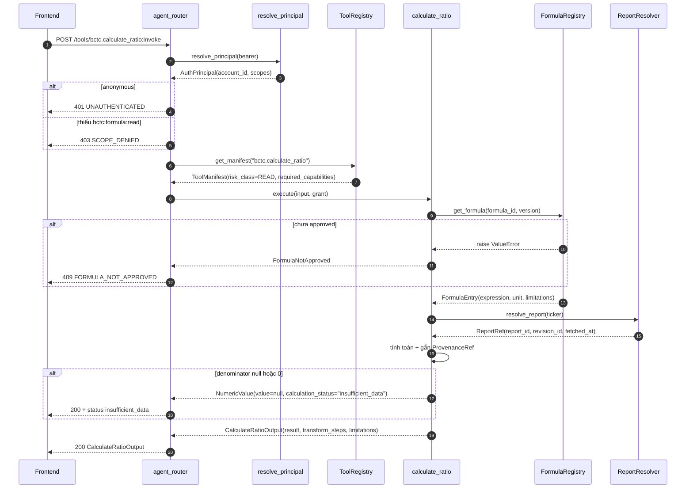

#### 1.4.3 Sequence — agent run có grounding gate + HITL

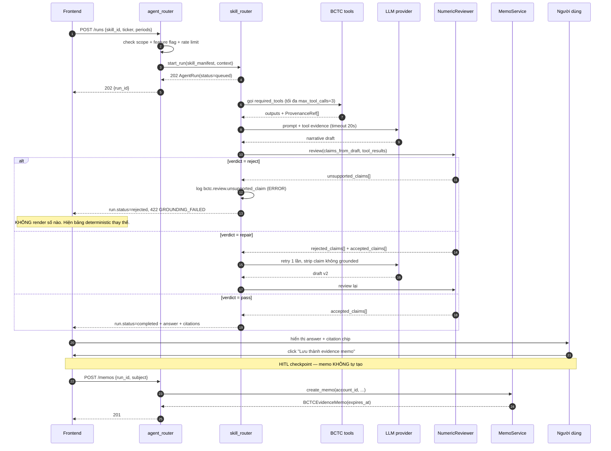

> Điểm HITL bắt buộc ở bước 21–23: memo là artifact bền, account-bound, nên **phải** do người dùng xác nhận — khớp `USER_INTERACTION_GUIDE` §3.3 và master plan §1460 ("student note luôn confirm").

#### 1.4.4 Failure Mode Analysis (FMEA)

Thang: S = severity, L = likelihood, D = detectability (1 = dễ phát hiện). RPN = S×L×D, thang 1–5 mỗi chiều.

| ID | Failure mode | Nguyên nhân | Tác động | S | L | D | RPN | Phát hiện bằng | Recovery |
|---|---|---|---|---|---|---|---|---|---|
| **F1** | Agent trả số không có evidence | Prompt injection; LLM bịa; reviewer tolerance quá rộng | **Sai lệch tài chính cho user** — vi phạm KPI critical | 5 | 3 | 2 | 30 | `bctc.review.unsupported_claim` ERROR; metric `bctc_unsupported_claims_total` | Reviewer chặn ở `verdict=reject` → 422, không render. Nếu lọt: tắt flag `bctc_agent.enabled` ngay (kill switch) |
| **F2** | Cross-account đọc private upload | G2 — thiếu ownership check ở `api/public.py:387` | **Rò rỉ dữ liệu tài chính riêng tư** | 5 | 4 | 4 | **80** | `bctc.upload.ownership_denied`; test `test_idor_matrix.py` | S3 vá; trước khi vá: **không bật flag cho cohort ngoài internal** |
| **F3** | Tool stub trả số hardcode `52618` | G4 — `domain_tools.py:73` fallback khi `service is None` | Số giả trông như số thật, **có provenance giả** | 5 | 3 | 3 | 45 | grep `52618`; unit test assert `provenance.revision_id` không rỗng | S2 xoá stub; thêm test guard |
| **F4** | Memo stale bị dùng như số hiện tại | Revision đổi sau khi memo tạo | User ra quyết định trên số cũ | 4 | 4 | 2 | 32 | `bctc.memo.stale_detected`; `is_stale` flag | `EvidenceSourceDrawer` đã có stale banner; API trả `is_stale=true` |
| **F5** | Formula chưa duyệt bị dùng | Dev thêm `FormulaEntry` với `approved=False` rồi gọi | Phép tính sai chuẩn kế toán | 4 | 2 | 1 | 8 | `get_formula():117` raise; `bctc.formula.rejected` WARN | Đã chặn ở registry — fail-closed sẵn |
| **F6** | Data source down | Upstream provider lỗi | Không tính được tỉ số | 3 | 3 | 1 | 9 | `bctc.breaker.opened`; `/health/bctc-agent` degraded | Breaker → cached dataset + `data_freshness: stale` |
| **F7** | LLM timeout / rate limited | Provider quá tải | Run treo ở `running` | 3 | 4 | 1 | 12 | `bctc.run.completed` không phát; metric `bctc_run_duration_seconds` p95 | Breaker `llm_provider` → fallback `deterministic_only`: trả bảng số, `answer=null` |
| **F8** | Chia cho 0 / mẫu số null | Kỳ thiếu dữ liệu | Crash hoặc `inf` | 3 | 4 | 1 | 12 | `calculation_status != ok` | Đã xử lý: `_calculated_ratio()` (`api/public.py:929`) trả `insufficient_data` |
| **F9** | Path traversal qua `upload_id` | `../../etc/passwd` trong path param | Đọc file tuỳ ý trên server | 5 | 2 | 3 | 30 | `bctc.upload.path_rejected` | `validate_upload_path()` đã viết — cần wire (S3) |
| **F10** | Memo table phình vô hạn | Không có job dọn expired | Disk đầy, query chậm | 2 | 4 | 3 | 24 | Metric `bctc_memos_total`; disk alert | Cron dọn `expires_at < now()` (xem §3.4) |

**Ưu tiên theo RPN:** F2 (80) → F3 (45) → F4 (32) → F1/F9 (30). Đúng với thứ tự S3 (IDOR) là release gate, S2 (xoá stub) nằm sớm trong critical path.

### 1.5 Operational Runbook

#### 1.5.1 Health check

`GET /api/v1/public/bctc/agent/health` — không cần auth, không lộ chi tiết nội bộ.

```json
{
  "status": "healthy",
  "checks": {
    "report_source":  {"status": "healthy",  "latency_ms": 12},
    "formula_registry": {"status": "healthy", "approved_formulas": 14},
    "memo_db":        {"status": "healthy",  "latency_ms": 3},
    "tool_registry":  {"status": "healthy",  "bctc_tools_registered": 6},
    "llm_provider":   {"status": "degraded", "breaker": "half_open"}
  },
  "feature_flags": {
    "module.financials_product.bctc_agent.enabled": true
  }
}
```

| `status` | Điều kiện | HTTP | Ý nghĩa với LB |
|---|---|---|---|
| `healthy` | Mọi check healthy | 200 | Nhận traffic |
| `degraded` | LLM hoặc report_source degraded, nhưng memo_db + tool_registry ok | 200 | **Vẫn nhận traffic** — deterministic path còn chạy |
| `unhealthy` | `memo_db` down hoặc `bctc_tools_registered < 6` | 503 | Rút khỏi LB |

> `bctc_tools_registered < 6` là **unhealthy**, không phải degraded: nếu registry thiếu tool thì skill sẽ chạy với evidence không đầy đủ — nguy hiểm hơn là không chạy.

#### 1.5.2 Metrics (Prometheus naming convention)

```
# Counters — hậu tố _total, đơn vị số nguyên
bctc_tool_calls_total{tool_id, status}                      # status: ok|insufficient_data|error
bctc_run_total{skill_id, status}                            # status: completed|rejected|failed
bctc_review_verdict_total{verdict}                          # verdict: pass|repair|reject
bctc_unsupported_claims_total                               # KPI CRITICAL — mục tiêu 0
bctc_formula_rejected_total{formula_id, reason}
bctc_memo_created_total
bctc_memo_stale_detected_total
bctc_upload_ownership_denied_total                          # security signal
bctc_upload_path_rejected_total                             # security signal
bctc_circuit_breaker_state_changes_total{dependency, to_state}

# Histograms — hậu tố _seconds, base unit giây (KHÔNG dùng _ms)
bctc_tool_duration_seconds{tool_id}                         # buckets: .01 .025 .05 .1 .25 .5 1 2.5
bctc_run_duration_seconds{skill_id}                         # buckets: .5 1 2 3 5 8 13 21
bctc_llm_duration_seconds

# Gauges
bctc_memos_active                                           # chưa expired
bctc_circuit_breaker_open{dependency}                       # 1 = open
bctc_tools_registered                                       # kỳ vọng = 6
```

**Alert rules:**

```yaml
groups:
  - name: bctc_agent
    rules:
      - alert: BctcUnsupportedClaimDetected
        expr: increase(bctc_unsupported_claims_total[5m]) > 0
        for: 0m
        labels: { severity: critical }
        annotations:
          summary: "Agent tạo numeric claim không có evidence"
          runbook: "§1.5.3 Playbook P1"

      - alert: BctcIdorAttempt
        expr: increase(bctc_upload_ownership_denied_total[5m]) > 3
        labels: { severity: critical }
        annotations: { runbook: "§1.5.3 Playbook P2" }

      - alert: BctcRatioLatencyHigh
        expr: histogram_quantile(0.95, rate(bctc_tool_duration_seconds_bucket{tool_id="bctc.calculate_ratio"}[5m])) > 0.5
        for: 10m
        labels: { severity: warning }
        annotations: { summary: "Vi phạm exit criteria: ratio p95 < 500ms" }

      - alert: BctcMemoLatencyHigh
        expr: histogram_quantile(0.95, rate(bctc_run_duration_seconds_bucket[5m])) > 8
        for: 10m
        labels: { severity: warning }
        annotations: { summary: "Vi phạm exit criteria: memo p95 < 8s" }

      - alert: BctcToolsMissing
        expr: bctc_tools_registered < 6
        for: 1m
        labels: { severity: critical }
        annotations: { runbook: "§1.5.3 Playbook P4" }
```

Threshold latency lấy trực tiếp từ exit criteria §5.2 / Master Plan §14A.3 (ratio p50 <200ms / p95 <500ms; memo p50 <3s / p95 <8s).

#### 1.5.3 Incident playbooks

**P1 — Unsupported numeric claim xuất hiện (severity: critical)**

1. **Chặn ngay:** tắt flag `module.financials_product.bctc_agent.enabled`. Deterministic routes `/api/bctc/income-statement/*` không bị ảnh hưởng — user vẫn dùng được sản phẩm.
2. Lấy `run_id` từ log `bctc.review.unsupported_claim`.
3. `GET /runs/{run_id}` → so `answer` với `citations`.
4. Phân loại:
   - **Reviewer bỏ sót** (claim có trong text, không có trong `accepted_claims`) → bug ở `numeric_reviewer.py:71` `_find_matching_evidence`, thường là tolerance hoặc unit mismatch.
   - **LLM bịa** → bug ở prompt template (`skills/prompts/*.py`).
   - **Tool trả sai provenance** → kiểm `report_resolver.py` revision derivation.
5. Thêm case vào `evals/gold_set.py`, chạy `BCTCEvalRunner` xác nhận fail → fix → pass.
6. Bật lại flag cho cohort internal, soak 24h trước khi mở rộng.

**P2 — Nghi ngờ IDOR (severity: critical)**

1. Từ log `bctc.upload.ownership_denied`, lấy `account_id_hash` + `upload_id`.
2. Kiểm số lần: >3 lần/5 phút từ 1 account ⇒ dò tìm chủ động, không phải lỗi vô tình.
3. Đối chiếu `bctc_upload_ownership` xem `upload_id` thuộc account nào.
4. **Nếu G2 chưa vá (S3 chưa deploy):** đây là lỗ hổng đang mở, không chỉ là attempt bị chặn — escalate security ngay, tạm rút route `analyze_uploaded_file` khỏi router.
5. Nếu đã vá: rate-limit/suspend account nghi vấn; giữ log 90 ngày làm bằng chứng.

**P3 — Latency vượt exit criteria (severity: warning)**

1. Xem `bctc_tool_duration_seconds` theo `tool_id` — xác định tool nào chậm.
2. `bctc.calculate_ratio` chậm thường do `ReportResolver` phải load dataset từ disk. Kiểm cache hit ở `data/financials/cache/`.
3. `bctc_llm_duration_seconds` chậm → vấn đề provider, không phải code. Xem breaker có nên hạ `timeout_ms`.
4. Nếu chậm do dataset lớn: cân nhắc lazy-load slice thay vì load toàn bộ `FinancialDataset`.

**P4 — `bctc_tools_registered < 6` (severity: critical)**

1. Đây là regression của S1. Kiểm bootstrap có gọi `get_bctc_tool_manifests()` không.
2. Nguy hiểm hơn "lỗi thường": skill có `required_tools` thiếu sẽ chạy với evidence không đầy đủ ⇒ tăng rủi ro F1.
3. Rollback deploy. Không hot-fix trên production.

**P5 — Memo table phình (severity: warning)**

1. `SELECT COUNT(*) FROM bctc_evidence_memos WHERE expires_at < datetime('now')`.
2. Chạy cleanup job (§3.4). Kiểm job scheduler có sống không.
3. Nếu memo chưa expired mà vẫn nhiều: xem lại TTL mặc định 30 ngày (`memo_service.py:44`) — liên quan U4.

---

## 2. AGENTIC AI INTEGRATION

### 2.1 Inter-module Contracts

Module 5 **không** gọi trực tiếp module 3/4. Mọi liên kết đi qua `agentic_core` (`ToolRegistry` + `skill_router`) hoặc qua event. Đây là ràng buộc kiến trúc, không phải lựa chọn phong cách: cho phép import chéo sẽ tạo vòng phụ thuộc giữa các bounded context.

#### 2.1.1 Với Module 3 (AI Tutor) — tool-level contract

AI Tutor cần giải thích một dòng BCTC trong bối cảnh bài học. Contract: Tutor **mượn tool** của module 5 qua registry, không import code.

```json
{
  "$schema": "https://json-schema.org/draft/2020-12/schema",
  "$id": "bctc/contracts/tutor_tool_borrow.v1.json",
  "title": "AI Tutor mượn BCTC tool",
  "type": "object",
  "required": ["tool_id", "grant", "input"],
  "properties": {
    "tool_id": {
      "type": "string",
      "enum": ["bctc.resolve_line_item", "bctc.get_formula", "bctc.calculate_ratio"],
      "description": "Tutor chỉ được mượn 3 tool READ. KHÔNG được mượn build_evidence_table (tạo artifact)."
    },
    "grant": {
      "type": "object",
      "required": ["account_id", "scopes", "risk_class"],
      "properties": {
        "account_id": { "type": "string" },
        "scopes": {
          "type": "array",
          "items": { "enum": ["bctc:report:read", "bctc:formula:read"] }
        },
        "risk_class": { "const": "read" }
      }
    },
    "input": { "type": "object" }
  }
}
```

**Ràng buộc bắt buộc:** scope của Tutor là **tập con thật sự** của scope module 5. Tutor không bao giờ nhận `bctc:evidence:read` — nếu học viên muốn tạo memo, phải chuyển sang BCTC Workspace (HITL checkpoint, §2.4).

#### 2.1.2 Với Module 4 (Learn Agent) — event-level contract

Learn Agent quan tâm "học viên đã đọc evidence memo nào" để điều chỉnh lộ trình. Đây là **one-way event**, không phải RPC.

```json
{
  "$schema": "https://json-schema.org/draft/2020-12/schema",
  "$id": "bctc/events/evidence_memo_created.v1.json",
  "title": "bctc.evidence_memo.created",
  "type": "object",
  "required": ["event_id", "event_type", "schema_version", "occurred_at", "account_id", "payload"],
  "properties": {
    "event_id":       { "type": "string", "description": "UUID, dùng để dedupe" },
    "event_type":     { "const": "bctc.evidence_memo.created" },
    "schema_version": { "const": "1.0.0" },
    "occurred_at":    { "type": "string", "format": "date-time" },
    "account_id":     { "type": "string" },
    "correlation_id": { "type": "string", "description": "= run_id, để trace ngược" },
    "payload": {
      "type": "object",
      "required": ["memo_id", "subject", "report_ids", "skill_id"],
      "properties": {
        "memo_id":    { "type": "string" },
        "subject":    { "type": "string" },
        "report_ids": { "type": "array", "items": { "type": "string" } },
        "skill_id":   { "type": "string" },
        "line_items": { "type": "array", "items": { "type": "string" } },
        "formula_ids":{ "type": "array", "items": { "type": "string" } }
      },
      "additionalProperties": false
    }
  },
  "additionalProperties": false
}
```

**Quan trọng — event KHÔNG chứa giá trị tài chính.** Chỉ chứa metadata (memo_id, line_item name, formula_id). Lý do: event bus là kênh chia sẻ giữa các module; đưa số thật vào đó sẽ tạo một đường rò rỉ nằm ngoài mọi ownership check của module 5. Consumer muốn số ⇒ gọi `GET /memos/{memo_id}` với token của chính user, đi qua đúng authorization.

Các event khác cùng envelope:

| Event type | Khi nào | Consumer quan tâm |
|---|---|---|
| `bctc.evidence_memo.created` | Memo được người dùng confirm | Module 4 (progress) |
| `bctc.evidence_memo.stale` | Revision đổi | Module 4 (nhắc ôn lại), Frontend |
| `bctc.agent_run.completed` | Run xong, verdict pass | Analytics |
| `bctc.agent_run.rejected` | Grounding gate chặn | Analytics, alerting |

#### 2.1.3 Backward compatibility

| Quy tắc | Chi tiết |
|---|---|
| **Additive-only trong cùng major** | Thêm field optional được; xoá/đổi kiểu/đổi nghĩa field ⇒ bump major |
| **Event version trong `schema_version`** | Consumer đọc `schema_version` trước khi parse `payload` |
| **Tool version trong manifest** | `ToolManifest.version`; consumer pin version. Đổi shape output ⇒ đăng ký `bctc.calculate_ratio.v2`, giữ v1 chạy song song ≥1 release |
| **Formula version tách riêng** | `FormulaEntry.version` độc lập với tool version — sửa công thức không buộc bump tool |
| **DB additive-only** | Chỉ `CREATE TABLE IF NOT EXISTS` / `ADD COLUMN`, không `DROP`/`ALTER TYPE` (xem §3.5) |
| **Deprecation window** | 2 release hoặc 60 ngày (lấy cái dài hơn); log `WARN` mỗi lần dùng version cũ |

**Trade-off — versioning tool bằng tool_id vs bằng field:**

| Lựa chọn | Ưu | Nhược | Quyết định |
|---|---|---|---|
| `bctc.calculate_ratio.v2` (tool_id mới) | Registry tách bạch; rollback = bỏ đăng ký v2; consumer cũ không đụng gì | Có 2 code path phải maintain trong deprecation window | ✅ — an toàn hơn cho path tài chính |
| `version` field trong input | Ít tool_id hơn | 1 hàm phải branch theo version ⇒ dễ regression cho consumer cũ | ❌ |

### 2.2 Agent Lifecycle State Machine

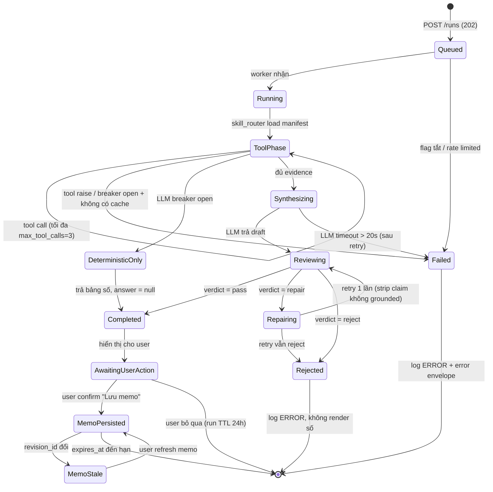

#### 2.2.1 Decision points và criteria

| # | Tại state | Điều kiện | Đi tới | Nguồn |
|---|---|---|---|---|
| D1 | `Queued` | `module.financials_product.bctc_agent.enabled == false` | `Failed` (404 cho client) | `module.py` feature_flags |
| D2 | `ToolPhase` | `tool_call_count >= manifest.max_tool_calls` (=3) | `Synthesizing` với evidence hiện có | `skills/manifests.py` |
| D3 | `ToolPhase` | Report source breaker open **và** có cached dataset | tiếp tục, gắn `data_freshness=stale` | §1.2.5 |
| D4 | `ToolPhase` | Report source breaker open **và không** có cache | `Failed` (503) | §1.2.5 |
| D5 | `ToolPhase` | LLM breaker open | `DeterministicOnly` | §1.2.5 |
| D6 | `Reviewing` | `unsupported_claims` rỗng **và** `rejected_claims` rỗng | `Completed` | `numeric_reviewer.py` `ReviewDecision` |
| D7 | `Reviewing` | `rejected_claims` không rỗng **nhưng** `unsupported_claims` rỗng | `Repairing` | idem |
| D8 | `Reviewing` | `unsupported_claims` **không rỗng** | `Rejected` — không thương lượng | idem |
| D9 | `Repairing` | đã retry 1 lần | `Rejected` | Giới hạn cứng: 1 retry |
| D10 | `Completed` | User nhấn "Lưu memo" | `MemoPersisted` | HITL, §2.4 |
| D11 | `MemoPersisted` | `memo.report_refs[*].revision_id != current_revision_id` | `MemoStale` | `memo_service.check_staleness` |

> **D8 tuyệt đối:** dù chỉ 1 claim không grounded, cả response bị chặn. Không có chế độ "trả phần grounded, bỏ phần không grounded" — vì narrative tài chính bị cắt xén giữa chừng còn nguy hiểm hơn không có narrative. Đây là fail-closed có chủ ý.

**Trade-off — số lần repair retry:**

| Lựa chọn | Ưu | Nhược | Quyết định |
|---|---|---|---|
| 0 retry (reject ngay) | Rẻ nhất, đơn giản nhất | Reject cả những trường hợp LLM chỉ sai đơn vị, UX tệ | ❌ |
| **1 retry** | Cứu được lỗi format/unit phổ biến; chi phí có trần rõ ràng | Tăng gấp đôi cost ở worst case | ✅ Chọn |
| N retry với backoff | Tỉ lệ pass cao nhất | Latency vượt p95 8s; cost không kiểm soát; dễ thành vòng lặp "thuyết phục" LLM | ❌ |

### 2.3 Human-in-the-loop Checkpoints

Theo `USER_INTERACTION_GUIDE` §3.3 và master plan §1460.

| CP | Checkpoint | Bắt buộc? | Component | Không confirm thì sao |
|---|---|---|---|---|
| **CP1** | Tạo evidence memo từ run | ✅ Bắt buộc | `<ActionProposalReview />` | Run hết hạn sau 24h, không lưu gì |
| **CP2** | Lưu student note từ agent output | ✅ Bắt buộc | `<ActionProposalReview />` | Không ghi vào learning progress |
| **CP3** | Dùng memo stale làm evidence | ✅ Bắt buộc | Stale banner trong `EvidenceSourceDrawer.jsx` | Số hiện với cảnh báo, nhưng không cho export/chia sẻ |
| **CP4** | Dùng private upload cho agent run | ✅ Bắt buộc | Consent dialog trước run đầu tiên | Chỉ dùng public dataset |
| **CP5** | Xem chi tiết tính toán | ❌ Optional | `<EvidenceDrawer />` — luôn mở được | — |

**Không phải checkpoint (chạy tự động):** gọi tool READ, tính tỉ số, dựng evidence table, đánh dấu memo stale. Đây đều là hành động không tạo trạng thái bền và không rời khỏi phạm vi account.

Nguyên tắc phân định: **HITL cho hành động tạo/sửa trạng thái bền hoặc mở rộng phạm vi dữ liệu; không HITL cho hành động read-only trong phạm vi đã cấp.** Đặt HITL vào mọi thứ sẽ gây confirm-fatigue, và người dùng sẽ bấm OK theo phản xạ — lúc đó checkpoint thật (CP1, CP4) mất tác dụng.

### 2.4 Verification Methodology

#### 2.4.1 Unit test cho agent logic

| Đối tượng | Thứ test | Ví dụ assertion |
|---|---|---|
| `NumericReviewer.review()` | Claim đúng trong tolerance → `accepted` | `verdict == "pass"` |
| | Claim sai đơn vị (`pct` vs `ratio`) → `rejected` | `len(rejected_claims) == 1` |
| | Claim không có trong tool result → `unsupported` | `verdict == "reject"` |
| | `is_hypothetical=True` → accept không cần evidence | `verdict == "pass"` |
| | Sai `revision_id` dù giá trị đúng → `unsupported` | phát hiện trộn revision |
| `FormulaRegistry.get_formula()` | `approved=False` → raise | `pytest.raises(ValueError)` |
| | version mismatch → raise | idem |
| `calculate_ratio` | mẫu số `0` → `insufficient_data`, không raise | `result.calculation_status == "insufficient_data"` |
| | mẫu số `None` → `insufficient_data` | idem |
| `derive_revision_id` | Cùng input → cùng output (deterministic) | `a == b` |
| | Đổi `fetched_at` → đổi revision | `a != b` |
| `MemoService.check_staleness` | Revision đổi → `is_stale=True` | idem |
| `validate_upload_path` | `../../etc/passwd` → reject | `pytest.raises` |
| | URL-encoded `%2e%2e%2f` → reject | idem |

Hiện trạng: 69 test BCTC đang pass. Test mới cho S1–S11 bổ sung vào cùng bộ.

#### 2.4.2 Integration test framework

`pytest` + `fastapi.testclient.TestClient`, DB tạm bằng SQLite file trong `tmp_path` (không dùng `:memory:` vì migration mở nhiều connection).

| Mức | Phạm vi | Test tiêu biểu |
|---|---|---|
| **L1 tool-over-HTTP** | Router → tool → domain, không LLM | `POST /tools/bctc.calculate_ratio:invoke` trả `CalculateRatioOutput` với `provenance` đầy đủ |
| **L2 run có LLM stub** | Toàn pipeline, LLM thay bằng fake trả draft cố định | Draft chứa claim bịa → `422 GROUNDING_FAILED`, body không chứa số bịa |
| **L3 security matrix** | Authorization | Account B gọi memo/upload của A → 404 (không 403). Anonymous → 401. Thiếu scope → 403 |
| **L4 migration** | DB | Chạy migration trên file trống → bảng + index tồn tại; chạy lần 2 → idempotent |
| **L5 breaker** | Resilience | Ép report source fail 5 lần → breaker open → dùng cache, `data_freshness=stale` |

**Trade-off — LLM thật hay stub trong integration test:**

| Lựa chọn | Ưu | Nhược | Quyết định |
|---|---|---|---|
| **Stub deterministic** | Nhanh, chạy được trong CI, test được đúng grounding gate | Không bắt được lỗi prompt thật | ✅ cho CI |
| LLM thật | Thực tế | Chậm, tốn tiền, flaky, cần secret trong CI | ❌ cho CI — thay bằng eval offline (§2.4.3) chạy theo lịch |

#### 2.4.3 Eval harness (đã tồn tại)

`evals/eval_runner.py` — `BCTCEvalRunner.run()` chạy gold set và đo:

| Metric | Ý nghĩa | Target (từ plan §13) |
|---|---|---|
| `grounded_rate` | % claim map được về evidence | **100%** (KPI critical) |
| `p50_latency_ms` / `p95_latency_ms` | Độ trễ | ratio: 200/500ms; memo: 3s/8s |
| `citation_count` | Số citation trung bình | ≥1 mỗi numeric claim |
| `unsupported_count` | Claim không grounded | **0** |
| `buy_sell_leaks` | Lời khuyên mua/bán lọt ra | **0** — zero-leakage |

Chạy: nightly trên gold set + bắt buộc trước mỗi lần mở rộng rollout cohort.

> **U2 chưa chốt:** threshold pass/fail cuối cùng cho `grounded_rate` chưa có trong code lẫn doc. Đề xuất thu thập: chạy `BCTCEvalRunner` trên gold set hiện tại lấy baseline, trình PO chốt ngưỡng (khuyến nghị 100% cho `unsupported_count == 0`, vì đây là ràng buộc nhị phân chứ không phải chỉ tiêu thống kê).

#### 2.4.4 A/B testing cho policy

Đối tượng A/B: **prompt template** và **reviewer tolerance**, không A/B công thức tài chính (công thức phải đúng, không phải "thắng").

| Thí nghiệm | Variant A | Variant B | Primary metric | Guardrail (dừng ngay nếu vi phạm) |
|---|---|---|---|---|
| E1 — prompt verbosity | Prompt hiện tại | Prompt bắt buộc trích dẫn inline sau mỗi số | `grounded_rate` | `unsupported_count > 0` ⇒ dừng |
| E2 — reviewer tolerance | `1e-4` | `1e-3` | tỉ lệ `verdict=pass` | `unsupported_count > 0` ⇒ dừng |
| E3 — max_tool_calls | 3 | 5 | `grounded_rate` | p95 latency > 8s ⇒ dừng |

- **Đơn vị phân bổ:** `account_id` (sticky), không phải per-request — tránh 1 user thấy 2 phong cách khác nhau.
- **Cỡ mẫu:** cần đủ để phát hiện chênh lệch `grounded_rate` ≥2 điểm phần trăm. Với baseline kỳ vọng ~98%, cần ~2000 run/variant ở α=0.05, power=0.8.
- **Guardrail tuyệt đối:** bất kỳ variant nào tạo ra `unsupported_count > 0` bị kill ngay, không chờ đủ significance. Đây không phải metric để tối ưu đánh đổi — nó là ràng buộc cứng.

> **Uncertainty:** repo hiện **chưa có** A/B framework (không có experiment assignment service). Cần quyết định: (a) tự viết assignment đơn giản bằng `hash(account_id) % 100`, hay (b) dùng feature-flag service có sẵn. Đề xuất (a) cho v1 — 10 dòng code, đủ cho 3 thí nghiệm trên.

---

## 3. DATABASE DESIGN

Engine: **SQLite** (`app_state.db`, mở qua `platform/database/open_app_state_db()`). Migration runner: `platform/database/migrate.py` — danh sách `(migration_id, sql)` có thứ tự, mọi statement là `CREATE TABLE IF NOT EXISTS` / `CREATE INDEX IF NOT EXISTS`.

### 3.1 ER Diagram

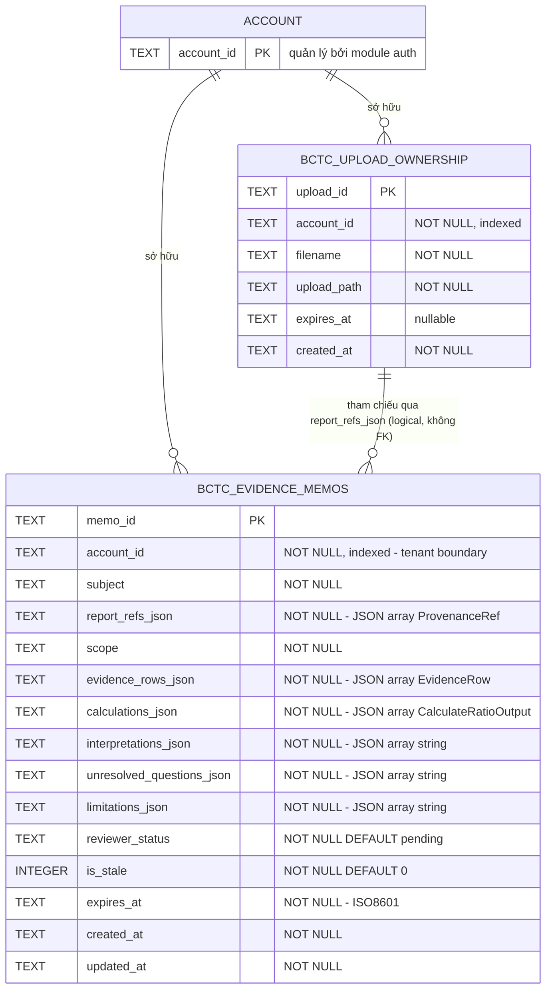

Cả 2 bảng đã tồn tại on-disk (`migrate.py:253`, `:274`; đăng ký `010_bctc_evidence_memos`, `011_bctc_upload_ownership`).

**Trade-off — JSON blob vs bảng chuẩn hoá:**

| Lựa chọn | Ưu | Nhược | Quyết định |
|---|---|---|---|
| **JSON column** (đang dùng) | Shape khớp 1-1 với Pydantic model; đổi schema Pydantic không cần migration; ghi/đọc memo là 1 row, 1 query | Không query được theo field bên trong (vd "memo nào dùng formula X"); không có referential integrity | ✅ Giữ — memo luôn đọc nguyên khối, chưa có use case query xuyên nội dung |
| Chuẩn hoá (bảng `memo_evidence_rows`, `memo_calculations`…) | Query linh hoạt; FK thật | 5–6 bảng + join cho mỗi lần đọc memo; migration mỗi lần contract đổi | ❌ cho v1 |

> `# ponytail: JSON blob, chuẩn hoá khi cần query xuyên nội dung memo`

**Không có FK thật giữa 2 bảng** vì `report_refs_json` là JSON array, không phải cột. Ràng buộc "memo chỉ trỏ tới upload mà account sở hữu" được enforce **ở application layer** khi tạo memo, không ở DB. Đây là điểm yếu đã biết — nếu có bug ở tầng app, DB không cứu được.

### 3.2 Indexing Strategy

| Index | Bảng | Cột | Query phục vụ | Trạng thái |
|---|---|---|---|---|
| `bctc_evidence_memos` PK | memos | `memo_id` | `get_memo(memo_id, account_id)` | ✅ có |
| `idx_bctc_memos_account` | memos | `account_id` | `list_memos_by_account` | ✅ có (`migrate.py:270`) |
| `idx_bctc_memos_account_created` | memos | `(account_id, created_at DESC)` | `list_memos_by_account` có `ORDER BY created_at DESC` | ⚠️ **đề xuất thêm** |
| `idx_bctc_memos_expires` | memos | `expires_at` | Cleanup job quét expired | ⚠️ **đề xuất thêm** |
| `bctc_upload_ownership` PK | uploads | `upload_id` | Ownership check — hot path của S3 | ✅ có |
| `idx_bctc_upload_owner` | uploads | `account_id` | Liệt kê upload của account | ✅ có (`migrate.py:282`) |

**Vì sao đề xuất `idx_bctc_memos_account_created`:** `sqlite_memo_repository.py:99` chạy `WHERE account_id = ? ORDER BY created_at DESC`. Index hiện tại chỉ cover `WHERE`, SQLite vẫn phải sort. Với <100 memo/account thì không đáng kể — **chỉ thêm khi đo được**, không thêm đầu cơ. Composite index tốn ghi và tốn disk.

> **Đo trước khi thêm:** `EXPLAIN QUERY PLAN SELECT * FROM bctc_evidence_memos WHERE account_id = ? ORDER BY created_at DESC;` — nếu xuất hiện `USE TEMP B-TREE FOR ORDER BY` **và** p95 latency vượt ngưỡng thì mới thêm.

**Ownership check là hot path:** sau S3, mỗi `analyze_uploaded_file` gọi 1 lookup bằng PK `upload_id` — O(log n), không cần index thêm.

### 3.3 Data Retention Policy

| Dữ liệu | TTL | Cơ chế | Nguồn |
|---|---|---|---|
| Evidence memo | **30 ngày** (mặc định) | `expires_at` set khi tạo; cleanup job xoá | `memo_service.py:44` |
| Upload ownership record | Theo `expires_at` (nullable) | Xoá cùng file vật lý | `upload_ownership_repository.py` |
| File upload vật lý | Cùng TTL với ownership record | Job xoá file + row trong 1 transaction logic | `RISK_DASHBOARD_FINANCIAL_UPLOADS_DIR` |
| Agent run (in-memory/DB) | 24h | Run không được lưu thành memo sẽ biến mất | §2.2 state machine |
| Log ứng dụng | 30 ngày | Log rotation | Infra |
| **Security log** (`ownership_denied`, `path_rejected`) | **90 ngày** | Tách sink riêng | §1.5.3 P2 |

**Thứ tự xoá bắt buộc khi dọn upload** — sai thứ tự sẽ để lại rác hoặc lỗ hổng:

1. Xoá row `bctc_upload_ownership` **trước**.
2. Xoá file vật lý **sau**.

Lý do: nếu xoá file trước rồi crash, row còn lại trỏ tới file không tồn tại ⇒ user thấy lỗi khó hiểu nhưng **không có rủi ro bảo mật**. Nếu xoá row trước rồi crash, file mồ côi tồn tại **không có owner** — mà một `upload_id` mới trùng tên (dù khó) sẽ truy cập được. Fail theo hướng an toàn.

> **U4 chưa chốt:** TTL 30 ngày là giá trị hardcode, chưa có căn cứ pháp lý/licensing. Cần hỏi legal + data-licensing: dữ liệu BCTC từ provider có ràng buộc thời hạn lưu trữ phái sinh không? Nếu có, giá trị này phải chuyển thành config và có thể ngắn hơn.

### 3.4 Cleanup Job

```
Tần suất: hàng ngày, 03:00 giờ VN (giờ thấp điểm)
Batch size: 500 row/lần, sleep 1s giữa batch (tránh khoá dài trên SQLite)
Idempotent: chạy 2 lần liên tiếp an toàn

Bước:
1. SELECT memo_id FROM bctc_evidence_memos WHERE expires_at < now() LIMIT 500
2. DELETE theo memo_id
3. SELECT upload_id, upload_path FROM bctc_upload_ownership
   WHERE expires_at IS NOT NULL AND expires_at < now() LIMIT 500
4. DELETE row → rồi mới unlink file (thứ tự §3.3)
5. Log bctc.cleanup.completed {memos_deleted, uploads_deleted, duration_ms}
```

**SQLite ghi khoá toàn DB** — đây là lý do batch 500 + sleep, không `DELETE` một phát. Với volume dự kiến (vài nghìn memo) thì job chạy <10s.

> `# ponytail: batch delete với sleep, chuyển sang partition/table rotation nếu memo vượt ~1M row`

### 3.5 Migration Strategy

#### 3.5.1 Quy ước

- **ID có thứ tự, không đổi:** `NNN_description` (`010_bctc_evidence_memos`, `011_bctc_upload_ownership`). Migration đã merge thì **không bao giờ** sửa nội dung — sửa nghĩa là môi trường đã chạy rồi sẽ khác môi trường mới.
- **Additive-only:** chỉ `CREATE TABLE IF NOT EXISTS`, `CREATE INDEX IF NOT EXISTS`, `ALTER TABLE ... ADD COLUMN`. Không `DROP COLUMN`, không `ALTER COLUMN TYPE`.
- **Idempotent:** chạy lại phải không lỗi (đảm bảo bởi `IF NOT EXISTS`).
- **Không có data backfill trong migration:** backfill là script riêng, chạy thủ công, có thể dừng/chạy lại.

#### 3.5.2 Zero-downtime — expand/contract

Thêm cột vào bảng đang chạy, ví dụ thêm `source_run_id` vào `bctc_evidence_memos`:

| Phase | Deploy | DB | Code | Rollback |
|---|---|---|---|---|
| **1. Expand** | Migration `012` | `ADD COLUMN source_run_id TEXT` (nullable, không default đắt) | Code cũ vẫn chạy — bỏ qua cột mới | Bỏ qua cột, vô hại |
| **2. Dual-write** | Release N | — | Ghi cả cột mới; đọc vẫn từ chỗ cũ | Revert code |
| **3. Backfill** | Script riêng | `UPDATE ... WHERE source_run_id IS NULL` theo batch | — | Dừng script |
| **4. Switch read** | Release N+1 | — | Đọc từ cột mới, có fallback nếu NULL | Revert code |
| **5. Contract** | Release N+2 | Bỏ fallback trong code. **Không DROP cột** | — | — |

**SQLite không hỗ trợ `DROP COLUMN` ở phiên bản cũ** — đây là ràng buộc kỹ thuật, nên phase 5 chỉ dọn code, cột chết vẫn nằm lại. Chấp nhận được: 1 cột TEXT nullable gần như không tốn gì.

**Cột mới bắt buộc là nullable.** `NOT NULL DEFAULT <value>` trên bảng lớn khiến SQLite rewrite toàn bảng ⇒ khoá DB ⇒ downtime. Nullable + backfill theo batch là cách duy nhất giữ được zero-downtime.

#### 3.5.3 Data validation checks

Chạy sau mỗi migration, trước khi đánh dấu deploy thành công:

| Check | SQL / kiểm tra | Pass khi |
|---|---|---|
| Bảng tồn tại | `SELECT name FROM sqlite_master WHERE type='table' AND name IN ('bctc_evidence_memos','bctc_upload_ownership')` | 2 row |
| Index tồn tại | `SELECT name FROM sqlite_master WHERE type='index' AND name LIKE 'idx_bctc%'` | ≥2 row |
| Không có memo mồ côi account | `SELECT COUNT(*) FROM bctc_evidence_memos WHERE account_id IS NULL OR account_id = ''` | 0 |
| JSON hợp lệ | `SELECT COUNT(*) FROM bctc_evidence_memos WHERE json_valid(report_refs_json) = 0` | 0 |
| Không có memo vĩnh viễn | `SELECT COUNT(*) FROM bctc_evidence_memos WHERE expires_at IS NULL OR expires_at = ''` | 0 |
| Upload path trong base dir | Script Python: mỗi `upload_path` phải `realpath` nằm trong uploads dir | 100% |
| Round-trip Pydantic | Lấy mẫu 100 memo, `_row_to_memo()` không raise | 0 lỗi |

**Rollback:** vì migration additive-only, rollback = **deploy lại code cũ**, không đụng DB. Bảng/cột thừa mà code cũ không biết đến là vô hại. Đây chính là lý do chọn additive-only thay vì migration có `DROP`: rollback DB trên SQLite production là thao tác rủi ro cao, tránh được thì tránh.

---

## 4. FRONTEND INTEGRATION

Sở hữu: `frontend/src/features/bctc/`. Đã có `BctcAnalysisWorkspace.jsx`, `EvidenceSourceDrawer.jsx`, `services/financialsApi.js`. Thiếu toàn bộ phần agent (G7).

### 4.1 User Interaction Flow

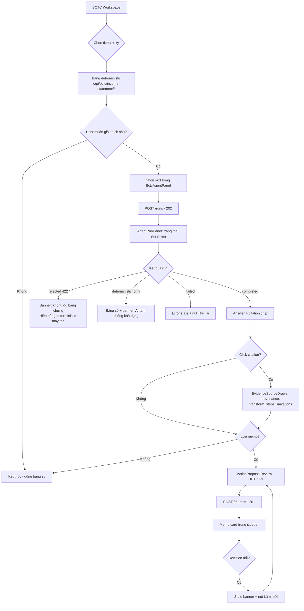

### 4.2 Wireframes

**W1 — BCTC Workspace có agent panel**

```
┌──────────────────────────────────────────────────────────────────────┐
│  BCTC Workspace          [FPT ▾]  [2024Q4 ▾]        [⚙]  [👤]        │
├────────────────────────────────────┬─────────────────────────────────┤
│  BÁO CÁO KẾT QUẢ KINH DOANH        │  ▸ TRỢ LÝ PHÂN TÍCH             │
│  ┌──────────────────────────────┐  │  ┌───────────────────────────┐  │
│  │ Chỉ tiêu        2024Q4   YoY │  │  │ Chọn kỹ năng:             │  │
│  │ Doanh thu thuần  52,618  +8% │  │  │ ○ Giải thích chỉ tiêu     │  │
│  │ Giá vốn          33,104  +6% │  │  │ ● So sánh kỳ              │  │
│  │ Lợi nhuận gộp    19,514 +12% │  │  │ ○ Diễn giải tỉ số         │  │
│  │ ...                          │  │  │ ○ Chất lượng lợi nhuận    │  │
│  └──────────────────────────────┘  │  │ ○ Checklist nghiên cứu    │  │
│                                    │  │                           │  │
│  [Xuất Excel]  [Xem công thức]     │  │        [▶ Chạy phân tích] │  │
│                                    │  └───────────────────────────┘  │
│                                    │                                 │
│                                    │  ▸ MEMO ĐÃ LƯU (3)              │
│                                    │  ┌───────────────────────────┐  │
│                                    │  │ ⚠ Biên LN gộp Q3→Q4       │  │
│                                    │  │   Dữ liệu đã cũ · 12/09   │  │
│                                    │  ├───────────────────────────┤  │
│                                    │  │ ✓ Chất lượng LN 2024      │  │
│                                    │  │   Hết hạn sau 18 ngày     │  │
│                                    │  └───────────────────────────┘  │
└────────────────────────────────────┴─────────────────────────────────┘
```

**W2 — Kết quả run có citation**

```
┌───────────────────────────────────────────────────────────┐
│  ▸ SO SÁNH KỲ · FPT · 2024Q3 → 2024Q4        [✓ Hoàn tất] │
├───────────────────────────────────────────────────────────┤
│                                                           │
│  Biên lợi nhuận gộp tăng từ 35,4% [1] lên 37,1% [2],     │
│  chủ yếu do giá vốn tăng chậm hơn doanh thu [3].         │
│                                                           │
│  Hạn chế: chưa loại trừ yếu tố mùa vụ; kỳ Q4 thường      │
│  có biên cao hơn do cơ cấu hợp đồng.                     │
│                                                           │
│  ┌─────────────────────────────────────────────────────┐ │
│  │ [1] gross_margin v1.0.0 · 2024Q3 · rev_9f2c1a4b     │ │
│  │ [2] gross_margin v1.0.0 · 2024Q4 · rev_9f2c1a4b     │ │
│  │ [3] revenue, cogs · 2024Q3-Q4 · vndirect            │ │
│  └─────────────────────────────────────────────────────┘ │
│                                                           │
│  ⓘ Đây là phân tích dữ liệu, không phải khuyến nghị      │
│    đầu tư.                                                │
│                                                           │
│              [Xem bằng chứng]     [💾 Lưu thành memo]     │
└───────────────────────────────────────────────────────────┘
```

**W3 — Grounding gate chặn (422)**

```
┌───────────────────────────────────────────────────────────┐
│  ▸ SO SÁNH KỲ · FPT              [⚠ Không đủ bằng chứng] │
├───────────────────────────────────────────────────────────┤
│                                                           │
│  ⚠ Trợ lý không tạo được phân tích có đầy đủ bằng        │
│    chứng cho kỳ này. Để đảm bảo chính xác, kết quả        │
│    đã bị chặn.                                            │
│                                                           │
│  Bạn vẫn có thể xem số liệu gốc bên dưới:                │
│  ┌─────────────────────────────────────────────────────┐ │
│  │ Biên LN gộp  2024Q3: 35,4%   2024Q4: 37,1%         │ │
│  │ Nguồn: vndirect · rev_9f2c1a4b                      │ │
│  └─────────────────────────────────────────────────────┘ │
│                                                           │
│                      [Thử lại]    [Báo cáo vấn đề]       │
└───────────────────────────────────────────────────────────┘
```

> **Nguyên tắc W3:** khi grounding gate chặn, **không hiện một con số nào từ LLM**, nhưng vẫn hiện số deterministic từ tool. User không bị bỏ tay trắng, mà cũng không thấy nội dung chưa xác minh. Đây là lý do `answer` và `citations` là 2 field tách biệt trong `AgentRun`.

### 4.3 Error & Loading State

| State | Trigger | UI | User làm gì tiếp |
|---|---|---|---|
| `idle` | Chưa chạy | Panel chọn skill | Chọn + Chạy |
| `submitting` | POST /runs đang bay | Nút disabled + spinner | Chờ (<1s) |
| `queued` | 202, chưa có worker | Skeleton + "Đang xếp hàng…" | Chờ |
| `running` | Tool phase | Progress: "Đang lấy dữ liệu 2024Q4…" theo tool_id | Chờ, có nút Huỷ |
| `synthesizing` | LLM phase | "Đang tổng hợp…" + skeleton text | Chờ |
| `completed` | verdict pass | W2 | Xem/lưu |
| `rejected` | 422 | W3 | Thử lại |
| `deterministic_only` | LLM breaker open | Bảng số + banner vàng "AI tạm không khả dụng" | Dùng bảng số |
| `stale_data` | `data_freshness=stale` | Banner "Dữ liệu tính đến <fetched_at>" | Chấp nhận hoặc chờ |
| `error_network` | fetch fail | "Mất kết nối" + Thử lại | Retry |
| `error_scope` | 403 | Ẩn panel hoàn toàn | — (không hiện nút rồi báo lỗi) |
| `error_rate_limited` | 429 | Countdown theo `Retry-After` | Chờ |

**Loading tiến trình có nội dung, không phải spinner trống.** `running` hiển thị đúng tool đang chạy vì run có thể mất tới 8s (p95) — spinner trống ở mốc đó khiến user nghĩ app treo. Tên tool map sang tiếng Việt ở client, không để server trả chuỗi hiển thị (server trả `tool_id`, client dịch — tránh i18n ở backend).

**Skeleton chứ không spinner** cho vùng text: giữ layout ổn định, tránh nhảy khi nội dung về.

### 4.4 API Consumption Pattern

#### 4.4.1 Caching

| Dữ liệu | Cache | TTL | Invalidate khi |
|---|---|---|---|
| `GET /tools` (manifest) | memory | cả session | Đăng xuất |
| Bảng deterministic `/api/bctc/income-statement/*` | memory theo `(ticker, period)` | 5 phút | Đổi ticker/period |
| `GET /runs/{id}` khi `status` terminal | memory | 24h | — (bất biến) |
| `GET /runs/{id}` khi đang chạy | **không cache** | — | — |
| `GET /memos` | memory | 60s | Sau POST/DELETE memo |
| `GET /memos/{id}` | memory | 5 phút | `is_stale=true` ⇒ bỏ cache ngay |

**Không cache run đang chạy** — hiển nhiên nhưng dễ sai nếu dùng thư viện cache mặc định cache mọi GET.

**Trade-off — cache ở client hay dựa vào HTTP cache header:**

| Lựa chọn | Ưu | Nhược | Quyết định |
|---|---|---|---|
| **Cache trong memory ở client** | Kiểm soát chính xác invalidation (vd bỏ cache khi `is_stale`); không phụ thuộc proxy | Mất khi refresh trang | ✅ — dữ liệu tài chính cần invalidation chính xác hơn là bền |
| `Cache-Control` header | Trình duyệt lo | Không invalidate được theo sự kiện nghiệp vụ (revision đổi); proxy trung gian có thể giữ số cũ **rất nguy hiểm** với dữ liệu tài chính | ❌ — mọi response agent gắn `Cache-Control: no-store` |

> Response chứa số tài chính **phải** gắn `Cache-Control: no-store` — tránh proxy/CDN giữ lại số của account này rồi trả cho account khác.

#### 4.4.2 Optimistic UI

Chỉ áp dụng cho hành động **không tạo ra số**:

| Hành động | Optimistic? | Lý do |
|---|---|---|
| Xoá memo | ✅ Có | Xoá nhầm khôi phục được bằng refetch; UI mượt hơn |
| Đổi tên/subject memo | ✅ Có | Không ảnh hưởng số |
| **Tạo memo** | ❌ Không | Server trả `memo_id`, `expires_at`, và xác nhận `report_refs` — không đoán được |
| **Chạy run** | ❌ Không | Không được dựng số giả trong lúc chờ, kể cả skeleton có nội dung |
| Vá IDOR / upload | ❌ Không | Cần xác nhận server |

**Quy tắc:** không bao giờ optimistic cho thứ hiển thị con số tài chính. Một con số optimistic sai trong 200ms vẫn là con số sai mà người dùng có thể chụp màn hình.

#### 4.4.3 Real-time subscription

| Lựa chọn | Ưu | Nhược | Quyết định |
|---|---|---|---|
| **Polling `GET /runs/{id}`** với backoff 500ms → 1s → 2s (trần 3s), dừng khi terminal | Không thêm infra; hợp với run ngắn (p95 8s ⇒ ~5 lần poll); retry/timeout tầm thường | Có độ trễ tới 3s ở cuối; tốn request | ✅ **Chọn cho v1** |
| SSE (`text/event-stream`) | Cập nhật tức thì; stream được từng token | Cần giữ connection; phức tạp với reconnect; proxy buffering | ⏸ Khi nào có streaming narrative thì chuyển |
| WebSocket | Hai chiều | Quá nặng cho use case một chiều, ngắn hạn | ❌ |

> `# ponytail: polling có backoff, chuyển SSE khi cần stream token narrative`

**Memo stale không cần realtime.** Kiểm tra khi mở workspace và khi mở memo là đủ — revision BCTC đổi theo ngày/quý, không theo giây. Đẩy realtime vào đây là over-engineering.

---

## 5. VERIFICATION STRATEGY

### 5.1 Test Matrix

| ID | Test Case | Input Scenario | Expected Output | Verification Method |
|---|---|---|---|---|
| **T1** | Provenance bắt buộc | Gọi `bctc.calculate_ratio` với ticker hợp lệ | `result.provenance` có đủ `report_id`, `revision_id`, `period`, `source`, `fetched_at`; không field nào rỗng | Unit test assert từng field |
| **T2** | Mẫu số bằng 0 | `denominator = 0` | `value=null`, `calculation_status="insufficient_data"`, **không raise** | Unit test, `pytest.raises` phải KHÔNG kích hoạt |
| **T3** | Mẫu số null | Kỳ thiếu dữ liệu | như T2 | Unit test |
| **T4** | Formula chưa duyệt | `FormulaEntry(approved=False)` | `get_formula()` raise `ValueError`; API trả 409 | Unit + integration |
| **T5** | Version formula sai | Yêu cầu `v2.0.0`, registry có `v1.0.0` | raise `ValueError` | Unit test |
| **T6** | Revision deterministic | Gọi `derive_revision_id` 2 lần cùng input | Kết quả giống hệt | Property test |
| **T7** | Revision đổi khi data đổi | Đổi `fetched_at` | `revision_id` khác | Unit test |
| **T8** | Reviewer — claim hợp lệ | Claim khớp tool result trong tolerance `1e-4` | `verdict="pass"`, `unsupported_claims=[]` | Unit test |
| **T9** | Reviewer — sai đơn vị | Claim `pct`, evidence `ratio`, giá trị số bằng nhau | `rejected_claims` có 1 phần tử | Unit test — bắt lỗi 0,37 vs 37% |
| **T10** | Reviewer — claim bịa | Claim `"biên 99%"` không có trong tool result | `verdict="reject"`, `unsupported_claims` 1 phần tử | Unit test |
| **T11** | Reviewer — trộn revision | Giá trị đúng nhưng `revision_id` khác | `unsupported` | Unit test — bắt lỗi trộn 2 bản dữ liệu |
| **T12** | Reviewer — hypothetical | Claim có `is_hypothetical=True` | Accept không cần evidence | Unit test |
| **T13** | Grounding gate chặn E2E | LLM stub trả draft có số bịa | HTTP 422 `GROUNDING_FAILED`; **body không chứa số bịa** | Integration L2 + assert chuỗi vắng mặt |
| **T14** | IDOR memo | Account B gọi `GET /memos/{memo_của_A}` | **404** (không phải 403 — tránh oracle xác nhận tồn tại) | Integration L3, `tests/test_idor_matrix.py` |
| **T15** | IDOR upload | Account B gọi `analyze_uploaded_file(upload_id_của_A)` | 404 + log `bctc.upload.ownership_denied` | Integration L3 |
| **T16** | Path traversal | `upload_id = "../../etc/passwd"` | Reject, không đọc file | Unit test `validate_upload_path` |
| **T17** | Path traversal encoded | `upload_id = "%2e%2e%2fetc%2fpasswd"` | Reject (unquote trước khi check) | Unit test |
| **T18** | Anonymous | Không có bearer token | 401 `UNAUTHENTICATED` | Integration L3 |
| **T19** | Thiếu scope | Token không có `bctc:formula:read`, gọi `calculate_ratio` | 403 `SCOPE_DENIED` | Integration L3 |
| **T20** | Feature flag tắt | `bctc_agent.enabled=false` | **404** (không phải 503 — không lộ sự tồn tại feature) | Integration |
| **T21** | Tool registry đủ | Bootstrap xong | `bctc_tools_registered == 6` | Integration L1 + health check |
| **T22** | Không còn stub hardcode | Toàn repo | `grep -r "52618" src/` → 0 hit | CI grep guard |
| **T23** | Memo account-scoped | Tạo memo bằng A, list bằng B | Danh sách của B không chứa memo của A | Integration L3 |
| **T24** | Memo stale detect | Memo tạo với `rev_X`, hiện tại `rev_Y` | `is_stale=true` | Unit `check_staleness` |
| **T25** | Memo TTL | Tạo memo mặc định | `expires_at ≈ created_at + 30 ngày` | Unit test |
| **T26** | Memo round-trip | Save rồi load | `BCTCEvidenceMemo` bằng nhau về mọi field | Integration L4 |
| **T27** | Migration idempotent | Chạy migration 2 lần trên cùng DB | Lần 2 không lỗi; schema không đổi | Integration L4 |
| **T28** | Migration trên DB trống | File DB mới | 2 bảng + ≥2 index tồn tại | Integration L4 |
| **T29** | Breaker report source | Ép source fail 5 lần liên tiếp | Breaker open; dùng cache; `data_freshness="stale"`; `fetched_at` là của cache, không phải now() | Integration L5 |
| **T30** | Breaker LLM | Ép LLM timeout | `status="completed"`, `answer=null`, `citations` không rỗng | Integration L5 |
| **T31** | Rate limit | 11 request `POST /runs` trong 1 phút | Request 11 trả 429 + header `Retry-After` | Integration |
| **T32** | Idempotency | 2 POST /memos cùng `Idempotency-Key` | Chỉ 1 memo được tạo; cả 2 trả cùng `memo_id` | Integration |
| **T33** | Zero-leakage | Chạy toàn gold set | `buy_sell_leaks == 0` — không có lời khuyên mua/bán | `BCTCEvalRunner` |
| **T34** | Grounded rate | Chạy toàn gold set | `unsupported_count == 0` | `BCTCEvalRunner` |
| **T35** | Latency ratio | 100 lần `calculate_ratio` | p50 < 200ms, p95 < 500ms | Benchmark, exit criteria plan §13 |
| **T36** | Latency memo | 50 run tạo memo | p50 < 3s, p95 < 8s | Benchmark |
| **T37** | Max tool calls | Skill với `max_tool_calls=3` | Không quá 3 tool call, kể cả khi LLM yêu cầu thêm | Integration L2 |
| **T38** | Repair 1 lần | Draft có `rejected_claims` | Retry đúng 1 lần, lần 2 fail thì `rejected` | Integration L2 |
| **T39** | Tutor scope subset | Module 3 mượn tool với scope Tutor | Không truy cập được `build_evidence_table` | Integration contract test |
| **T40** | Event không chứa số | Phát `bctc.evidence_memo.created` | Payload không có field kiểu số tài chính; validate theo JSON schema | Schema validation test |
| **T41** | `Cache-Control` | Mọi response agent có số | Header `no-store` | Integration |
| **T42** | Cleanup job idempotent | Chạy 2 lần liên tiếp | Lần 2 xoá 0 row, không lỗi | Integration |
| **T43** | Cleanup thứ tự | Ép crash giữa xoá row và xoá file | Row đã xoá, file mồ côi — **không** có file có row trỏ tới mà mất quyền | Integration với fault injection |
| **T44** | Frontend không optimistic số | Tạo memo | UI không hiện `memo_id`/`expires_at` trước khi server trả | Component test |

### 5.2 Exit Criteria (gate cho VP-AT5)

Lấy từ tiêu chí nghiệm thu kiểm soát chất lượng Master Plan §14A.3 / VP-AT5:

| # | Tiêu chí | Đo bằng | Ngưỡng |
|---|---|---|---|
| E1 | 100% numeric claim map về tool evidence | `BCTCEvalRunner.grounded_rate`, metric `bctc_unsupported_claims_total` | `unsupported_count == 0` |
| E2 | Latency tính tỉ số | `bctc_tool_duration_seconds{tool_id="bctc.calculate_ratio"}` | p50 <200ms, p95 <500ms |
| E3 | Latency evidence memo | `bctc_run_duration_seconds` | p50 <3s, p95 <8s |
| E4 | Chi phí memo | Cost tracking LLM | ≤ $0.03/memo |
| E5 | Zero cross-account private report access | T14, T15, T23 pass; `bctc_upload_ownership_denied_total` không có case lọt | 0 |
| E6 | Zero buy/sell leakage | `buy_sell_leaks` | 0 |
| E7 | Tool registry đầy đủ | `bctc_tools_registered` | == 6 |

**Gate cứng để mở rộng rollout cohort:** E1, E5, E6, E7 phải pass. E2–E4 vi phạm ⇒ warning, được phép tiếp tục nếu PO chấp nhận; E1/E5/E6 vi phạm ⇒ **dừng, không mở cohort**.

### 5.3 Rollout Plan

| Phase | Cohort | Điều kiện vào | Soak | Điều kiện ra |
|---|---|---|---|---|
| R0 | Internal (dev + PO) | S1–S6 xong; **S3 (IDOR) đã deploy** | 3 ngày | 0 unsupported claim; 0 ownership_denied bất thường |
| R1 | 5% user | R0 pass + S7–S9 xong | 7 ngày | E1, E5, E6, E7 pass |
| R2 | 25% | R1 pass + S10 (frontend) xong | 7 ngày | idem + E2, E3 trong ngưỡng |
| R3 | 100% | R2 pass | — | — |

**Kill switch:** tắt `module.financials_product.bctc_agent.enabled`. Tác động: agent surface trả 404; **deterministic routes không bị ảnh hưởng** — đây là lý do agent nằm ở router riêng chứ không trộn vào `api/public.py`.

---

## 6. TRADE-OFF SUMMARY

Tổng hợp mọi quyết định kỹ thuật, để review không phải đọc lại toàn spec.

| # | Quyết định | Chọn | Thay vì | Lý do chính | Đổi ý khi nào |
|---|---|---|---|---|---|
| 1 | Thứ tự build API | Tool endpoint (S4) trước run endpoint (S5) | Chỉ làm run endpoint | Debug được tool riêng; frontend unblock sớm | — |
| 2 | `INSUFFICIENT_DATA` HTTP code | 200 + `calculation_status` | 4xx | Là kết quả hợp lệ, không phải lỗi hệ thống | — |
| 3 | Rate limit store | In-process token bucket | Redis | Deployment hiện là 1 instance | Scale ngang |
| 4 | LLM breaker fallback | `deterministic_only` (bảng số, `answer=null`) | Trả 503 | Deterministic path độc lập với LLM | — |
| 5 | Log sampling | 10% happy path, 100% error | 100% tất cả | Giảm 85% volume, giữ trọn tín hiệu lỗi | Cần audit trail đầy đủ theo yêu cầu pháp lý |
| 6 | Tool versioning | tool_id mới (`.v2`) | field `version` | Rollback = bỏ đăng ký; consumer cũ không đụng | — |
| 7 | Repair retry | 1 lần | 0 hoặc N | Cứu lỗi unit/format, cost có trần | Đo thấy retry không cải thiện pass rate |
| 8 | Grounding gate | Fail-closed toàn bộ response | Trả phần grounded | Narrative tài chính cắt xén nguy hiểm hơn không có | — |
| 9 | Memo storage | JSON column | Bảng chuẩn hoá | Khớp Pydantic; đọc nguyên khối | Cần query xuyên nội dung memo |
| 10 | Index composite | **Chưa thêm**, đo trước | Thêm ngay | Tránh index đầu cơ; volume hiện nhỏ | `EXPLAIN QUERY PLAN` cho `TEMP B-TREE` + p95 vượt ngưỡng |
| 11 | Migration | Additive-only | Có DROP/ALTER | Rollback = deploy code cũ, không đụng DB | — |
| 12 | Thứ tự xoá upload | Row trước, file sau | File trước | Fail theo hướng an toàn (file mồ côi > file mất owner) | — |
| 13 | Client cache | Memory ở client + `no-store` | HTTP cache header | Invalidate theo sự kiện nghiệp vụ; tránh proxy giữ số của account khác | — |
| 14 | Optimistic UI | Chỉ cho hành động không tạo số | Optimistic toàn bộ | Số optimistic sai vẫn là số sai | — |
| 15 | Realtime | Polling backoff | SSE / WebSocket | Run ngắn (p95 8s); không thêm infra | Cần stream token narrative |
| 16 | Integration test LLM | Stub deterministic | LLM thật | CI nhanh, không flaky, không tốn tiền | — |
| 17 | Event payload | Chỉ metadata, không số | Kèm giá trị | Event bus là kênh chia sẻ — số ở đó nằm ngoài ownership check | — |
| 18 | IDOR response code | 404 | 403 | 403 là oracle xác nhận resource tồn tại | — |
| 19 | Feature flag tắt | 404 | 503 | Không lộ sự tồn tại của feature | — |
| 20 | Health khi thiếu tool | `unhealthy` (503) | `degraded` | Skill chạy thiếu evidence nguy hiểm hơn không chạy | — |

---

## 7. OPEN QUESTIONS

Không tự quyết được từ code — cần người trả lời trước khi build phần liên quan.

| ID | Câu hỏi | Chặn work item nào | Cách thu thập | Người trả lời |
|---|---|---|---|---|
| **U1** | `analyze_uploaded_file` hiện public; vá IDOR (S3) có phá client đang dùng không? | S3 | Bật access log 7 ngày đếm caller; hoặc hỏi trực tiếp | PO |
| **U2** | Threshold `grounded_rate` cuối cùng | R1 gate | Chạy `BCTCEvalRunner` lấy baseline → chốt | PO + tech lead |
| **U3** | Ai sign-off công thức tài chính (`FormulaEntry.approved_by`)? Hiện là `str \| None`, chưa có owner thật | Bật formula mới | Cần tên domain expert | PO |
| **U4** | TTL memo 30 ngày có căn cứ pháp lý/licensing không? | §3.3 retention | Hỏi legal + data-licensing về ràng buộc lưu trữ dữ liệu phái sinh | Legal |
| **U5** | Deploy Prometheus, hay dùng `analytics_monitoring` sẵn có? Repo **không có** `prometheus_client` | S9 | Xác nhận stack với DevOps | DevOps |
| **U6** | `is_private_upload` đang **hardcode `False`** (`report_resolver.py`) — private upload chưa đi qua agent path. Có trong scope v1 không? | CP4, S5 | Xác nhận phạm vi v1 | PO |
| **U7** | A/B framework: tự viết `hash(account_id) % 100` hay dùng service? Repo chưa có experiment assignment | §2.4.4 | Quyết định kiến trúc | Tech lead |
---

## 8. CÁC CHỨC NĂNG CẦN CÓ SAU KHI HOÀN THÀNH (POST-COMPLETION ADVANCED CAPABILITIES)

### 8.1 Tầm nhìn & Lộ trình Tiến hóa Hệ thống (Vision & Quantum Evolution)

Sau khi hoàn tất Giai đoạn 1 (v1 Core: 6 Read Domain Tools, 5 Basic Skills, NumericReviewer Grounding Gate, HTTP Surface và Evidence Memo Persistence), Module 5 bước vào giai đoạn nâng cấp thành **Hệ thống Trí tuệ BCTC Cấp Tổ chức (Institutional-Grade Financial Intelligence Engine)**. Mục tiêu là chuyển dịch từ việc "truy vấn số liệu và tính chỉ số đơn lẻ" sang "thẩm định chất lượng tài chính đa chiều, phát hiện gian lận kế toán, định giá nội tại và dự báo rủi ro thanh khoản".

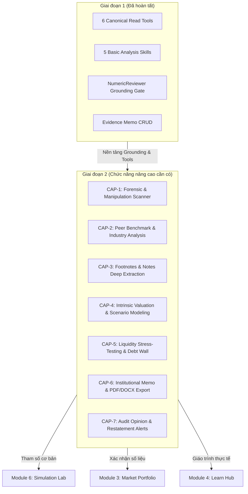

---

### 8.2 Danh mục 7 Chức năng Nâng cao (Capabilities Catalog)

| Mã CAP | Tên chức năng | Tool ID đề xuất | Skill ID đề xuất | Giá trị nghiệp vụ cốt lõi |
|---|---|---|---|---|
| **CAP-1** | Forensic Accounting & Earnings Manipulation Scanner | `bctc.compute_forensic_scores` | `bctc.forensic_scan.v1` | Tự động tính toán Beneish M-Score, Altman Z''-Score, Piotroski F-Score và phát hiện tín hiệu bất thường kế toán. |
| **CAP-2** | Peer Benchmark & Cross-Sectional Industry Analysis | `bctc.compare_peer_metrics` | `bctc.peer_benchmark.v1` | Đối sánh doanh nghiệp với trung vị ngành và Top đối thủ cạnh tranh qua phân rã DuPont 5 bước và Chu kỳ tiền mặt (CCC). |
| **CAP-3** | Footnotes & Notes Deep Extraction | `bctc.resolve_footnote_section` | `bctc.extract_footnotes.v1` | Tách lớp thuyết minh nợ vay, ngân hàng chủ nợ, lãi suất thực tế, giao dịch bên liên quan và chi phí dở dang (CIP). |
| **CAP-4** | Intrinsic Valuation & Sensitivity Modeling | `bctc.compute_valuation_models` | `bctc.intrinsic_valuation.v1` | Định giá nội tại đa mô hình (FCFF/FCFE 2 giai đoạn, DDM, P/E & P/B band lịch sử) kèm ma trận độ nhạy theo WACC và tăng trưởng dài hạn. |
| **CAP-5** | Liquidity Stress-Testing & Debt Maturity Wall | `bctc.simulate_liquidity_runway` | `bctc.liquidity_stress_test.v1` | Lập tường nợ đáo hạn 12 tháng, đo lường hệ số bao phủ lãi vay (ICR, DSCR) và mô phỏng số tháng trụ vững khi doanh thu suy giảm. |
| **CAP-6** | Automated Institutional-Grade Memo & Export | `bctc.compile_full_memo` | `bctc.generate_investment_memo.v1` | Soạn thảo báo cáo thẩm định đầu tư chuẩn mực tổ chức, đóng dấu số xác thực bằng chứng, xuất bản PDF/DOCX chuyên nghiệp. |
| **CAP-7** | Smart Audit Opinion & Restatement Alert Engine | `bctc.scan_audit_modifications` | `bctc.audit_opinion_check.v1` | Tự động quét ý kiến kiểm toán (ngoại trừ/từ chối), vấn đề cần nhấn mạnh (Going Concern), và các điều chỉnh hồi tố số liệu quá khứ. |

---

### 8.3 Đặc tả Chi tiết từng Chức năng theo Use Case & Dataflow

#### 8.3.1 CAP-1: Forensic Accounting & Earnings Manipulation Scanner

##### A. Use Case
- **Mục tiêu**: Phát hiện sớm các rủi ro gian lận kế toán, xào nấu lợi nhuận (Earnings Manipulation) và nguy cơ mất khả năng thanh toán trước khi số liệu vỡ nợ phản ánh ra giá cổ phiếu.
- **Actors**: Chuyên viên phân tích cơ bản, Giám đốc Quản trị rủi ro tín dụng (Risk Manager), Nhà đầu tư giá trị.
- **Preconditions**:
  - Doanh nghiệp phi tài chính có tối thiểu 8 quý dữ liệu BCTC đã được chuẩn hóa trong cache/database.
  - Phải có đủ 3 bảng: Bảng cân đối kế toán, Báo cáo kết quả kinh doanh và Báo cáo lưu chuyển tiền tệ (trực tiếp hoặc gián tiếp).
- **Triggers**:
  - Người dùng chọn Tab "Forensic & Manipulation Risk" trên `BctcAnalysisWorkspace` hoặc gửi prompt yêu cầu kiểm định gian lận.
  - Lệnh kiểm tra định kỳ trong Multi-Agent Pipeline trước khi giải ngân danh mục.
- **Happy Path**:
  1. Người dùng chọn mã cổ phiếu (ví dụ: `NVL`, `HPG`, `VNM`) và kích hoạt `bctc.forensic_scan.v1`.
  2. Agent triệu hồi tool `bctc.compute_forensic_scores` với tham số `ticker` và `period`.
  3. Tool tính toán 8 biến số của **Beneish M-Score**:
     - $DSRI$ (Days Sales in Receivables Index): $\frac{AR_t / Rev_t}{AR_{t-1} / Rev_{t-1}}$
     - $GMI$ (Gross Margin Index): $\frac{GM_{t-1}}{GM_t}$
     - $AQI$ (Asset Quality Index): Tỷ lệ tài sản phi hiện hữu phi sinh lời.
     - $SGI$ (Sales Growth Index): Tốc độ tăng trưởng doanh thu.
     - $DEPI$ (Depreciation Index): Tốc độ khấu hao tài sản.
     - $SGAI$ (Sales, General and Administrative Expense Index).
     - $LVGI$ (Leverage Index): Đòn bẩy nợ vay tổng thể.
     - $TATA$ (Total Accruals to Total Assets): Chênh lệch giữa lợi nhuận thuần kế toán và dòng tiền hoạt động kinh doanh thực tế $CFO$.
     - Công thức Beneish M:
       $$\text{M-Score} = -4.84 + 0.920 \cdot DSRI + 0.528 \cdot GMI + 0.404 \cdot AQI + 0.892 \cdot SGI + 0.115 \cdot DEPI - 0.172 \cdot SGAI + 4.037 \cdot TATA + 0.0327 \cdot LVGI$$
  4. Tool tính toán **Altman Z''-Score** (phiên bản thị trường mới nổi) và **Piotroski 9-point F-Score**.
  5. Quét bộ quy tắc phát hiện bất thường (Rule-based Red Flags):
     - Dòng tiền hoạt động kinh doanh $CFO < 0$ liên tục 3 kỳ trong khi Lợi nhuận sau thuế $PAT > 0$ và tăng trưởng.
     - Tốc độ tăng Phải thu khách hàng ($DSO$) vượt trội > 2 lần tốc độ tăng trưởng doanh thu thuần.
     - Chi phí trả trước ngắn/dài hạn hoặc Tạm ứng tăng vọt bất thường không có thuyết minh tương ứng.
  6. Agent tổng hợp bảng bằng chứng số liệu (`EvidenceTable`), trích dẫn nguồn gốc từng biến số từ BCTC gốc, gán nhãn mức độ rủi ro (`LOW`, `MEDIUM`, `HIGH_MANIPULATION_RISK`).
  7. `NumericReviewer` phê duyệt tính xác thực 100% của các số liệu tính toán. Kết quả hiển thị trực quan trên giao diện `BctcForensicCard`.
- **Edge Cases & Failure Modes**:
  - *Doanh nghiệp tài chính (Ngân hàng, Bảo hiểm, Chứng khoán)*: Cấu trúc BCTC đặc thù không áp dụng Beneish M-Score và Altman Z-Score thông thường. Hệ thống chuyển đổi sang mô hình **Texas Ratio** và **NPL Coverage Ratio**, ghi nhận rõ giới hạn phân tích trong trường `limitations`.
  - *Thiếu kỳ so sánh*: Nếu thiếu dữ liệu kỳ $t-1$, hệ thống trả về kết quả từng phần có cờ `calculation_status: "insufficient_data"`, tuyệt đối không suy diễn số liệu.

##### B. Dataflow Architecture
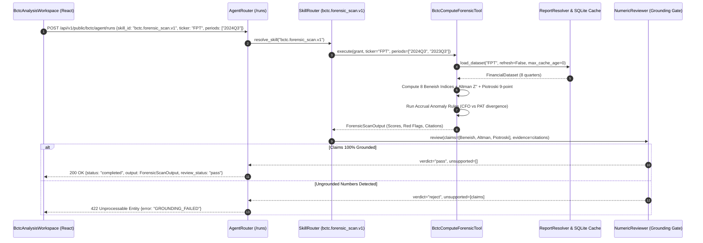

##### C. Schemas & Contract Specification
```python
class BeneishIndices(BaseModel):
    dsri: float = Field(..., description="Days Sales in Receivables Index")
    gmi: float = Field(..., description="Gross Margin Index")
    aqi: float = Field(..., description="Asset Quality Index")
    sgi: float = Field(..., description="Sales Growth Index")
    depi: float = Field(..., description="Depreciation Index")
    sgai: float = Field(..., description="SGA Expense Index")
    lvgi: float = Field(..., description="Leverage Index")
    tata: float = Field(..., description="Total Accruals to Total Assets")
    m_score: float = Field(..., description="Beneish M-Score value")
    manipulation_probability: Literal["low", "unlikely", "high_probability"]

class AltmanZScore(BaseModel):
    z_score: float = Field(..., description="Altman Z''-Score value for emerging markets")
    zone: Literal["safe", "grey", "distress"]

class ForensicScanOutput(BaseModel):
    schema_version: str = "1.0.0"
    ticker: str
    period: str
    beneish: BeneishIndices
    altman: AltmanZScore
    piotroski_f_score: int = Field(..., ge=0, le=9)
    red_flags: list[dict[str, Any]] = Field(default_factory=list)
    citations: list[ProvenanceRef]
    freshness_days: int
```

---

#### 8.3.2 CAP-2: Peer Benchmark & Cross-Sectional Industry Analysis

##### A. Use Case
- **Mục tiêu**: Đặt doanh nghiệp vào bức tranh toàn cảnh ngành, nhận diện vị thế cạnh tranh vượt trội (Economic Moat) hoặc điểm yếu chết người so với các đối thủ cùng phân khúc.
- **Actors**: Chuyên viên phân tích danh mục, Giám đốc đầu tư (CIO), Nhà nghiên cứu thị trường.
- **Preconditions**:
  - Mã cổ phiếu mục tiêu và danh sách các mã đối thủ (Peers) có BCTC cùng kỳ hợp lệ.
  - Bảng tra cứu ngành chuẩn (Industry Classification Benchmark - ICB) cấp 2 và cấp 3 đã sẵn sàng.
- **Triggers**:
  - Người dùng yêu cầu đối sánh ngang: "So sánh biên lợi nhuận, ROE và chu kỳ tiền mặt của HPG so với NKG và HSG trong năm 2024".
- **Happy Path**:
  1. Người dùng chọn mã `HPG` và tab "Peer Comparison" (hệ thống tự động gợi ý `HSG`, `NKG`, `TLH` theo mã ngành Thép ICB 1750).
  2. Agent triệu hồi `bctc.compare_peer_metrics`.
  3. Tool tính toán đồng thời cho tất cả các mã trong nhóm:
     - **Phân rã DuPont 5 bước**:
       $$\text{ROE} = \left(\frac{\text{PAT}}{\text{EBT}}\right) \times \left(\frac{\text{EBT}}{\text{EBIT}}\right) \times \left(\frac{\text{EBIT}}{\text{Doanh thu}}\right) \times \left(\frac{\text{Doanh thu}}{\text{Tổng tài sản}}\right) \times \left(\frac{\text{Tổng tài sản}}{\text{Vốn chủ sở hữu}}\right)$$
       *(Gồm: Gánh nặng thuế, Gánh nặng lãi vay, Biên lợi nhuận hoạt động EBIT Margin, Vòng quay tài sản Asset Turnover, và Đòn bẩy tài chính Leverage).*
     - **Chu kỳ chuyển đổi tiền mặt (Cash Conversion Cycle - CCC)**:
       $$\text{CCC} = \text{DIO (Số ngày tồn kho)} + \text{DSO (Số ngày thu tiền)} - \text{DPO (Số ngày trả người bán)}$$
     - **Khả năng sinh lời & Định giá tương đối**: ROA, ROIC, Gross Margin, Net Margin, EV/EBITDA, P/E, P/B.
  4. Tính toán giá trị **Trung vị ngành (Industry Median)** để loại bỏ nhiễu từ các doanh nghiệp đột biến ngoại lai (outliers).
  5. Đánh giá tín hiệu Con hào kinh tế (Economic Moat Signals): Doanh nghiệp có biên gộp cao hơn ngành > 5% trong 3 năm liên tiếp hoặc CCC ngắn hơn ngành > 30 ngày.
  6. Xuất ma trận đối sánh (Peer Matrix Table) và hiển thị biểu đồ radar trên frontend.
- **Edge Cases & Failure Modes**:
  - *Lệch kỳ kế toán*: Một số doanh nghiệp có niên độ tài chính kết thúc ngày 31/03 hoặc 30/09 thay vì 31/12 (ví dụ: một số công ty nông nghiệp/đường). Hệ thống tự động căn chỉnh (re-align) theo 4 quý lũy kế gần nhất (Trailing Twelve Months - TTM).
  - *Đối thủ bị lỗ ròng*: Mẫu số âm làm méo mó các chỉ số P/E, ROE. Hệ thống tự động hiển thị `N/A` kèm ghi chú nguyên nhân âm, chuyển sang so sánh P/B hoặc EV/EBITDA.

##### B. Dataflow Architecture
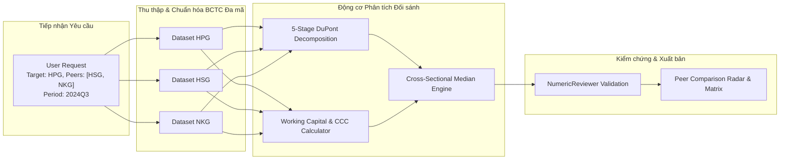

---

#### 8.3.3 CAP-3: Footnotes & Notes Deep Extraction

##### A. Use Case
- **Mục tiêu**: Bóc tách các thông tin trọng yếu ẩn sâu trong Thuyết minh BCTC mà các bảng tổng hợp không hiển thị được, đặc biệt là rủi ro nợ vay ngân hàng, phát hành trái phiếu và rút ruột qua các bên liên quan.
- **Actors**: Chuyên viên thẩm định tín dụng ngân hàng, Kiểm toán viên độc lập, Chuyên gia định giá M&A.
- **Preconditions**:
  - Báo cáo tài chính đã kiểm toán có đính kèm phần Thuyết minh dạng văn bản hoặc bảng biểu chi tiết (hỗ trợ text structure từ file PDF hoặc file JSON bóc tách có cấu trúc).
- **Triggers**:
  - Người dùng truy vấn chuyên sâu: "Chi tiết các khoản nợ ngân hàng của FPT hiện tại có lãi suất bao nhiêu và vay những ngân hàng nào?" hoặc "Kiểm tra giao dịch với các bên liên quan của NVL".
- **Happy Path**:
  1. Agent nhận yêu cầu và kích hoạt tool `bctc.resolve_footnote_section`.
  2. Tool phân tích mục lục và định vị các phần thuyết minh trọng điểm theo từ khóa nghiệp vụ kế toán Việt Nam (Chuẩn mực VAS / Thông tư 200/2014/TT-BTC):
     - *Thuyết minh Nợ vay & Thuê tài chính*: Tách danh mục ngân hàng cho vay, dư nợ ngắn hạn/dài hạn, loại tiền tệ vay (VND hay USD), lãi suất vay thực tế (cố định hay thả nổi theo lãi suất huy động 12 tháng + biên độ), giá trị tài sản đảm bảo thế chấp.
     - *Thuyết minh Trái phiếu Doanh nghiệp*: Lãi suất danh nghĩa, ngày đáo hạn, đơn vị tư vấn phát hành, điều khoản mua lại trước hạn, cam kết duy trì tỷ lệ tài chính (Financial Covenants).
     - *Thuyết minh Giao dịch Bên liên quan*: Bảng tổng hợp các khoản Cho vay / Tạm ứng / Mua bán hàng hóa với các bên có liên quan, công ty liên doanh, công ty liên kết, ban điều hành.
     - *Thuyết minh Chi phí Xây dựng Cơ bản Dở dang (CIP)*: Liệt kê chi tiết tiến độ các dự án nhà máy, khu đô thị, hạ tầng đang đầu tư dở dang và thời gian dự kiến hoàn thành.
  3. Trích xuất thành bảng số liệu cấu trúc `FootnoteItemRecord`, mỗi khoản mục kèm dẫn chứng số trang (`page_number`), số thứ tự thuyết minh (`note_ref: "Thuyết minh số 15"`) và trích dẫn nguyên văn đoạn văn bản kiểm toán (`verbatim_excerpt`).
  4. Trả về kết quả cho Frontend `EvidenceSourceDrawer` để người dùng có thể nhấp vào bất kỳ khoản nợ nào và xem ngay trang PDF kiểm toán gốc tương ứng.
- **Edge Cases & Failure Modes**:
  - *BCTC scan chất lượng thấp*: Hình ảnh mờ, bảng bị nghiêng. Module áp dụng cơ chế phân tích đa tầng (Multi-modal OCR) kèm độ tin cậy `ocr_confidence`. Nếu `ocr_confidence < 0.85`, hệ thống hiển thị cảnh báo và yêu cầu người dùng xác nhận thủ công đối chiếu văn bản.

##### B. Dataflow Architecture
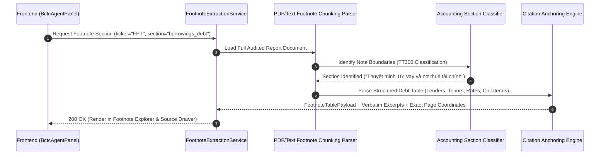

---

#### 8.3.4 CAP-4: Intrinsic Valuation & Scenario Modeling

##### A. Use Case
- **Mục tiêu**: Cung cấp công cụ định giá nội tại dựa trên mô hình tài chính chuẩn mực (DCF, DDM, Historical Valuation Multiples) được cấp nguồn trực tiếp từ số liệu BCTC đã được kiểm chứng (grounded data).
- **Actors**: Nhà đầu tư tổ chức, Chuyên viên nghiên cứu cổ phiếu (Equity Research Analyst).
- **Preconditions**:
  - Doanh nghiệp mục tiêu có tối thiểu 5 năm dữ liệu lịch sử về dòng tiền và doanh thu.
  - Các chỉ số WACC, Beta ngành, Lãi suất phi rủi ro (Trái phiếu Chính phủ Việt Nam 10 năm) đã được cấu hình hoặc tính toán hợp lệ.
- **Triggers**:
  - Người dùng chọn chức năng "Định giá & Phân tích Độ nhạy" trên giao diện hoặc gửi lệnh qua Copilot: "Định giá DCF cho VNM với kịch bản WACC 10.5% và tốc độ tăng trưởng dài hạn 2.5%".
- **Happy Path**:
  1. Kích hoạt tool `bctc.compute_valuation_models`.
  2. Tool thực hiện chuỗi tính toán chiết khấu dòng tiền:
     - **Chiết khấu Dòng tiền Tự do Doanh nghiệp (FCFF)**:
       $$\text{FCFF} = \text{EBIT} \times (1 - t) + \text{Khấu hao} - \text{Capex} - \Delta\text{Vốn lưu động}$$
     - Tính toán **Chi phí vốn bình quân gia quyền (WACC)**:
       $$\text{WACC} = \left(\frac{E}{E + D}\right) \times K_e + \left(\frac{D}{E + D}\right) \times K_d \times (1 - t)$$
       Trong đó $K_e$ tính theo mô hình CAPM: $K_e = R_f + \beta \times (R_m - R_f)$.
     - Tính Giá trị Doanh nghiệp ($EV$) và Giá trị Vốn chủ sở hữu ($Equity\ Value = EV - Nợ\ ròng$).
     - Chia cho số lượng cổ phiếu lưu hành để ra **Giá trị hợp lý trên mỗi cổ phiếu (Fair Value per Share)**.
  3. **Định giá theo Bội số Lịch sử (Historical Valuation Band)**:
     - Thống kê phân vị P/E và P/B trong 5 năm lịch sử của cổ phiếu (Percentile 10%, 25%, 50% Median, 75%, 90%).
     - Đưa ra mức định giá tương đối nếu P/E hồi quy về mức trung bình 5 năm.
  4. **Lập Ma trận Phân tích Độ nhạy 2 chiều (2D Sensitivity Matrix)**:
     - Biến thiên WACC từ $-1.5\%$ đến $+1.5\%$ (bước nhảy $0.5\%$).
     - Biến thiên Tốc độ tăng trưởng dài hạn $g$ từ $-1.0\%$ đến $+1.0\%$ (bước nhảy $0.5\%$).
     - Tạo ma trận $5 \times 5$ ô thể hiện giá trị cổ phiếu tương ứng trong từng kịch bản.
  5. Tất cả các giả định (WACC, g, tax rate, capex) đều được ghi nhận rõ ràng vào báo cáo định giá, tuyệt đối không đưa ra khuyến nghị mua/bán chủ quan (tuân thủ nghiêm ngặt nguyên tắc Zero Buy/Sell Leakage).
- **Edge Cases & Failure Modes**:
  - *Dòng tiền FCFF âm triền miên*: Đối với các công ty khởi nghiệp hoặc công ty mở rộng tài sản quy mô lớn, FCFF có thể âm trong 5 năm tới. Hệ thống tự động chuyển trọng số sang mô hình **P/B lịch sử** hoặc mô hình **Chiết khấu Dòng tiền Siêu lợi nhuận (Residual Income Model - RIM)**.

##### B. Dataflow Architecture
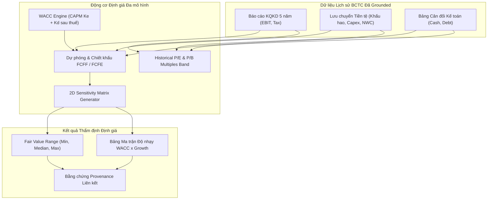

---

#### 8.3.5 CAP-5: Liquidity Stress-Testing & Debt Maturity Wall

##### A. Use Case
- **Mục tiêu**: Kiểm định sức chống chịu tài chính của doanh nghiệp trong kịch bản khủng hoảng tín dụng, đóng băng thanh khoản hoặc đứt gãy dòng tiền hoạt động kinh doanh.
- **Actors**: Chuyên viên quản lý rủi ro danh mục, Bộ phận thẩm định bảo lãnh phát hành trái phiếu.
- **Preconditions**:
  - Dữ liệu nợ vay ngắn hạn, dài hạn và tài sản có tính thanh khoản cao (Tiền mặt, Tiền gửi ngân hàng ngắn hạn, Trái phiếu chính phủ có thể thanh lý ngay) của kỳ gần nhất.
- **Triggers**:
  - Người dùng kích hoạt kịch bản stress-test: "Kiểm tra sức chịu đựng thanh khoản của NVL nếu doanh thu giảm 30% và lãi suất vay tăng thêm 200 điểm cơ bản".
- **Happy Path**:
  1. Agent triệu hồi `bctc.simulate_liquidity_runway`.
  2. Lập **Tường nợ Đáo hạn 12 tháng (Debt Maturity Wall)**:
     - Tổng hợp nghĩa vụ nợ gốc và nợ lãi vay phải trả trong các mốc thời gian: 3 tháng, 6 tháng, 9 tháng và 12 tháng tới.
     - So sánh đối ứng với **Bộ đệm Thanh khoản Tức thời (Liquid Buffer)** = Tiền mặt + Tương đương tiền + Đầu tư tài chính ngắn hạn thanh khoản cao.
  3. Tính toán **Chỉ số Bao phủ Dịch vụ Nợ (Debt Service Coverage Ratio - DSCR)** và **Hệ số Bao phủ Lãi vay (Interest Coverage Ratio - ICR)**:
     $$\text{ICR} = \frac{\text{EBIT}}{\text{Chi phí lãi vay}}$$
     $$\text{DSCR} = \frac{\text{EBITDA} - \text{Thuế TNDN}}{\text{Nợ gốc đến hạn} + \text{Lãi vay}}$$
  4. Mô phỏng kịch bản căng thẳng (Stress-Test Simulation):
     - *Kịch bản Cơ sở (Base Case)*: Giữ nguyên tốc độ tăng trưởng và lãi suất hiện hành.
     - *Kịch bản Căng thẳng Nhẹ (Mild Stress)*: Doanh thu giảm 15%, chi phí lãi vay tăng 100 bps.
     - *Kịch bản Căng thẳng Cực đoan (Severe Stress)*: Doanh thu giảm 35%, biên gộp co hẹp 500 bps, chi phí lãi vay tăng 250 bps.
  5. Ước tính **Thời gian Trụ vững Thanh khoản (Cash Runway in Months)**: Số tháng tối đa doanh nghiệp có thể trang trải chi phí cố định (Opex cố định + Lãi vay + Nợ gốc) trước khi cạn kiệt tiền mặt hoàn toàn nếu không huy động được vốn mới.
  6. Xuất báo cáo rủi ro thanh khoản kèm ma trận cảnh báo đỏ nếu $DSCR < 1.0$ hoặc $Runway < 6\ \text{tháng}$.

##### B. Dataflow Architecture
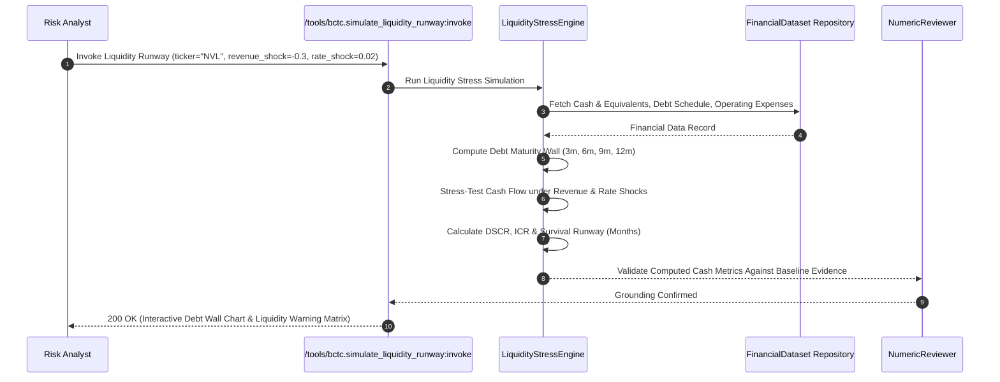

---

#### 8.3.6 CAP-6: Automated Institutional-Grade Investment Memo & Multi-Format Export

##### A. Use Case
- **Mục tiêu**: Chuyển hóa toàn bộ kết quả phân tích phân tán (chỉ số, mô hình gian lận, đối sánh ngành, định giá, thuyết minh) thành một **Bản Ghi nhớ Thẩm định Đầu tư Toàn diện (Institutional Investment Memo)**, có thể xuất bản ra file PDF hoặc DOCX chuẩn mực in ấn để phục vụ hội đồng đầu tư.
- **Actors**: Trưởng phòng Phân tích (Head of Research), Chuyên viên quản lý quỹ (Fund Manager), Khách hàng VIP.
- **Preconditions**:
  - Đã thực hiện tối thiểu 1 Run phân tích BCTC và lưu các `evidence_rows` vào `MemoService`.
- **Triggers**:
  - Người dùng nhấn nút **"Xuất Báo cáo Toàn diện (Export Memo)"** trên giao diện hoặc chọn định dạng xuất file (PDF/Word).
- **Happy Path**:
  1. Người dùng chọn template báo cáo (ví dụ: `institutional_equity_research` hoặc `credit_risk_assessment`).
  2. Agent triệu hồi `bctc.compile_full_memo`.
  3. Hệ thống thu thập:
     - Tóm tắt điều hành (Executive Summary).
     - Bảng số liệu BCTC 4 kỳ gần nhất và 3 năm lịch sử.
     - Kết quả phân rã DuPont và biểu đồ đối sánh ngành.
     - Đánh giá chất lượng lợi nhuận và điểm số rủi ro gian lận (Beneish/Altman/Piotroski).
     - Định giá nội tại và ma trận độ nhạy.
     - Trích dẫn Thuyết minh trọng yếu (Nợ vay, Trái phiếu, Bên liên quan).
     - Danh sách đầy đủ các nguồn gốc số liệu (Provenance Citations & Revision Hash).
  4. Tạo mã băm an toàn **SHA-256 Digest** gắn trên header báo cáo, đính kèm timestamp kiểm toán và chữ ký số hệ thống để bảo đảm tài liệu không bị chỉnh sửa giả mạo số liệu sau khi xuất.
  5. Đóng gói thành định dạng HTML chuẩn in ấn hoặc render thành file PDF / DOCX chuyên nghiệp có bìa, mục lục tự động, watermark bảo mật và biểu đồ sắc nét.
  6. Lưu trữ bản ghi nhớ vào SQLite `bctc_evidence_memos` và trả về link tải file an toàn có thời hạn (Signed URL).

---

#### 8.3.7 CAP-7: Smart Audit Opinion & Restatement Alert Engine

##### A. Use Case
- **Mục tiêu**: Tự động phát hiện các tín hiệu cảnh báo pháp lý nguy hiểm nhất trên Báo cáo tài chính: Ý kiến kiểm toán bị sửa đổi (Modified Audit Opinion), Nghi ngờ khả năng hoạt động liên tục (Going Concern), và Hành vi điều chỉnh hồi tố số liệu quá khứ (Restatements).
- **Actors**: Kiểm toán viên, Cán bộ thẩm định tuân thủ (Compliance Officer), Nhà đầu tư tổ chức.
- **Preconditions**:
  - Báo cáo tài chính năm đã qua kiểm toán độc lập của các đơn vị kiểm toán (Big 4 hoặc công ty kiểm toán được UBCKNN chấp thuận).
- **Triggers**:
  - Tự động chạy trong bộ lọc cổ phiếu định kỳ hoặc khi có BCTC kiểm toán mới được công bố.
- **Happy Path**:
  1. Kích hoạt `bctc.scan_audit_modifications`.
  2. Phân tích văn bản Báo cáo Kiểm toán Độc lập (Independent Auditor's Report):
     - Xác định loại ý kiến kiểm toán:
       - `UNQUALIFIED` (Chấp nhận toàn phần - Sạch).
       - `QUALIFIED` (Ý kiến ngoại trừ - Có vấn đề trọng yếu).
       - `ADVERSE` (Ý kiến trái ngược - Không phản ánh trung thực và hợp lý).
       - `DISCLAIMER` (Từ chối đưa ra ý kiến - Nghiêm trọng nhất, kiểm toán không thể thu thập đủ bằng chứng).
     - Quét phần **Vấn đề cần nhấn mạnh (Emphasis of Matters)**: Phát hiện từ khóa cảnh báo: "nghi ngờ đáng kể về khả năng hoạt động liên tục", "vi phạm cam kết duy trì tỷ lệ tài chính của hợp đồng vay", "tranh chấp pháp lý chưa có phán quyết cuối cùng".
  3. So sánh chéo số liệu giữa BCTC Kiểm toán năm nay và BCTC Tự lập cùng kỳ:
     - Tính toán chênh lệch (Variance) Lợi nhuận sau thuế trước và sau kiểm toán.
     - Gắn cờ cảnh báo đỏ nếu Lợi nhuận sau kiểm toán sụt giảm > 10% so với báo cáo tự lập (hiện tượng phổ biến trên sàn chứng khoán Việt Nam).
  4. Quét **Điều chỉnh Hồi tố (Prior Year Restatement Check)**:
     - So sánh số liệu "Số đầu năm" trên BCTC năm nay với số liệu "Số cuối năm" trên BCTC năm trước.
     - Nếu phát hiện số dư đầu năm bị sửa đổi hồi tố (ví dụ: điều chỉnh giảm vốn chủ sở hữu, trích lập bổ sung chi phí năm trước), hệ thống lập bảng đối chiếu chênh lệch và phát tín hiệu cảnh báo gian lận giấu lỗ quá khứ.
  5. Xuất báo cáo kiểm định tuân thủ kiểm toán kèm trích dẫn văn bản ý kiến kiểm toán viên.

---

### 8.4 Ma trận Phối hợp Multi-Agent trong Hệ thống Quantum (Inter-Agent Synergies)

Module 5 (BCTC Agent) không hoạt động độc lập mà đóng vai trò là **Nguồn Sự thật Dữ liệu Cơ bản (Fundamental Grounding Source of Truth)** cho toàn bộ mạng lưới Multi-Agent Quantum:

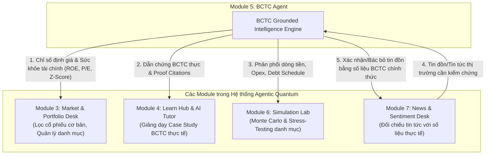

1. **Phối hợp với Module 3 (Market & Portfolio Desk)**:
   - Module 3 triệu hồi BCTC Agent để thực hiện lọc cổ phiếu chất lượng cao (High-Quality Screening): Loại bỏ ngay lập tức các mã có Beneish M-Score cảnh báo gian lận hoặc Altman Z-Score thuộc vùng kiệt quệ tài chính trước khi đưa vào danh mục theo dõi.
2. **Phối hợp với Module 4 (Learn Hub & AI Tutor)**:
   - AI Tutor sử dụng BCTC Agent để lấy các ví dụ BCTC thực tế của các doanh nghiệp đầu ngành tại Việt Nam (như FPT, VNM, HPG) làm bài tập phân tích tình huống (Case Studies) cho học viên, bảo đảm 100% số liệu bài học là số liệu kiểm toán thật có căn cứ trích dẫn.
3. **Phối hợp với Module 6 (Simulation Lab)**:
   - Simulation Lab nhận ma trận dòng tiền, lịch đáo hạn nợ vay và chi phí hoạt động cố định từ BCTC Agent để chạy mô phỏng ngẫu nhiên Monte Carlo (10,000 kịch bản biến động doanh thu và chi phí vốn) nhằm dự báo xác suất vỡ nợ của danh mục đầu tư.
4. **Phối hợp với Module 7 (News & Sentiment Desk)**:
   - Khi News Desk phát hiện tin tức hoặc tin đồn trên thị trường (ví dụ: "Doanh nghiệp X sắp vỡ nợ trái phiếu" hoặc "Doanh nghiệp Y biên lợi nhuận tăng kỷ lục"), News Desk kích hoạt BCTC Agent để đối chiếu ngay với thuyết minh nợ vay và số liệu doanh thu thực tế, đưa ra cảnh báo "Tin đồn sai sự thật so với BCTC đã công bố".

---

### 8.5 Tiêu chuẩn Đảm bảo An toàn, Grounding Gate & Non-Deterministic Containment

Mọi chức năng mở rộng trong Mục 8 bắt buộc phải tuân thủ nghiêm ngặt các rào chắn kỹ thuật (Invariants) sau:

1. **Nguyên tắc Bảo toàn Grounding (Grounded Numeric Invariant)**:
   - Mọi con số xuất hiện trong phân tích Forensic, Định giá, hay Đối sánh ngành bắt buộc phải bắt nguồn từ `NumericValue` có kèm `ProvenanceRef` hợp lệ.
   - LLM tuyệt đối **KHÔNG ĐƯỢC PHÉP** tự tính nhẩm các phép tính phức tạp (WACC, M-Score, DuPont). Tất cả phép tính số học phải được thực hiện bằng Python logic nội bộ trong các Domain Tools và được `NumericReviewer` phê duyệt độc lập trước khi gửi ra response.
2. **Nguyên tắc Cấm Khuyến nghị Đầu tư (Zero Buy/Sell Invariant)**:
   - Mặc dù cung cấp mô hình định giá nội tại (Fair Value), hệ thống tuyệt đối không xuất các từ ngữ mệnh lệnh giao dịch trực tiếp (`mua ngay`, `bán khống`, `tất tay`, `buy/sell recommendations`).
   - Mọi kết quả định giá phải được gắn kèm tuyên bố miễn trừ trách nhiệm (Disclaimer) và giới hạn phân tích (Limitations).
3. **Nguyên tắc Cách ly Đa Người Dùng (Zero Cross-Account Leakage)**:
   - Các BCTC riêng tư do người dùng tải lên (Private Uploads) chỉ được sử dụng cho tài khoản sở hữu. Không một chức năng phân tích đối sánh ngành (Peer Benchmark) nào được phép sử dụng BCTC riêng tư của Người dùng A để làm dữ liệu đối sánh cho Người dùng B trừ khi tài liệu đó được gắn cờ công khai rõ ràng.
4. **Nguyên tắc Chống Sập Quota (Deterministic Offline Fallback)**:
   - Mọi công cụ phân tích nâng cao phải ưu tiên sử dụng cache SQLite offline đã được chuẩn hóa. Tuyệt đối không để xảy ra tình trạng gọi lặp lại provider bên ngoài làm cạn kiệt hạn ngạch API hoặc làm treo hệ sinh thái.

---

## 9. PHỤ LỤC — LỆNH VERIFY

```bash
# Chạy test BCTC toàn diện
.venv/bin/pytest tests/test_bctc_*.py tests/test_telegram_bctc_handler.py -v

# Kiểm tra tính toàn vẹn của Tool Registry (đủ 6 tools)
.venv/bin/python -c "from risk_dashboard.modules.financials_product.agent_tools import get_bctc_tool_manifests; print(f'BCTC Tools: {len(get_bctc_tool_manifests())}')"

# Guard CI: Kiểm tra sạch hoàn toàn stub giả mạo 52618 trên toàn repository
grep -rn "52618" src/ || echo "CLEAN_NO_52618_IN_SRC"
grep -rn --exclude-dir=node_modules --exclude-dir=dist "52618" frontend/src || echo "CLEAN_NO_52618_IN_FRONTEND"

# Kiểm tra kiểm soát sở hữu và an toàn IDOR
.venv/bin/pytest tests/test_idor_matrix.py -v

# Kiểm tra hồi quy hệ thống
.venv/bin/pytest tests/test_agentic_graph.py tests/test_financial_analysis.py -v

# Kiểm tra schema SQLite BCTC
sqlite3 data/app_state.db ".schema bctc_evidence_memos"
sqlite3 data/app_state.db ".schema bctc_upload_ownership"

# Kiểm tra build frontend production
npm --prefix frontend run build
```

> **Lưu ý môi trường:** `python` không có trên PATH — dùng `.venv/bin/python`. Nếu output lệnh trông bị biến dạng, chạy qua `rtk proxy <cmd>`.

---

*Hết. Mọi `file:line` trong tài liệu này được verify trên branch `fix/audit-remediation-module5` ngày 2026-09-14. Tài liệu kết hợp đặc tả kỹ thuật v1 Core và lộ trình tính năng nâng cao Giai đoạn 2 cho Hệ thống Multi-Agent Quantum.*
