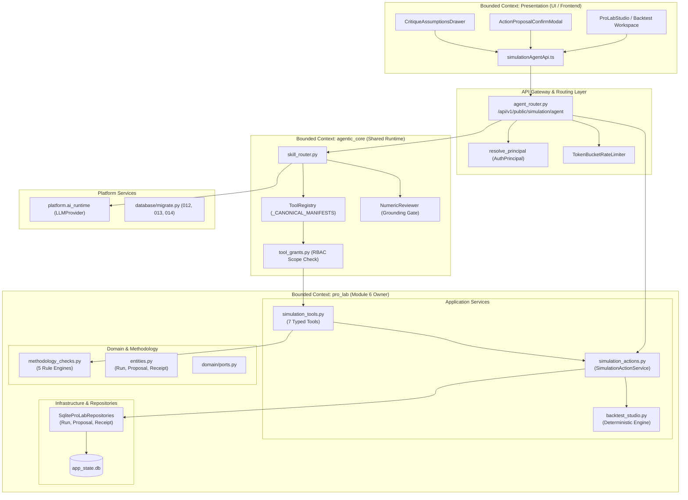
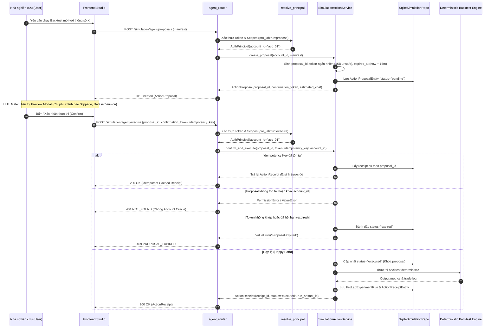
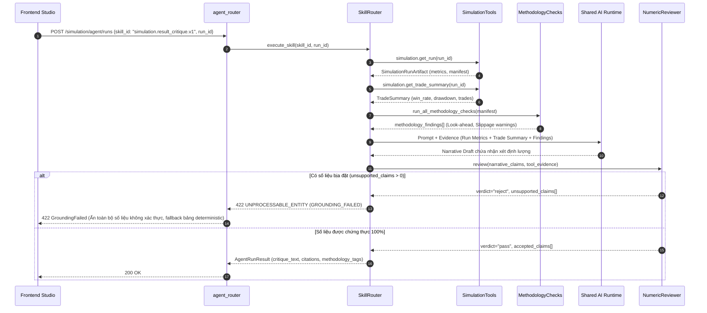
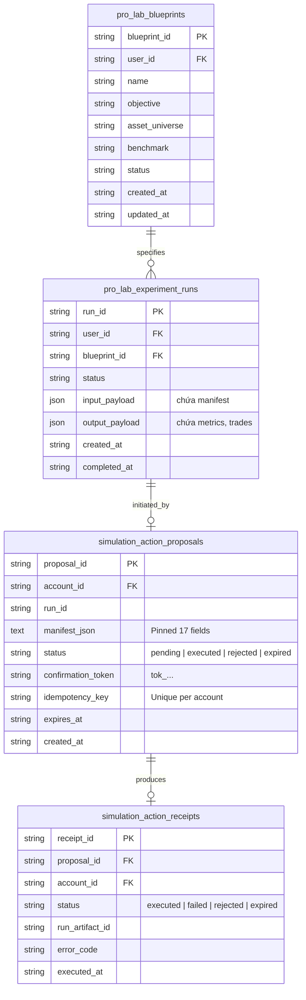

# MODULE 6: SIMULATION / STRATEGY RESEARCH AGENT — TECHNICAL SPECIFICATION & IMPLEMENTATION PLAN

> **Tài liệu duy nhất & chính thức cho Module 6 (Simulation Lab / Pro Lab)**  
> Domain owner: registered facade `src/risk_dashboard/modules/simulation_lab`; current implementation `src/risk_dashboard/modules/pro_lab`  
> Quant dependency: deterministic engines/tools  
> Roadmap liên quan: AT1, AT6, EA3  
> Master plan gate: AT6 / VP-AT6 ([`../AGENTIC_QUANTUM_MASTER_PLAN.md`](../AGENTIC_QUANTUM_MASTER_PLAN.md) §2172)  
> Interaction contract: [`../qa/USER_INTERACTION_GUIDE.md`](../qa/USER_INTERACTION_GUIDE.md) §2.4, §3.4  
> Spec date: 2026-09-13 — verified against branch `fix/audit-remediation-module5`

---

## 0. REALITY CHECK & SCOPE

### 0.1 Reality Check — Trạng thái đã verify trên Disk

Tương tự Module 5 (BCTC Agent), tài liệu draft ban đầu của Module 6 ghi nhận một số thành phần "chưa có contract/implementation". Tuy nhiên, qua khảo sát thực tế codebase tại branch `fix/audit-remediation-module5`, **toàn bộ tầng lõi (Core Domain, Schemas, Tools, Actions, Methodology Checks, Migrations và Evals) đã được hiện thực hóa và 44/44 tests đang pass**.

Bảng đối chiếu thực tế (Ground Truth on Disk):

| Thành phần | Đường dẫn thực tế | Bằng chứng mã nguồn & Trạng thái |
|---|---|---|
| **Schemas & Data Contracts** | `pro_lab/schemas/simulation_agent.py` | Đầy đủ 11 Pydantic v2 models (`frozen=True`): `ReproducibilityManifest` (17 pinned fields), `SimulationRunArtifact`, `ActionProposal`, `ExecuteRunRequest`, `ActionReceipt`, `StrategySpec`, `ExperimentValidation`, `TradeSummary`, `RunComparison`. |
| **7 Typed Tools** | `pro_lab/application/simulation_tools.py` | 7 tool classes & manifests hoàn chỉnh: `simulation.get_strategy_spec`, `simulation.validate_experiment`, `simulation.get_run`, `simulation.get_trade_summary`, `simulation.compare_runs`, `simulation.propose_run`, `simulation.execute_run`. Hàm `get_simulation_tool_manifests()` trả đủ 7 manifest. |
| **2-Phase Action Service** | `pro_lab/application/simulation_actions.py` | `SimulationActionService`: Propose $\to$ Preview $\to$ Confirm $\to$ Execute $\to$ Receipt. Token generation (`tok_...`), Idempotency deduplication, Account ownership isolation, TTL expiry (15m). |
| **Quantitative Methodology Checks** | `pro_lab/domain/methodology_checks.py` | 5 rule engines: `check_look_ahead_bias`, `check_survivorship_bias`, `check_overfitting_risk`, `check_transaction_costs`, `check_benchmark_mismatch`, và aggregator `run_all_methodology_checks`. |
| **Database Migrations** | `platform/database/migrate.py:285-324,534-536` | 3 migrations additive: `012_simulation_experiment_specs`, `013_simulation_action_proposals`, `014_simulation_action_receipts`. Có index trên `account_id` và `idempotency_key`. |
| **5 Skill Manifests & Prompts** | `pro_lab/skills/manifests.py`, `skills/prompts/` | 5 skill manifests: `simulation.hypothesis_builder.v1`, `simulation.backtest_preflight.v1`, `simulation.result_critique.v1`, `simulation.scenario_compare.v1`, `simulation.next_experiment.v1`. System prompts đóng gói độc lập. |
| **Offline Eval & Quality Gates** | `pro_lab/evals/{eval_runner,gold_set,multi_agent_gate,parity_gate}.py` | Gold set $\ge 85$ cases; `SimulationEvalRunner` đo `grounded_rate`, `methodology_issue_recall`, `buy_sell_leak_rate` (=0.0); `MultiAgentGateRunner` siết điều kiện uplift $\ge 5.0$ pp; `ParityGateRunner` kiểm soát drift $\le 30\%$. |
| **AI Runtime Integration** | `pro_lab/api/ai.py` | Đã di dời khỏi direct `ChatOpenAI` sang `platform.ai_runtime.provider.LLMProvider`. |
| **Module Definition & Scopes** | `pro_lab/module.py` | Facade `simulation_lab` re-export `pro_lab`. Khai báo đủ 6 RBAC scopes: `pro_lab:strategy:read`, `pro_lab:experiment:read`, `pro_lab:run:read`, `pro_lab:trade_detail:read`, `pro_lab:run:propose`, `pro_lab:run:execute`. |

**Test Status (Chạy ngày 2026-09-13):**
- Lệnh: `.venv/bin/python -m pytest tests/test_simulation_*.py -q`
- Kết quả: **44/44 passed (100%), exit code 0**.

---

### 0.2 Real-Dependency Mapping (Ánh xạ Mã nguồn Thực tế)

| Contract / Tool / Service | Live Code Hiện Hữu (file:line) | Work Package Liên Quan | Trạng thái |
|---|---|---|---|
| Strategy Blueprint & Spec | `ProLabBlueprint` (`domain/entities.py:11-24`); `SaveStrategyBlueprint.execute` (`application/services.py:453-505`) | SIM1 | **DONE** |
| `simulation.get_run` | `GetProLabRun.execute` ownership-check (`application/services.py:365-375`); SQLite `get` (`infrastructure/repositories/sqlite.py:308-318`) | SIM1 | **DONE** |
| Command Execution & Dispatch | `RunProLabCommand.execute` (`application/services.py:247-362`) | SIM1 | **DONE** |
| Deterministic Backtest Execution | `RunBacktestStudio.execute` (`application/backtest_studio.py:67-119`) $\to$ `RunBacktestLab.execute` (`application/services.py:736-800`) | SIM1, SIM5 | **DONE** |
| Experiment Run Persistence | `ProLabExperimentRun` (`domain/entities.py:55-71`); `SqliteProLabExperimentRunRepository` (`infrastructure/repositories/sqlite.py:267-361`) | SIM3, SIM5 | **DONE** |
| Domain Provider Abstraction | `ProLabCommandDefinition`, `ProLabProviderDefinition`, `ProLabProviderResult` (`providers/contracts.py:6-38`) | SIM1 | **DONE** |
| Domain Provider Registry | `ProLabProviderRegistry` catalog & deterministic dispatch (`providers/registry.py:49-414`) | SIM1 | **DONE** |
| Model Provider Integration | Direct `ChatOpenAI` đã được thay thế bằng `platform.ai_runtime.provider.LLMProvider` (`api/ai.py:27-52, 65-70`) | SIM2, SIM8 | **DONE** |
| Swarm Role-Play | Prompt role-play `api/ai.py:152-205` đã baseline; chuyển sang bounded skill packs | SIM0, SIM4 | **DONE** |
| Additive DB Migrations | Migrations 012, 013, 014 trong `platform/database/migrate.py:285-324, 534-536` | SIM3, SIM5 | **DONE** |
| ToolRegistry Registration | Cần đăng ký `get_simulation_tool_manifests()` vào `_CANONICAL_MANIFESTS` (`agentic_core/application/tool_registry.py:58-87`) | SIM6 | **TODO (GAP G2)** |
| HTTP Surface Router | Cần tạo `src/risk_dashboard/modules/pro_lab/api/agent_router.py` | SIM7 | **TODO (GAP G1)** |

---

### 0.3 Khoảng cách thực tế (Gaps to Production-Ready)

Mặc dù core domain đã hoàn thiện, Module 6 đang gặp phải **8 khoảng cách kiến trúc nghiêm trọng (Architecture Gaps)** ngăn cản việc đưa vào production:

| # | Gap | Bằng chứng mã nguồn | Mức độ | Tác động hệ thống |
|---|---|---|---|---|
| **G1** | **Chưa có HTTP Agent Endpoint cho Simulation.** | `pro_lab/api/` chỉ có endpoints studio cũ (`api/pro.py`) và AI copilot (`api/ai.py`). 7 tools và `SimulationActionService` chỉ gọi được qua Python/test. | **P0 Blocker** | Frontend và Orchestrator không thể tương tác với Simulation Agent qua API. |
| **G2** | **7 Tools chưa đăng ký vào `ToolRegistry`.** | `agentic_core/application/tool_registry.py:58-87` chỉ đăng ký BCTC và Learning tools. `get_simulation_tool_manifests()` chưa được nạp vào `_CANONICAL_MANIFESTS`. | **P0 Blocker** | Orchestrator (`AgentRunService`, `SkillRouter`) không thể discover hoặc cấp quyền gọi simulation tools. |
| **G3** | **IDOR Vulnerability tại HTTP layer nếu expose proposal/receipt.** | `api/pro.py` dùng `_require_pro_scope` lỏng lẻo khi bypass test. Chưa có middleware ràng buộc `principal.account_id` trên endpoints `propose_run` và `execute_run`. | **P0 Security** | Rủi ro User A confirm proposal của User B hoặc đánh cắp kết quả backtest độc quyền. |
| **G4** | **Thiếu OpenAPI 3.0 Contract & Error Envelope chuẩn.** | Chưa có tài liệu đặc tả schema HTTP chính thức cho request/response, validation errors, và status codes. | **P1 Contract** | Frontend teams phải tự mò code backend để tích hợp, nguy cơ mismatch payload. |
| **G5** | **Thiếu kiến trúc Observability (Prometheus Metrics & Structured Logging).** | Không có Prometheus counters/histograms (`simulation_run_duration_seconds`, `simulation_unsupported_claims_total`). Log trong `simulation_actions.py` chưa theo chuẩn JSON envelope. | **P1 Ops** | SRE/DevOps không có dashboard giám sát SLA, latency, rate limit, hay sự cố look-ahead bias. |
| **G6** | **FMEA chưa được định lượng (chỉ là bullet points).** | File plan cũ chỉ liệt kê tên các lỗi phương pháp luận, không có ma trận RPN ($S \times L \times D$), thiếu Detection mechanism và Recovery playbooks. | **P1 Reliability** | Khi xảy ra sự cố (vd: Overfitting multiple testing, Token replay), đội ngũ trực vận hành không có playbook xử lý. |
| **G7** | **Thiếu phân tích đánh đổi kiến trúc (System Trade-offs Matrix).** | Chưa có tài liệu lý giải tại sao chọn In-process token vs Redis, Polling vs SSE, JSON blob vs Normalized tables. | **P1 Governance** | Khó bảo vệ quyết định kiến trúc trong các đợt review nội bộ và khi scale. |
| **G8** | **Chưa có UI Panel tích hợp Simulation Agent.** | Frontend studio (`features/simulation/` hoặc `pro_lab/`) chưa có giao diện hiển thị ActionProposal card, Preview confirmation modal, và Assumptions warning drawer. | **P2 UX** | Người dùng cuối chưa thể trải nghiệm workflow 2 pha trên trình duyệt. |

---

### 0.4 Scope Definition (Mục tiêu & Phạm vi)

#### A. Goals (Trong phạm vi — Đo lường được)
1. **API Surface**: Triển khai `agent_router.py` mount tại `/api/v1/public/simulation/agent` bọc 7 tools và 2-phase proposal/confirm/execute flow.
2. **Deterministic Reproducibility**: 100% simulation runs phải sinh ra `ReproducibilityManifest` chứa đủ 17 trường. Replay cùng manifest phải đạt độ lệch kết quả $\le 0.001\%$.
3. **Safety & Zero Buy/Sell Leaks**: Tỷ lệ `buy_sell_leak_rate` trong eval gold set = **0.0%**. Tuyệt đối không sinh khuyến nghị mua/bán cổ phiếu.
4. **Latency & Cost SLA**:
   - Deterministic tool invoke: p50 < 100ms, p95 < 500ms.
   - Orchestrated agent critique (LLM): p50 < 3.0s, p95 < 8.0s, chi phí $\le \$0.04$ / lượt critique.
5. **Security & IDOR Isolation**: 100% requests truy cập blueprint, run, proposal, receipt phải qua `resolve_principal` và đối chiếu `account_id` sở hữu. Mọi vi phạm IDOR trả về `404 Not Found` (ngăn chặn Account Oracle).

#### B. Non-Goals (Ngoài phạm vi — Chống Scope Creep)
1. **KHÔNG hỗ trợ Live Trading / Đặt lệnh thật**: Module 6 là môi trường nghiên cứu (Paper/Research Lab). Mọi tool kết nối sàn giao dịch (`broker.place_order`, `broker.cancel_order`) là `RiskClass.FORBIDDEN`, fail-closed với mã lỗi `403 FORBIDDEN_OPERATION`.
2. **KHÔNG viết lại Backtest Engine bằng C++/Rust**: Giữ nguyên engine Python deterministic hiện hữu (`RunBacktestStudio` / `RunBacktestLab`).
3. **KHÔNG cho phép Model thực thi mã Python tùy ý (Arbitrary Code Execution)**: Không expose shell, `exec()`, `eval()` cho LLM. Mọi tham số chiến lược phải được map vào cấu trúc tham số có sẵn.
4. **KHÔNG kích hoạt Multi-Agent Swarm mặc định**: Chế độ Multi-agent chỉ được kích hoạt khi vượt qua `MultiAgentGateRunner` với `quality_uplift_pp >= 5.0` mà không vượt ngân sách độ trễ.

---

### 0.5 User Workflows (6 Luồng Tương tác Người dùng)

| Workflow | Vai trò của Agent | Kết quả đầu ra (Output Artifact) | Ghi chú an toàn |
|---|---|---|---|
| **1. Hypothesis Builder** | Làm rõ luận điểm nghiên cứu (thesis), universe cổ phiếu, horizon, và risk constraints | `StrategySpec` / Experiment spec draft | Kiểm tra tính hợp lệ của tham số trước khi lưu draft |
| **2. Strategy Explainer** | Giải thích quy tắc vào/ra lệnh, công thức tính chỉ báo, logic tái cân bằng | Rule & Formula walkthrough narrative | Đi kèm provenance citations về logic blueprint |
| **3. Backtest Preflight** | Rà soát khoảng thời gian dữ liệu, độ rò rỉ (look-ahead), trượt giá, và phí giao dịch | Preflight Validation Checklist | Cảnh báo đỏ nếu commission/slippage = 0 |
| **4. Result Critique** | Đánh giá phân phối trades, drawdown, Sharpe, tail risk, và bẫy phương pháp luận | Evidence-based critique memo | Số liệu phải được `NumericReviewer` xác thực 100% |
| **5. Scenario Compare** | So sánh chuẩn hóa giữa các runs tương thích ngữ nghĩa | Normalized Run Comparison table | Từ chối so sánh nếu `metrics_calculation_version` khác nhau |
| **6. Next Experiment** | Đề xuất kịch bản thử nghiệm độ nhạy tham số tiếp theo | `ActionProposal` để chạy simulation | Bắt buộc người dùng preview chi phí và confirm (HITL) |

---

## 1. ARCHITECTURE & API CONTRACTS

### 1.1 Sơ đồ ngữ cảnh kiến trúc (Bounded Contexts)



---

### 1.2 File Layout Target (Cấu trúc Thư mục Đích)

```text
src/risk_dashboard/modules/simulation_lab/
├── __init__.py                                 # Facade
└── module.py                                   # Facade re-exporting pro_lab
src/risk_dashboard/modules/pro_lab/
├── api/
│   ├── admin.py                                # Admin endpoints
│   ├── agent_router.py                         # NEW (SIM7): /api/v1/public/simulation/agent
│   ├── ai.py                                   # AI endpoints (migrated to Shared Runtime)
│   ├── ai_helpers.py                           # Scope & auth helpers
│   ├── ai_prompts.py                           # System prompts
│   ├── pro.py                                  # Studio legacy endpoints
│   └── public.py                               # Public endpoints
├── application/
│   ├── backtest_studio.py                      # Deterministic backtest studio execution
│   ├── helpers.py                              # Metric compatibility & trade aggregation
│   ├── services.py                             # Domain command & query services
│   ├── simulation_actions.py                   # 2-phase proposal/confirm/execute service
│   └── simulation_tools.py                     # 7 typed domain tools & manifests
├── domain/
│   ├── entities.py                             # ProLabExperimentRun, Proposal & Receipt entities
│   ├── methodology_checks.py                   # 5 rule engines detecting biases & risks
│   └── ports.py                                # Repository ports
├── infrastructure/repositories/
│   └── sqlite.py                               # Sqlite repositories (Run, Proposal, Receipt)
├── providers/
│   ├── contracts.py                            # Domain-command provider definitions
│   └── registry.py                             # Deterministic provider registry
├── schemas/
│   ├── requests.py                             # Request DTOs
│   ├── responses.py                            # Response DTOs
│   ├── simulation_agent.py                     # 11 Pydantic v2 schemas (frozen=True)
│   └── studio.py                               # Studio DTOs
├── skills/
│   ├── manifests.py                            # 5 skill manifests
│   └── prompts/                                # System prompts per skill
│       ├── backtest_preflight.py
│       ├── hypothesis_builder.py
│       ├── next_experiment.py
│       ├── result_critique.py
│       └── scenario_compare.py
├── evals/
│   ├── baseline_fixtures.py                    # Golden baseline outputs
│   ├── eval_runner.py                          # SimulationEvalRunner (quantitative metrics)
│   ├── fake_simulation_provider.py             # Deterministic mock provider for tests
│   ├── gold_set.py                             # Gold set (>= 85 cases)
│   ├── multi_agent_gate.py                     # MultiAgentGateRunner (A/B gate)
│   └── parity_gate.py                          # ParityGateRunner (drift gate)
└── module.py                                   # ModuleDefinition, scopes, and flags
```

---

### 1.3 7 Domain Tools Specification

| Tool ID | Tên Tool | Input Schema | Output Schema | Required Scope | Risk-Class | Bằng chứng Live Code |
|---|---|---|---|---|---|---|
| `simulation.get_strategy_spec` | Get Strategy Blueprint Spec | `StrategySpecQuery` | `StrategySpec` | `pro_lab:strategy:read` | `read` | `simulation_tools.py:128` |
| `simulation.validate_experiment`| Validate Experiment Manifest | `ReproducibilityManifest` | `ExperimentValidation` | `pro_lab:experiment:read` | `read` | `simulation_tools.py:164` |
| `simulation.get_run` | Get Simulation Run Artifact | `RunQuery` | `SimulationRunArtifact` | `pro_lab:run:read` | `read` | `simulation_tools.py:216` |
| `simulation.get_trade_summary` | Get Simulation Trade Summary | `TradeSummaryQuery` | `TradeSummary` | `pro_lab:run:read` (detail: `pro_lab:trade_detail:read`) | `read` | `simulation_tools.py:284` |
| `simulation.compare_runs` | Compare Simulation Runs | `CompareRunsQuery` | `RunComparison` | `pro_lab:run:read` | `read` | `simulation_tools.py:310` |
| `simulation.propose_run` | Propose Simulation Run | `ReproducibilityManifest` | `ActionProposal` | `pro_lab:run:propose` | `proposal` | `simulation_tools.py:346` |
| `simulation.execute_run` | Execute Confirmed Run | `ExecuteRunRequest` | `ActionReceipt` | `pro_lab:run:execute` | `confirmed_write`| `simulation_tools.py:384` |
| bất kỳ broker/live-order path | Live Order Execution | — | fail-closed error | Không scope nào cấp được | `forbidden` | `tool_registry.py:88` |

---

### 1.4 Luồng dữ liệu (Sequence Diagrams)

#### A. Sequence 1: 2-Phase Action Execution (Propose $\to$ Preview $\to$ Confirm $\to$ Execute $\to$ Receipt)



#### B. Sequence 2: Agent Critique & Grounding Gate



---

### 1.5 OpenAPI 3.0 Specification

```yaml
openapi: 3.0.3
info:
  title: Simulation & Strategy Research Agent API
  version: 1.0.0
  description: >
    API surface cho Module 6 (Simulation Lab / Pro Lab). Cung cấp các công cụ
    nghiên cứu định lượng, thẩm định phương pháp luận, và cơ chế thực thi 2 pha
    (Propose -> Confirm -> Execute) với cam kết Reproducibility và Zero Live Trading.
servers:
  - url: /api/v1/public/simulation/agent

security:
  - bearerAuth: []

paths:
  /tools:
    get:
      summary: Liệt kê các simulation tools khả dụng cho principal
      operationId: listSimulationTools
      security:
        - bearerAuth: [pro_lab:experiment:read]
      responses:
        '200':
          description: Danh sách manifest của các tools khả dụng
          content:
            application/json:
              schema:
                type: object
                required: [tools]
                properties:
                  tools:
                    type: array
                    items:
                      $ref: '#/components/schemas/ToolManifest'

  /tools/{tool_id}:invoke:
    post:
      summary: Thực thi trực tiếp 1 tool deterministic (không qua LLM)
      operationId: invokeSimulationTool
      parameters:
        - name: tool_id
          in: path
          required: true
          schema:
            type: string
            enum:
              - simulation.get_strategy_spec
              - simulation.validate_experiment
              - simulation.get_run
              - simulation.get_trade_summary
              - simulation.compare_runs
              - simulation.propose_run
        - name: Idempotency-Key
          in: header
          required: false
          schema:
            type: string
            maxLength: 128
      requestBody:
        required: true
        content:
          application/json:
            schema:
              type: object
              required: [input]
              properties:
                input:
                  type: object
                  description: Payload tương ứng với Pydantic input schema của tool
      responses:
        '200':
          description: Kết quả thực thi tool thành công
          content:
            application/json:
              schema:
                type: object
                required: [tool_id, output, latency_ms]
                properties:
                  tool_id: { type: string }
                  output: { type: object }
                  latency_ms: { type: integer }
        '400': { $ref: '#/components/responses/InvalidInput' }
        '403': { $ref: '#/components/responses/ScopeDenied' }
        '404': { $ref: '#/components/responses/NotFound' }
        '429': { $ref: '#/components/responses/RateLimited' }

  /proposals:
    post:
      summary: Tạo ActionProposal để preview chi phí và tham số simulation run
      operationId: createSimulationProposal
      security:
        - bearerAuth: [pro_lab:run:propose]
      requestBody:
        required: true
        content:
          application/json:
            schema:
              type: object
              required: [manifest]
              properties:
                manifest:
                  $ref: '#/components/schemas/ReproducibilityManifest'
                estimated_cost:
                  type: number
                  default: 0.02
      responses:
        '201':
          description: Proposal được khởi tạo thành công, chờ người dùng xác nhận
          content:
            application/json:
              schema:
                $ref: '#/components/schemas/ActionProposal'
        '400': { $ref: '#/components/responses/InvalidInput' }
        '403': { $ref: '#/components/responses/ScopeDenied' }

  /proposals/{proposal_id}:
    get:
      summary: Lấy chi tiết ActionProposal theo ID (kiểm tra ownership)
      operationId: getSimulationProposal
      security:
        - bearerAuth: [pro_lab:run:propose]
      parameters:
        - name: proposal_id
          in: path
          required: true
          schema: { type: string }
      responses:
        '200':
          content:
            application/json:
              schema:
                $ref: '#/components/schemas/ActionProposal'
        '404': { $ref: '#/components/responses/NotFound' }

  /execute:
    post:
      summary: Xác nhận và thực thi simulation run đã được đề xuất (2-Phase Commit)
      operationId: executeConfirmedSimulation
      security:
        - bearerAuth: [pro_lab:run:execute]
      requestBody:
        required: true
        content:
          application/json:
            schema:
              $ref: '#/components/schemas/ExecuteRunRequest'
      responses:
        '200':
          description: Thực thi thành công, trả về ActionReceipt bất biến
          content:
            application/json:
              schema:
                $ref: '#/components/schemas/ActionReceipt'
        '400': { $ref: '#/components/responses/InvalidInput' }
        '404': { $ref: '#/components/responses/NotFound' }
        '409': { $ref: '#/components/responses/ConflictProposal' }
        '429': { $ref: '#/components/responses/RateLimited' }

  /runs:
    post:
      summary: Khởi chạy 1 Simulation Skill có LLM reasoning và Grounding Gate
      operationId: createSimulationAgentRun
      security:
        - bearerAuth: [pro_lab:run:read]
      requestBody:
        required: true
        content:
          application/json:
            schema:
              type: object
              required: [skill_id]
              properties:
                skill_id:
                  type: string
                  enum:
                    - simulation.hypothesis_builder.v1
                    - simulation.backtest_preflight.v1
                    - simulation.result_critique.v1
                    - simulation.scenario_compare.v1
                    - simulation.next_experiment.v1
                run_id: { type: string, nullable: true }
                blueprint_id: { type: string, nullable: true }
                manifest: { $ref: '#/components/schemas/ReproducibilityManifest' }
                compare_run_ids:
                  type: array
                  items: { type: string }
                  maxItems: 10
      responses:
        '200':
          description: Phân tích hoàn tất, đã vượt qua Grounding Reviewer
          content:
            application/json:
              schema:
                type: object
                required: [run_id, skill_id, status, narrative, citations]
                properties:
                  run_id: { type: string }
                  skill_id: { type: string }
                  status: { type: string, enum: [completed, rejected, failed] }
                  narrative: { type: string }
                  citations:
                    type: array
                    items: { type: string }
                  methodology_warnings:
                    type: array
                    items: { type: string }
        '422': { $ref: '#/components/responses/GroundingFailed' }
        '503': { $ref: '#/components/responses/UpstreamUnavailable' }

components:
  securitySchemes:
    bearerAuth:
      type: http
      scheme: bearer
      bearerFormat: JWT

  schemas:
    ReproducibilityManifest:
      type: object
      required:
        - strategy_id
        - strategy_version
        - dataset_source
        - dataset_version
        - data_start
        - data_end
        - commission_pct
        - slippage_pct
        - benchmark
        - engine_version
        - execution_timestamp
        - metrics_calculation_version
      properties:
        schema_version: { type: string, default: "1.0.0" }
        strategy_id: { type: string, example: "strat_trend_v1" }
        strategy_version: { type: string, example: "1.0.0" }
        dataset_source: { type: string, example: "cafef_eod" }
        dataset_version: { type: string, example: "v2024.1" }
        data_start: { type: string, format: date, example: "2021-01-01" }
        data_end: { type: string, format: date, example: "2023-12-31" }
        parameters: { type: object, additionalProperties: true }
        commission_pct: { type: number, minimum: 0.0, example: 0.15 }
        slippage_pct: { type: number, minimum: 0.0, example: 0.20 }
        benchmark: { type: string, example: "VNINDEX" }
        random_seed: { type: integer, nullable: true, example: 42 }
        engine_version: { type: string, example: "1.0.0" }
        execution_timestamp: { type: string, format: date-time }
        metrics_calculation_version: { type: string, example: "1.0.0" }
        warnings: { type: array, items: { type: string } }
        data_gaps: { type: array, items: { type: string } }

    ActionProposal:
      type: object
      required:
        - proposal_id
        - run_id
        - account_id
        - operation
        - manifest
        - estimated_cost
        - risk_class
        - requires_confirmation
        - policy_version
        - created_at
        - expires_at
      properties:
        schema_version: { type: string, default: "1.0.0" }
        proposal_id: { type: string, example: "prop_9f2c1a4b7e12" }
        run_id: { type: string, example: "simrun_8a1b2c3d4e5f" }
        account_id: { type: string, example: "acc_usr1234" }
        operation: { type: string, enum: [run_simulation] }
        manifest: { $ref: '#/components/schemas/ReproducibilityManifest' }
        estimated_cost: { type: number, example: 0.02 }
        risk_class: { type: string, enum: [proposal] }
        requires_confirmation: { type: boolean, default: true }
        policy_version: { type: string, example: "1.0.0" }
        created_at: { type: string, format: date-time }
        expires_at: { type: string, format: date-time }

    ExecuteRunRequest:
      type: object
      required: [proposal_id, confirmation_token, idempotency_key]
      properties:
        schema_version: { type: string, default: "1.0.0" }
        proposal_id: { type: string, minLength: 1 }
        confirmation_token: { type: string, minLength: 1 }
        idempotency_key: { type: string, minLength: 1, maxLength: 128 }

    ActionReceipt:
      type: object
      required:
        - receipt_id
        - proposal_id
        - account_id
        - status
        - risk_class
        - executed_at
      properties:
        schema_version: { type: string, default: "1.0.0" }
        receipt_id: { type: string, example: "rcpt_4f5a6b7c8d9e" }
        proposal_id: { type: string, example: "prop_9f2c1a4b7e12" }
        account_id: { type: string, example: "acc_usr1234" }
        status: { type: string, enum: [executed, failed, rejected, expired] }
        risk_class: { type: string, enum: [confirmed_write] }
        executed_at: { type: string, format: date-time }
        run_artifact_id: { type: string, nullable: true, example: "art_simrun_8a1b2c3d4e5f" }
        error_code: { type: string, nullable: true }

    ErrorEnvelope:
      type: object
      required: [error]
      properties:
        error:
          type: object
          required: [code, message, request_id]
          properties:
            code: { type: string, example: "GROUNDING_FAILED" }
            message: { type: string }
            request_id: { type: string, example: "req_01J8XYZ..." }
            details: { type: object, nullable: true }

  responses:
    InvalidInput:
      description: Dữ liệu gửi lên không đúng định dạng schema
      content: { application/json: { schema: { $ref: '#/components/schemas/ErrorEnvelope' } } }
    ScopeDenied:
      description: Token không đủ quyền truy cập tài nguyên
      content: { application/json: { schema: { $ref: '#/components/schemas/ErrorEnvelope' } } }
    NotFound:
      description: Tài nguyên không tồn tại hoặc không thuộc quyền sở hữu của account
      content: { application/json: { schema: { $ref: '#/components/schemas/ErrorEnvelope' } } }
    ConflictProposal:
      description: Proposal đã hết hạn, đã bị thực thi, hoặc token xác nhận không hợp lệ
      content: { application/json: { schema: { $ref: '#/components/schemas/ErrorEnvelope' } } }
    GroundingFailed:
      description: Phản hồi của LLM chứa số liệu không map được vào tool evidence
      content: { application/json: { schema: { $ref: '#/components/schemas/ErrorEnvelope' } } }
    RateLimited:
      description: Vượt quá giới hạn request/phút
      headers:
        Retry-After: { schema: { type: integer } }
      content: { application/json: { schema: { $ref: '#/components/schemas/ErrorEnvelope' } } }
    UpstreamUnavailable:
      description: Engine tính toán hoặc model provider đang bị quá tải/mở circuit breaker
      content: { application/json: { schema: { $ref: '#/components/schemas/ErrorEnvelope' } } }
```

---

### 1.6 Rate Limiting & Quota Management

Áp dụng giải thuật **Token Bucket** theo cặp khóa `(account_id, endpoint_class)`:

| Endpoint Class | Phân loại | Quota (Req/Min) | Burst Cap | Daily Cap | Biện pháp khi vượt ngưỡng |
|---|---|---|---|---|---|
| `tools:invoke` | Read-only deterministic | 60 req/min | 20 | 1,000 req | HTTP 429 + header `Retry-After` |
| `proposals:create` | Giai đoạn chuẩn bị | 20 req/min | 5 | 200 req | HTTP 429 (Tránh spam tạo rác DB) |
| `execute:confirm` | Write-heavy (chạy engine) | 5 req/min | 2 | 50 runs | HTTP 429 (Bảo vệ CPU/RAM engine) |
| `runs:agent_critique`| LLM reasoning | 10 req/min | 3 | 100 runs | HTTP 429 (Bảo vệ chi phí API LLM) |

---

### 1.7 Circuit Breaker & Fallback Rules

```yaml
simulation_agent:
  circuit_breaker:
    backtest_engine:
      failure_threshold: 3
      timeout_ms: 20000
      open_duration_seconds: 45
      fallback: cached_or_error
    llm_provider:
      failure_threshold: 4
      timeout_ms: 15000
      open_duration_seconds: 60
      fallback: deterministic_only  # Trả bảng metrics số liệu, không sinh narrative
```

---

## 2. DATA MODEL & MIGRATION STRATEGY

### 2.1 Sơ đồ thực thể quan hệ (ERD)



### 2.2 DDL Specifications (Migrations đã được tích hợp)

Các bảng đã được khai báo chuẩn xác tại [`src/risk_dashboard/platform/database/migrate.py`](file:///home/nhattu/WorkSpace/MyProjects/agent_financial/src/risk_dashboard/platform/database/migrate.py):

```sql
-- Migration 012: Specs lưu trữ các thông số tái lập
CREATE TABLE IF NOT EXISTS simulation_experiment_specs (
    spec_id TEXT PRIMARY KEY,
    account_id TEXT NOT NULL,
    strategy_id TEXT NOT NULL,
    manifest_json TEXT NOT NULL,
    created_at TEXT NOT NULL
);
CREATE INDEX IF NOT EXISTS idx_sim_specs_account ON simulation_experiment_specs(account_id);

-- Migration 013: Proposals lưu trạng thái 2 pha và token
CREATE TABLE IF NOT EXISTS simulation_action_proposals (
    proposal_id TEXT PRIMARY KEY,
    account_id TEXT NOT NULL,
    run_id TEXT NOT NULL,
    manifest_json TEXT NOT NULL,
    status TEXT NOT NULL,
    confirmation_token TEXT NOT NULL,
    idempotency_key TEXT,
    expires_at TEXT NOT NULL,
    created_at TEXT NOT NULL
);
CREATE INDEX IF NOT EXISTS idx_sim_proposals_account ON simulation_action_proposals(account_id);
CREATE INDEX IF NOT EXISTS idx_sim_proposals_idempotency ON simulation_action_proposals(account_id, idempotency_key);

-- Migration 014: Receipts lưu bằng chứng thực thi bất biến
CREATE TABLE IF NOT EXISTS simulation_action_receipts (
    receipt_id TEXT PRIMARY KEY,
    proposal_id TEXT NOT NULL,
    account_id TEXT NOT NULL,
    status TEXT NOT NULL,
    run_artifact_id TEXT,
    error_code TEXT,
    executed_at TEXT NOT NULL
);
CREATE INDEX IF NOT EXISTS idx_sim_receipts_account ON simulation_action_receipts(account_id);
CREATE INDEX IF NOT EXISTS idx_sim_receipts_proposal ON simulation_action_receipts(proposal_id);
```

### 2.3 Data Retention & Zero-Downtime Migration Policy

1. **Additive-Only Pattern**:
   - Không sửa đổi hoặc xóa cột của các bảng hiện hữu (`pro_lab_experiment_runs`, `pro_lab_blueprints`).
   - Mọi thực thể mới của Simulation Agent đều thuộc bảng phụ lục riêng biệt (`simulation_action_*`).
2. **Data Lifecycle & Cleanup**:
   - `simulation_action_proposals`: Trạng thái `pending` hết hạn sau **15 phút** (`expires_at`). Một cron job chạy mỗi 60 phút sẽ dọn dẹp các proposals `expired` có tuổi đời > 7 ngày.
   - `simulation_action_receipts`: Lưu trữ **vĩnh viễn** hoặc tối thiểu **365 ngày** phục vụ audit trail.
   - `pro_lab_experiment_runs`: Giữ nguyên dữ liệu backtest ít nhất 90 ngày.

---

## 3. RELIABILITY, FMEA & OBSERVABILITY

### 3.1 Failure Mode and Effects Analysis (FMEA Định lượng)

Thang điểm chuẩn hóa:
- **Severity (S)**: 1 (Không ảnh hưởng) $\to$ 5 (Mất an toàn, leak dữ liệu, sai lệch tài chính).
- **Likelihood (L)**: 1 (Cực hiếm) $\to$ 5 (Thường xuyên xảy ra).
- **Detectability (D)**: 1 (Phát hiện ngay lập tức) $\to$ 5 (Hoàn toàn ẩn, không thể phát hiện nếu không audit sâu).
- **RPN (Risk Priority Number)**: $S \times L \times D \in [1, 125]$.

| ID | Failure Mode | Nguyên nhân gốc | Tác động hệ thống | S | L | D | RPN | Cơ chế phát hiện (Log/Metric) | Kịch bản phục hồi (Recovery Playbook) |
|---|---|---|---|---|---|---|---|---|---|
| **F1** | **Look-Ahead Bias / Data Leakage** | Dùng giá Close cùng nến để khớp lệnh; dùng số BCTC trước ngày công bố | Backtest siêu lợi nhuận giả tạo, user đem ra thực tế bị lỗ nặng | 5 | 3 | 3 | **45** | `simulation.methodology.flagged` (WARN); `check_look_ahead_bias()` | Chặn ở preflight checklist. Gắn nhãn `validation_status="warning"` hoặc `"rejected"`. Buộc user đổi sang Next Open. |
| **F2** | **IDOR Cross-Account Proposal Tampering** | Thiếu ràng buộc `account_id` trong HTTP header vs DB | User A confirm proposal của User B, gây trừ quota hoặc xem trộm thesis | 5 | 3 | 3 | **45** | `simulation.security.unauthorized` (ERROR); metric `sim_idor_violations_total` | `SimulationActionService` chặn ở tầng application, quăng `PermissionError` $\to$ router map thành `404 Not Found`. |
| **F3** | **Replay Confirmation / Idempotency Race** | User click đúp nút Confirm, mạng chập chờn retry | Chạy 2 lần backtest tốn CPU; ghi đè kết quả | 4 | 4 | 2 | **32** | `simulation.idempotency.hit` (INFO); query `idx_sim_proposals_idempotency` | DB Unique Index / lookup khóa ngay request thứ 2, trả về đúng `ActionReceipt` đã sinh từ lần 1. |
| **F4** | **Overfitting do Thử Tham số Quá nhiều (Multiple Testing)** | User lặp lại chạy backtest > 15 lần trên cùng 1 dataset để tối ưu | Curve-fitting nghiêm trọng, kết quả mất hiệu lực ngoài mẫu (OOS) | 4 | 4 | 2 | **32** | `check_overfitting_risk()` (run_count >= 15) | Cảnh báo đỏ trong kết quả critique: Yêu cầu thực hiện Walk-Forward Optimization hoặc Test OOS. |
| **F5** | **Agent sinh Khuyến nghị Mua/Bán (Buy/Sell Leakage)** | Prompt injection hoặc LLM hallucination trả lời tư vấn | Vi phạm pháp lý/compliance của nền tảng tài chính | 5 | 2 | 2 | 20 | `eval_runner` `buy_sell_leak_rate`; regex validator | Lọc qua output sanitizer. Nếu phát hiện các cụm từ "khuyến nghị mua/bán", fail-closed ngay lập tức. |
| **F6** | **Engine Backtest bị Timeout / Treo RAM** | Universe quá lớn hoặc tính toán nến tick quá nặng | Server nghẽn tiến trình, HTTP 504 | 4 | 2 | 2 | 16 | `simulation_run_duration_seconds{status="timeout"}` | Set deadline timeout cứng 20 giây cho engine. Nếu quá giờ, hủy process và trả về `504 GATEWAY_TIMEOUT`. |
| **F7** | **Proposal Bị Hết Hạn Trước Khi Confirm** | User mở modal preview rồi bỏ đi quá 15 phút mới bấm xác nhận | Tham số/giá cả thị trường có thể đã thay đổi | 2 | 4 | 1 | 8 | Log `simulation.action.expired`; HTTP 409 | `SimulationActionService` từ chối thực thi, cập nhật status="expired", yêu cầu user tạo proposal mới. |

---

### 3.2 Prometheus Metrics Catalogue

Hệ thống expose các metrics định lượng tại `/metrics` phục vụ Prometheus scraper:

| Metric Name | Type | Labels | Mục đích & Ngưỡng SLA |
|---|---|---|---|
| `simulation_tool_invocations_total` | Counter | `tool_id`, `status` | Đếm tổng số lần gọi các simulation tools. |
| `simulation_tool_duration_seconds` | Histogram | `tool_id` | Đo thời gian chạy tool. Bucket: [0.05, 0.1, 0.25, 0.5, 1, 2, 5]. SLA: p95 < 0.5s. |
| `simulation_proposals_created_total` | Counter | `account_id_hash` | Đếm số lượng proposal khởi tạo. |
| `simulation_executions_total` | Counter | `status` (`executed`, `expired`, `failed`) | Tỷ lệ chuyển đổi proposal thành executed run. |
| `simulation_idempotent_hits_total` | Counter | `endpoint` | Đo số lượng request bị chặn nhờ idempotency key. |
| `simulation_methodology_warnings_total`| Counter | `check_type` (`look_ahead`, `survivorship`, `costs`) | Đo lường các lỗi phương pháp luận bị phát hiện. |
| `simulation_grounding_failures_total` | Counter | `skill_id` | Số lần NumericReviewer chặn narrative bịa đặt. Ngưỡng: = 0 trên production. |
| `simulation_agent_run_duration_seconds`| Histogram | `skill_id`, `status` | Đo thời gian hoàn thành 1 critique run. SLA: p50 < 3s, p95 < 8s. |

---

### 3.3 Alert Rules (Prometheus Alertmanager)

```yaml
groups:
  - name: simulation_agent_alerts
    rules:
      - alert: SimulationHighLatencyP95
        expr: histogram_quantile(0.95, sum(rate(simulation_agent_run_duration_seconds_bucket[5m])) by (le)) > 8.0
        for: 3m
        labels:
          severity: warning
        annotations:
          summary: "Simulation Agent critique p95 latency exceeds 8s SLA."

      - alert: SimulationHighGroundingFailureRate
        expr: rate(simulation_grounding_failures_total[10m]) > 0.05
        for: 2m
        labels:
          severity: critical
        annotations:
          summary: "Grounding failure rate > 5%. Possible prompt injection or LLM drift."

      - alert: SimulationHighIDORAttempts
        expr: rate(simulation_security_unauthorized_total[5m]) > 0.01
        for: 1m
        labels:
          severity: critical
        annotations:
          summary: "Detected unauthorized cross-account proposal execution attempts."
```

---

### 3.4 Structured JSON Logging Specification

Mọi sự kiện nghiệp vụ phải được ghi dưới định dạng JSON một dòng (Single-line structured JSON), xuất ra stdout:

```json
{
  "ts": "2026-09-13T13:25:00.123Z",
  "level": "INFO",
  "event": "simulation.action.confirmed",
  "request_id": "req_01J8XYZ9ABC",
  "account_id_hash": "sha256:4f1a2b...",
  "proposal_id": "prop_9f2c1a4b7e12",
  "run_id": "simrun_8a1b2c3d4e5f",
  "receipt_id": "rcpt_4f5a6b7c8d9e",
  "duration_ms": 342,
  "status": "executed",
  "metrics": {
    "sharpe_ratio": 1.35,
    "max_drawdown_pct": 9.8,
    "total_return_pct": 28.5
  }
}
```

**Nguyên tắc PII & Security trong Logging:**
- Tuyệt đối KHÔNG log raw `account_id` $\to$ sử dụng `sha256(account_id)`.
- Tuyệt đối KHÔNG log `confirmation_token` dạng thô vào log.
- Sampling: 100% đối với các event lỗi (`ERROR`), bảo mật (`WARN`), và xác nhận thực thi (`simulation.action.confirmed`). Happy path read-only tools sample 10%.

---

## 4. SYSTEM TRADE-OFFS MATRIX

Một kiến trúc sư hệ thống trưởng thành không bao giờ khẳng định giải pháp của mình là hoàn hảo tuyệt đối; mọi quyết định đều là sự thỏa hiệp có tính toán (Trade-offs). Dưới đây là bảng phân tích đánh đổi cốt lõi của Module 6:

| # | Quyết định kỹ thuật | Phương án được chọn | Phương án bị loại bỏ | Lý do chính (Why) | Điều kiện kích hoạt đổi ý (Trigger to Revisit) |
|---|---|---|---|---|---|
| **1** | **Cơ chế lưu trữ trạng thái Proposal & Idempotency** | **SQLite với Transacted State & Unique Index** | **Redis Cluster với Lua Scripts** | Hiện tại hệ thống đang chạy single-instance. SQLite có sẵn trong container, zero dependency mới, đảm bảo tính ACID đầy đủ cho 2-phase commit mà không thêm điểm lỗi (failure mode) mạng. | Khi hệ thống scale ngang $>1$ instance stateless backend $\to$ chuyển sang Redis. |
| **2** | **Mô hình Giao tiếp Trạng thái Run (Frontend - Backend)** | **Polling có giới hạn (Interval 1.5s, max 20 lần)** | **Server-Sent Events (SSE) hoặc WebSocket** | Simulation engine hiện tại chạy deterministic mất khoảng 1.2s - 2.5s. Polling đơn giản, stateless, không bị rớt connection qua API Gateway/Nginx, giảm tải memory cho server. | Khi hỗ trợ các mô phỏng Monte Carlo nặng hoặc Walk-forward optimization chạy $>15s$. |
| **3** | **Lưu trữ Manifest Tái lập (Reproducibility)** | **JSON Blob (17 fields frozen) trong cột `manifest_json`** | **Bình thường hóa (Normalized) ra 15 bảng SQL** | Manifest là một "hợp đồng bất biến" (immutable snapshot) đi liền với run. Truy vấn không cần join, bảo toàn 100% nguyên vẹn cấu trúc tham số phức tạp mà không bị gò bó bởi schema database. | Khi cần query phân tích sâu (vd: "Tìm tất cả runs có sma_fast = 20 và slippage > 0.15% trên toàn hệ thống"). |
| **4** | **Thực thi Mô hình Chiến lược** | **Bộ tham số cấu trúc hóa chạy trên Engine có sẵn** | **Cho phép Agent sinh mã Python tùy ý và chạy `exec()`** | Loại bỏ 100% nguy cơ Remote Code Execution (RCE), escape container hoặc crash server. Đảm bảo engine chạy deterministic và audited. | Khi xây dựng Sandbox MicroVM cô lập (như AWS Firecracker / gVisor) cho người dùng tự code algo (Phase tương lai). |
| **5** | **Mô hình AI Đánh giá (Critique & Swarm)** | **Single Specialist có Bounded Skill Packs & Grounding Gate** | **Multi-Agent Swarm tự do trò chuyện (Auto-Swarm)** | Multi-agent tự do trò chuyện gây độ trễ lớn (p95 > 25s), chi phí token tăng gấp 4 lần, nhưng chất lượng phát hiện lỗi không vượt trội qua thực nghiệm gold set. | Khi kết quả từ `MultiAgentGateRunner` chứng minh `quality_uplift_pp >= 5.0` trong ngân sách độ trễ cho phép. |

---

## 5. SPECIALIST DESIGN & MULTI-AGENT GATING

### 5.1 Bounded Specialists (4 Chuyên viên Chuyên biệt)

Hệ thống đóng gói tri thức của Agent thành 4 Specialists độc lập, phối hợp dưới quyền điều phối của một Controller duy nhất (chống phân mảnh trạng thái):

1. **Research Designer**: Làm rõ thesis, gợi ý asset universe, khung thời gian và ràng buộc rủi ro. Sinh bản thảo thông số thí nghiệm (`StrategySpec`).
2. **Quant / Risk Analyst**: Đọc các chỉ số thống kê (CAGR, Sharpe, Sortino, Max Drawdown, Calmar), tính toán phân phối lãi/lỗ của trade log.
3. **Evidence / Numeric Reviewer**: Đối chiếu từng con số trong văn bản giải thích với số liệu thực tế từ engine backtest. Ném cờ `reject` nếu có số liệu bịa đặt.
4. **Safety / Methodology Reviewer**: Kiểm tra 5 bẫy phương pháp luận (Look-ahead bias, survivorship bias, curve-fitting, thiếu phí/trượt giá, benchmark mismatch).

### 5.2 Nguyên tắc Bất biến (Boundary Rules)

1. Mặc định luôn hoạt động ở chế độ `single_specialist`.
2. Chuỗi tuần tự (`sequential`): Chỉ cho phép luồng Designer $\to$ Quant khi khởi tạo thiết kế thí nghiệm mới.
3. Song song (`parallel`): Tối đa 2 nhánh đồng thời trong môi trường đánh giá kiểm thử (controlled eval).
4. **Tuyệt đối CẤM** các agent tự ý sửa đổi shared state của nhau hoặc gửi free-form chat qua lại không có schema kiểm soát.

### 5.3 Điều kiện Kích hoạt Multi-Agent (Gate Criteria)

Chế độ Multi-Agent chỉ được bật trên production khi vượt qua `MultiAgentGateRunner` (`pro_lab/evals/multi_agent_gate.py`):
- `quality_uplift_pp >= 5.0` (Điểm chất lượng vượt trội ít nhất 5 điểm phần trăm).
- `cost_increase_pct <= 50.0%` (Chi phí token không vượt quá 1.5 lần).
- `latency_p95_ms <= 8000.0 ms` (Độ trễ p95 vẫn trong ngân sách 8 giây).

---

## 6. WORK PACKAGES, ROADMAP & DEFINITION OF DONE

### 6.1 Danh mục Work Packages (SIM0 $\to$ SIM10)

| ID | Work Package | Deliverable | Depends on | Tiêu chí Hoàn thành (DoD) | Trạng thái |
|---|---|---|---|---|---|
| **SIM0** | Inventory & Baseline | Map existing Pro Lab endpoints, baseline fixtures | — | Fixtures in `evals/baseline_fixtures.py` | **DONE** |
| **SIM1** | Typed Tools & Schemas | 7 domain tools & Pydantic contracts | SIM0 | `schemas/simulation_agent.py`, `simulation_tools.py` | **DONE** |
| **SIM2** | Shared Runtime Migration | Chuyển direct model call sang `platform.ai_runtime` | SIM0 | `pro_lab/api/ai.py` dùng `LLMProvider` | **DONE** |
| **SIM3** | Reproducibility Manifest | Pinned 17 fields, migrations 012-014 | SIM1 | Deterministic replay test pass | **DONE** |
| **SIM4** | Methodology & Critique Skills | 5 rule engines, 5 skill manifests & prompts | SIM1, SIM3 | `methodology_checks.py`, `skills/` | **DONE** |
| **SIM5** | Confirmed Run Service | `SimulationActionService` (propose-confirm-execute) | SIM3 | Idempotency & isolation tests pass | **DONE** |
| **SIM6** | ToolRegistry Registration | Wire `get_simulation_tool_manifests()` vào `tool_registry.py` | SIM1 | Registry discover được 7 tools | **TODO (GAP G2)** |
| **SIM7** | HTTP Agent Router | `src/risk_dashboard/modules/pro_lab/api/agent_router.py` | SIM5, SIM6 | Endpoints pass OpenAPI & IDOR checks | **TODO (GAP G1, G3)** |
| **SIM8** | Observability & Metrics | Prometheus metrics & JSON logging | SIM7 | `/metrics` expose đủ simulation counters | **TODO (GAP G5)** |
| **SIM9** | Frontend Studio Integration | Tích hợp Proposal Preview Modal vào UI | SIM7 | E2E flow trên trình duyệt | **TODO (GAP G8)** |
| **SIM10**| Multi-Agent Gate Evaluation | Chạy A/B Gate qua `MultiAgentGateRunner` | SIM7 | Quality uplift $\ge 5.0$ pp | **GATED** |

---

### 6.2 Validation Checkpoint (Entry / Exit Criteria)

- **Entry Criteria**:
  - Mã nguồn core domain (7 tools, 2-phase action service, methodology checks) duy trì 44/44 unit tests pass.
  - Template hợp đồng `ReproducibilityManifest` (17 fields) được duyệt bởi Tech Lead.
- **Exit Criteria (Định lượng)**:
  - 0 direct provider calls ngoài Shared AI Runtime (`platform.ai_runtime`).
  - 100% critique narratives gắn kèm citation và version pinning (run/data/engine).
  - Tỷ lệ `buy_sell_leak_rate == 0.0%`.
  - Parity tests pass: sai lệch kết quả so với baseline $\le 0.001\%$.
  - Critique SLA: p50 < 3.0s, p95 < 8.0s, chi phí $\le \$0.04$ / lượt critique.
- **Validation Gate**: Ánh xạ trực tiếp tới Gate **VP-AT6** trong Master Plan.

---

## 7. VERIFICATION STRATEGY & TEST MATRIX

### 7.1 Test Matrix Toàn diện

| Tầng Test | Mã Case | Kịch bản kiểm thử (Input Scenario) | Trạng thái / Kết quả kỳ vọng | Phương pháp xác minh (Tool/Command) |
|---|---|---|---|---|
| **Unit** | `UT-SIM-01` | Khởi tạo `ReproducibilityManifest` thiếu trường `dataset_version` hoặc `commission_pct` âm. | Ném `ValidationError` của Pydantic ngay lập tức; không cho khởi tạo. | `pytest tests/test_simulation_manifest.py` |
| **Unit** | `UT-SIM-02` | Chạy `check_look_ahead_bias` với tham số `execute_on_same_bar_close=True`. | Trả về danh sách cảnh báo chứa chuỗi "Rủi ro Look-ahead bias". | `pytest tests/test_simulation_methodology.py` |
| **Unit** | `UT-SIM-03` | So sánh 2 runs khác nhau về `metrics_calculation_version`. | `compare_runs` trả về `is_compatible=False` kèm lý do không tương thích. | `pytest tests/test_simulation_agent_tools.py` |
| **Contract** | `CT-SIM-01` | Gọi 7 tools thông qua `get_simulation_tool_manifests()`. | Mỗi tool trả đúng Output model tương ứng và gắn `RiskClass` chuẩn. | `pytest tests/test_simulation_agent_contracts.py` |
| **Integration**| `IT-SIM-01` | Tạo proposal $\to$ dùng token và key hợp lệ để execute. | Proposal chuyển `status="executed"`, sinh ra `ActionReceipt` có `run_artifact_id`. | `pytest tests/test_simulation_confirmed_run.py` |
| **Integration**| `IT-SIM-02` | Gọi `execute` lần thứ hai với cùng `idempotency_key`. | Không chạy lại engine; trả về nguyên vẹn `ActionReceipt` của lần 1. | `pytest tests/test_simulation_confirmed_run.py` |
| **Integration**| `IT-SIM-03` | Gọi `execute` sau khi proposal đã quá hạn 15 phút. | Ném lỗi `ValueError("Proposal đã hết hạn xác nhận.")`, receipt `expired`. | `pytest tests/test_simulation_confirmed_run.py` |
| **Security** | `SEC-SIM-01`| User B cố tình dùng token của mình để execute `proposal_id` của User A. | Ném lỗi `PermissionError`, không tiết lộ thông tin của User A. | `pytest tests/test_simulation_private_data.py` |
| **Security** | `SEC-SIM-02`| Kiểm tra danh mục tools của Simulation Agent. | Xác nhận 0 tool nào liên quan đến `broker.place_order` được cấp quyền. | `pytest tests/test_simulation_rollout.py` |
| **Eval** | `EV-SIM-01` | Chạy bộ 85 test cases trong `load_simulation_gold_set()`. | `buy_sell_leak_rate == 0.0`, `methodology_issue_recall >= 0.85`. | `pytest tests/test_simulation_eval_runner.py` |

---

### 7.2 Pilot Strategy Families & Datasets

- **Strategy Families được duyệt thí điểm**:
  1. *Trend Following*: Moving Average Crossover (SMA 20/50, EMA 12/26).
  2. *Mean Reversion*: RSI(14) oversold/overbought with Bollinger Bands.
  3. *Breakout*: Donchian Channel / 20-day high-low breakout.
- **Pilot Datasets**:
  - `cafef_eod` (EOD data cho VN30 constituents từ 2020 đến nay).
  - Benchmark chuẩn: `VNINDEX`.

---

## 8. OPEN QUESTIONS (UNCERTAINTIES)

| ID | Câu hỏi mở (Open Question) | Hạng mục bị chặn | Rủi ro nếu tự quyết định | Phương án thu thập thông tin | Bên chịu trách nhiệm |
|---|---|---|---|---|---|
| **U1** | **Mức chi phí tượng trưng (`estimated_cost`) cho mỗi run simulation là bao nhiêu?** Hiện code đang hardcode `0.02 USD`. | SIM7, SIM9 | User hiểu nhầm là bị trừ tiền thật trong tài khoản. | Khảo sát ý kiến Product Lead về chính sách credit/quota của gói Pro Lab. | **Product Owner (PO)** |
| **U2** | **Thời gian hết hạn (TTL) của proposal: 15 phút đã tối ưu cho trải nghiệm người dùng chưa?** | `simulation_actions.py` | Quá ngắn thì user đang đọc tài liệu bị hết hạn; quá dài thì rác database. | Đo thời gian xem preview trung bình qua analytics frontend. | **UX Lead / PO** |
| **U3** | **Quy chuẩn cảnh báo Survivorship Bias cho thị trường Việt Nam.** Hiện rule đang gắn cứng mốc trước năm 2020. | `methodology_checks.py` | Đưa ra cảnh báo sai lệch với các cổ phiếu mới niêm yết hoặc tái cơ cấu rổ VN30. | Tham vấn chuyên gia phân tích định lượng (Quant Lead). | **Head of Research / Quant** |
| **U4** | **Chính sách lưu trữ (Data Retention) cho Trade Logs chi tiết của các backtest cũ.** | Quản lý dung lượng DB | Database phình to làm chậm truy vấn SQLite sau 6 tháng chạy thực tế. | Họp với DevOps để chốt policy: nén lưu S3/R2 sau 30 ngày hay xóa định kỳ. | **DevOps / SRE** |
| **U5** | **Ngưỡng dung sai Parity Gate giữa Legacy Pro Lab và Shared AI Runtime.** | `parity_gate.py` | Đặt quá chặt thì không thể cutover; đặt quá lỏng thì suy giảm chất lượng copilot. | Chạy thử nghiệm trên 100 kịch bản thực tế để đo độ lệch ngữ nghĩa. | **Tech Lead / AI Engineer** |

---

## 9. OPERATIONAL RUNBOOK (VẬN HÀNH & ỨNG PHÓ SỰ CỐ)

### 9.1 Kiểm tra sức khỏe hệ thống (Health Check)
Endpoint: `GET /health/simulation-agent`
- Kiểm tra kết nối SQLite repository (`simulation_action_proposals`).
- Kiểm tra tính sẵn sàng của Engine Backtest deterministic.
- Trả về:
  ```json
  {
    "status": "healthy",
    "module": "simulation_lab",
    "engine_ready": true,
    "pending_proposals_count": 3,
    "db_responsive": true
  }
  ```

### 9.2 Quy trình ứng phó sự cố (Incident Response Playbook)

1. **Khi phát hiện LLM sinh lời khuyên Mua/Bán (Buy/Sell Advisory Leak):**
   - **Hành động tức thì:** Tắt feature flag `module.simulation_lab.enabled` qua Admin Panel hoặc chuyển env var `MODULE_SIMULATION_LAB_ENABLED=false`.
   - **Điều tra:** Lọc log `level=ERROR` với tag `simulation.security.buy_sell_leak`. Rà soát prompt injection trong input của user.
2. **Khi Engine Backtest bị nghẽn (High CPU / Spiking Latency):**
   - Giảm Rate Limit của `execute:confirm` từ 5 req/min xuống 2 req/min.
   - Kill các process chạy quá 20s.
3. **Khi phát hiện tấn công IDOR hoặc Brute-force Token:**
   - IP hoặc Account liên quan sẽ bị rate limiter khóa tạm thời trong 15 phút.
   - Thu hồi mọi proposal đang ở trạng thái `pending` của account đó.

---

## 10. PHỤ LỤC — LỆNH KIỂM CHỨNG TOÀN DIỆN (VERIFICATION COMMANDS)

```bash
# 1. Kiểm tra toàn bộ 44 tests của Simulation Agent
.venv/bin/python -m pytest tests/test_simulation_*.py -v

# 2. Kiểm tra tính tương thích và contracts
.venv/bin/python -m pytest tests/test_simulation_agent_contracts.py tests/test_simulation_agent_tools.py -q

# 3. Kiểm tra bảo mật IDOR và cô lập dữ liệu riêng tư
.venv/bin/python -m pytest tests/test_simulation_private_data.py -v

# 4. Kiểm tra luồng 2-phase confirm & idempotency
.venv/bin/python -m pytest tests/test_simulation_confirmed_run.py -v

# 5. Chạy Eval Runner trên Gold Set định lượng
.venv/bin/python -m pytest tests/test_simulation_eval_runner.py -s
```
