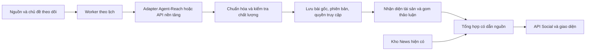

# Social Intelligence — nghiên cứu tích hợp Agent-Reach

Ngày: 02/11/2026. **Bản nghiên cứu lịch sử; S0/S1 và S2 mức trích đoạn đã triển khai sau khi người dùng đồng ý.** Xem [phạm vi hiện hành](../SOCIAL.md) và [QA](../../qa/results/SOCIAL_IMPLEMENTATION_2026_11_02.md). Các đoạn “chưa triển khai/live” bên dưới mô tả thời điểm nghiên cứu, không phải trạng thái mã nguồn sau triển khai. S3/S4 và các khả năng AI/ngữ nghĩa nâng cao còn là đề xuất có điều kiện.

Yêu cầu đã chốt: tổng hợp thông tin Social thành khu vực riêng, **kết hợp Việt Nam và quốc tế**. Các nguồn, ngưỡng và cách xếp hạng bên dưới là đề xuất triển khai, chưa phải tính năng đang hoạt động.

## 1. Sản phẩm đề xuất

Thêm mục **Social** cạnh Tin tức, dùng route dự kiến `/dashboard-static/news/social`. Người dùng theo dõi các cuộc thảo luận, quan điểm phân tích và video liên quan đến tài sản; mở được bài gốc và thấy căn cứ cho từng bản tổng hợp.

| Thành phần | Hành vi |
| --- | --- |
| Phạm vi | Tất cả / Việt Nam / Quốc tế / Đang theo dõi; giữ phạm vi trong URL |
| Bộ lọc gọn | Mã tài sản hoặc chủ đề, nền tảng, 24 giờ / 7 ngày, ngôn ngữ |
| Dòng thảo luận | Một hàng cho mỗi chủ đề; số bài gốc, tác giả, nguồn và thời điểm dữ liệu |
| Bản tổng hợp | Nội dung đang được bàn luận, các quan điểm khác nhau, điểm còn thiếu căn cứ, liên kết nguồn |
| Chi tiết | Tác giả, nền tảng, văn bản gốc, bản dịch riêng, bài liên quan; video có trạng thái phụ đề |
| Liên hệ News | “Đối chiếu với tin tức” mở các bài báo liên quan, không tự biến ý kiến thành dữ kiện |
| Cá nhân | Theo dõi tài sản/chủ đề/kênh, lưu bài, ẩn nguồn; đồng bộ theo tài khoản |
| Trạng thái nguồn | Cập nhật cuối, dữ liệu thiếu, cần kết nối, nguồn tạm lỗi; không tạo bài mẫu để lấp chỗ trống |

Desktop dùng dòng thảo luận và khung chi tiết; mobile chuyển giữa hai vùng. Thanh điều khiển gọn; không thêm banner hoặc hàng thống kê lớn trước nội dung. Bản tổng hợp mặc định bằng tiếng Việt, có nút xem nguyên văn. Quốc gia của tác giả, ngôn ngữ và thị trường được nhắc đến là ba thuộc tính độc lập.

Ví dụ cấu trúc, không phải dữ liệu thật: chủ đề “Lãi suất và cổ phiếu ngân hàng” gồm vài luận điểm có dẫn bài nguồn, mã liên quan đã xác định, quan điểm trái chiều và các thông báo chính thức để đối chiếu. Không sinh con số tương tác hoặc kết luận đầu tư giả.

## 2. Agent-Reach làm được gì qua source hiện tại

Đã đọc nhánh `main` trực tiếp ngày 02/11/2026; chưa xác định được commit SHA. Khi triển khai phải khóa commit/release và phiên bản công cụ phụ thuộc, chạy lại kiểm tra hợp đồng dữ liệu. Nội dung quảng bá hoặc tài trợ trong README không được xem là khả năng của connector.

| Nguồn | Phạm vi hữu ích | Bằng chứng và giới hạn | Ưu tiên |
| --- | --- | --- | --- |
| YouTube | Kênh phân tích Việt Nam; vĩ mô, cổ phiếu, crypto quốc tế | Có search/read/subtitle/transcribe. Search có thể thiếu ngày đăng; cần read để bổ sung. Phụ đề mặc định ưu tiên zh/en, cần chọn vi/en. Chuyển âm thanh thành chữ cần provider | Đợt 1 |
| Reddit | Cộng đồng cổ phiếu Mỹ, kinh tế, crypto | Có search/read/subreddit. Kênh optional; khả năng đọc công khai và browser có đăng nhập khác nhau. Kết quả read có thể ghép bình luận vào text | Đợt 1, sau probe |
| X | Tài khoản tổ chức, nhà phân tích và cuộc thảo luận thị trường | Có search/profile/tweets/thread; experimental, một số đường truy cập cần phiên đăng nhập | Đợt 2 |
| Facebook | Nguồn cộng đồng Việt Nam được người dùng lựa chọn | Source chỉ khai báo action search/profile; chưa có action đọc permalink, ảnh, feed nhóm. Dòng usage có nhắc groups không chứng minh action đó đã được expose | Thử nghiệm riêng |
| Xueqiu / Bilibili | Trung Quốc và tác động tới thị trường quốc tế | Có trong danh sách nền tảng của dự án; chưa rà soát sâu adapter hoặc chạy live trong lượt này | Sau khi có nhu cầu |

Nguồn: [danh mục chính thức](https://github.com/Panniantong/Agent-Reach/blob/main/docs/README_en.md#supported-platforms), [YouTube adapter](https://github.com/Panniantong/Agent-Reach/blob/main/agent_reach/channels/youtube.py), [Reddit adapter](https://github.com/Panniantong/Agent-Reach/blob/main/agent_reach/channels/reddit.py), [X adapter](https://github.com/Panniantong/Agent-Reach/blob/main/agent_reach/channels/twitter.py), [Facebook adapter](https://github.com/Panniantong/Agent-Reach/blob/main/agent_reach/channels/facebook.py).

**Kết luận tích hợp:** dùng Agent-Reach như một adapter thu thập có thể thay thế. Ứng dụng tự quản lý danh mục nguồn, lịch chạy, lưu trữ, gom chủ đề, phân quyền và bản tổng hợp. Với kênh YouTube đã biết, cân nhắc collector theo playlist qua [YouTube Data API](https://developers.google.com/youtube/data/reference/rest/v3/playlistItems/list), hỗ trợ phân trang, rồi dùng Agent-Reach đọc nội dung/phụ đề. Kết quả search giới hạn chỉ phục vụ khám phá; không đại diện tổng số bài mới.

Lưu ý nội dung video: adapter hiện chuyển VTT thành văn bản và bỏ timestamp; không hứa nút nhảy chính xác tới câu nói nếu chưa bổ sung lưu segment. Thiếu phụ đề phải hiện “Chưa có nội dung video”; không suy diễn toàn bộ luận điểm từ tiêu đề/mô tả.

## 3. Đối chiếu code dự án

Đường dẫn trong bảng là source đã đọc; tính khả dụng live chưa được xác nhận trong nghiên cứu này.

| Hiện trạng | Quyết định đề xuất |
| --- | --- |
| [News service](../../../../src/risk_dashboard/modules/news_intelligence/application/services.py) gọi producer khi GET feed hết TTL, bên trong lock và connection DB | Collector Social chạy worker riêng; GET chỉ đọc dữ liệu đã lưu. Không đặt browser/subtitle vào vòng GET hiện tại |
| [NewsArticle](../../../../src/risk_dashboard/modules/news_intelligence/domain/entities.py) phục vụ bài báo, thiếu tác giả gốc, thread và snapshot tương tác | Thêm entity/bảng Social riêng trong module `news_intelligence` |
| [Clustering](../../../../src/risk_dashboard/modules/news_intelligence/application/clustering.py) dùng Jaccard tiêu đề trong 24 giờ; cluster ID phụ thuộc các article thành viên | Không dùng nguyên logic này cho post ngắn, đa ngôn ngữ hoặc các ý kiến trái ngược; ID chủ đề Social phải bền khi có bài mới |
| [Enrichment](../../../../src/risk_dashboard/modules/news_intelligence/application/enrichment.py) dựa trên keyword; ticker lấy regex trên headline | Xác định tài sản bằng danh mục instrument và ngữ cảnh cả nội dung, lưu cách đối sánh |
| [Impact mapping](../../../../src/risk_dashboard/modules/news_intelligence/domain/impact.py) lower-case text trước khi chạy regex ticker chữ hoa trong `_extract_entities` | Đây là bất nhất quan sát được qua source; cần xử lý khi tách resolver dùng chung. Không đồng nghĩa toàn bộ `article.tickers` hỏng vì enrichment có đường riêng |
| [Feed snapshots](../../../../src/risk_dashboard/modules/news_intelligence/application/feed_pagination.py) giữ thứ tự khi phân trang; [auto refresh](../../../../frontend/src/features/news/pages/hooks/useNewsAutoRefresh.js) có visibility/focus | Tái sử dụng nguyên tắc, nhưng snapshot Social phải chứa account/visibility scope |
| [SourceRegistry](../../../../src/risk_dashboard/modules/news_intelligence/infrastructure/source_registry.py) là in-memory | Registry collector cần lưu bền và phân biệt theo connection/tài khoản |
| [News API](../../../../src/risk_dashboard/modules/news_intelligence/api/public.py) lưu bài nhận `user_id` từ request | Social lấy owner từ auth principal; không sao chép contract lưu bài này |
| [Route map](../../../../frontend/src/app/domainRoutes.js) hiện chưa có `/news/social` | Bổ sung route, lazy page và điều hướng Social trong News khi triển khai |

## 4. Luồng xử lý

Khởi đầu một worker độc lập, job bền trong SQLite, lease theo connection/query để tránh hai tiến trình chạy trùng. Thu thập ngoài transaction; upsert trong transaction ngắn. Checkpoint chỉ tiến lên sau khi lưu thành công; đọc chồng một khoảng nhỏ rồi loại trùng để bắt bài đến muộn. Khi tải lớn mới cân nhắc queue ngoài; không cần đưa Redis vào chỉ để có bản đầu.

Contract CLI upstream hiện có JSON envelope, `ok`, `items`, `error`, `schema_version`; trường thiếu được trả null. Adapter phải kiểm tra schema, exit code và `ok`, không coi mảng rỗng trong lỗi là “không có bài”. Lưu backend thật đã dùng vì search công khai có thể chỉ trả snippet. Tham khảo [CLI](https://github.com/Panniantong/Agent-Reach/blob/main/agent_reach/runtime/cli.py), [result schema](https://github.com/Panniantong/Agent-Reach/blob/main/agent_reach/runtime/result.py).

Trạng thái cần ánh xạ: thiếu cài đặt, cần đăng nhập, hết hạn chờ, bị giới hạn, nguồn chặn, không tìm thấy, dữ liệu không đúng schema. Với `NOT_FOUND` phải xét action: không có phụ đề khác với video đã bị xóa. `ok=true` nhưng items rỗng chỉ ghi nhận một lần thu thập thành công không có kết quả.

Worker dùng argv cố định/allowlist, không ghép lệnh shell từ bài viết; giới hạn thời gian và output. Một profile browser chạy tuần tự lúc đầu; lỗi tạm thì backoff có giới hạn, rate limit tôn trọng thời gian chờ; login/challenge chờ người dùng xử lý. Không tự nâng cấp hoặc mở phiên đăng nhập trong job nền. Upstream cũng có cơ chế pause và giới hạn browser; xem [dispatch](https://github.com/Panniantong/Agent-Reach/blob/main/agent_reach/runtime/dispatch.py).

## 5. Dữ liệu và quyền truy cập

Các bảng dự kiến, chưa tạo migration:

| Bảng | Nội dung chính |
| --- | --- |
| `social_sources`, `social_connections` | Nền tảng, ID nguồn, scope public/account, owner, secret reference, trạng thái và cấu hình thu thập |
| `social_collection_runs` | Query/version, scheduled window, backend, limit, pages, coverage, lỗi, checkpoint, thời điểm thành công |
| `social_posts`, `social_post_revisions` | Native ID, URL canonical, tác giả, parent/repost ID, nội dung gốc, hash, language, published/fetched/edited time, visibility và access scope |
| `social_media` | Ảnh/video, provenance, caption/OCR/transcript riêng, độ chính xác thời gian, trạng thái đọc |
| `social_metric_snapshots` | Like/comment/share/view tại `observed_at`; không có thì null, không đổi thành 0 |
| `social_post_entities`, `social_topics`, `social_topic_members` | Instrument ID, evidence span, cách match, quan hệ bài–chủ đề; topic ID ổn định |
| `social_briefs`, `social_brief_evidence` | Tóm lược, luận điểm, dẫn bài/đoạn nguồn, phương pháp/model version, input hash, scope, thời điểm hết hạn |
| `social_subscriptions`, `social_saved_posts`, `social_hidden_sources` | Cá nhân hóa theo account ID từ session hợp lệ |

Khóa duy nhất bài: `(access_scope_id, platform, native_id)`; nếu thiếu native ID thì dùng canonical URL. URL phải giữ tham số định danh bài/video, chỉ bỏ tracking đã biết. Bản đăng lại giữ quan hệ với bản gốc; thay đổi nội dung tạo revision. `published_at` có thể null hoặc chỉ chính xác đến ngày; lưu `time_precision`. Không thay ngày đăng bằng ngày tải.

Nội dung đọc bằng phiên cá nhân mặc định thuộc account đó; chỉ nội dung đã xác định là công khai và được phép dùng chung mới vào kho public. Cache, cursor, chủ đề, bản tổng hợp và thống kê đều kế thừa scope. Có thể dùng shared public content cộng dữ liệu riêng của owner nhưng không làm lộ số bài hoặc bản tổng hợp của tài khoản khác. Mỗi connection có browser/session riêng; không dùng browser chung cho nhiều user.

Sử dụng `resolve_principal` của module auth trực tiếp cho owner; tránh gọi resolver thị trường có side effect khôi phục danh mục. Cookie/key chỉ nằm trong kho bí mật phía worker. Bản tổng hợp coi nội dung nguồn là dữ liệu không tin cậy; không làm theo chỉ dẫn nằm trong bài. Tái dùng [content boundary](../../../../src/risk_dashboard/modules/news_intelligence/safety/content_boundary.py) để làm sạch, nhưng bộ dò regex không đủ làm ranh giới quyền cho LLM.

Chính sách lưu: giữ metadata/provenance và bản tóm lược; nội dung gốc/ảnh/phụ đề có retention theo quyền của nguồn. Bài bị xóa hoặc mất quyền chuyển trạng thái, ngừng phục vụ nội dung không còn được phép, vô hiệu hóa brief liên quan. Không tự tải toàn bộ ảnh/video hoặc đưa nội dung từ nhóm riêng vào feed chung.

## 6. Logic tổng hợp và định lượng

### Nhận diện tài sản

Dùng ID gồm loại tài sản + sàn/namespace + symbol. `GAS` của HOSE, “gas” trong bài khí đốt và một token trùng tên phải phân biệt. `$FPT`, “HOSE:FPT”, tên doanh nghiệp kèm ngữ cảnh thị trường là các tín hiệu; token ba chữ đứng riêng không đủ. Lưu span và mức match `exact/contextual/ambiguous`; ambiguous không tự nối watchlist. Bài tiếng Anh có thể tác động Việt Nam và ngược lại.

### Loại trùng và gom chủ đề

Loại bản sao bằng native ID/URL/hash trước. Near-duplicate xử lý nội dung copy, bỏ boilerplate nhưng giữ số liệu, tên, phủ định. Gom chủ đề dựa trên thực thể + sự kiện + cửa sổ thời gian; embedding đa ngôn ngữ là tùy chọn khi có model và tập đánh giá. Hai bài cùng ticker nhưng khác sự kiện không mặc nhiên chung cụm. Ý kiến tăng/giảm đối lập có thể cùng chủ đề nhưng phải giữ hai lập trường. Không dùng nối chuỗi similarity vô hạn khiến chủ đề trôi; đối chiếu với mô tả/đại diện chủ đề và giới hạn thời gian.

Reddit/thread phải giữ tác giả bình luận riêng; không gán tất cả câu trong text ghép cho tác giả bài gốc. Số tác giả khác nhau không đồng nghĩa số căn cứ độc lập: nhiều bài trích cùng một thông báo được tính một nguồn căn cứ.

ID tác giả gắn nền tảng; chỉ hợp nhất danh tính xuyên nền tảng khi có liên kết đã xác nhận. Không suy đoán hai tài khoản cùng một người từ tên hiển thị. Nhãn thống kê ghi rõ “tài khoản quan sát được” nếu chưa thể đếm người độc lập.

### Bản tổng hợp

Mỗi luận điểm dẫn `post_id + revision + evidence_span`, phân loại “tác giả nhận định”, “nội dung thông báo”, “chưa có căn cứ bổ sung”, hoặc “có nguồn mâu thuẫn”. Liên kết bài báo cùng chủ đề chỉ là liên quan; nhãn được đối chiếu cần đoạn nguồn thật sự hỗ trợ luận điểm và thời điểm phù hợp. Mức lan truyền không phải độ đúng.

Ban đầu có thể dùng trích đoạn + template ghi rõ phương pháp. Chỉ bật tóm tắt/dịch LLM sau khi cấu hình provider và đánh giá grounding; cache theo hash nội dung. Không gọi tính năng “AI đã phân tích” khi chỉ dùng keyword. Không tạo luận điểm từ nội dung video/ảnh chưa đọc được.

### Chỉ số đề xuất — cần hiệu chỉnh bằng dữ liệu

1. **Số thảo luận quan sát được:** đếm bài gốc sau loại trùng trong phạm vi nguồn đang theo dõi; hiện thêm tác giả quan sát được, cửa sổ thời gian, nguồn hoạt động và cách thu thập. Nguồn search top-K luôn có nhãn “mẫu tìm kiếm”; không suy ra tổng thị trường.
2. **Mức tăng bất thường:** chỉ cho nguồn có phân trang/checkpoint đủ và cohort ổn định. Với `N_t` là số tác giả khác nhau đề cập một thực thể trong giờ (đã loại copy và repost), đặt `x_t = ln(1 + N_t)`, `B_t = (x_t - median(H)) / max(1.4826 × MAD(H), 0.25)`. `H` là tối đa 28 ngày trước ở cùng giờ, tách ngày làm việc/nghỉ, cùng cohort và phiên bản query. Cần ít nhất 14 cửa sổ hợp lệ; không đủ thì null. Gợi ý khởi đầu `B_t >= 3` và `N_t >= 10` mới hiện “tăng chú ý”. Đây là ngưỡng thử nghiệm, chưa kiểm định hiệu quả dự báo.
3. **Quan điểm đối với từng tài sản:** hỗ trợ bullish/bearish/neutral/unknown. Một tác giả trong một cửa sổ chỉ có một phiếu sau gom bài; quan điểm mâu thuẫn chưa giải được là unknown. `S = 100 × (n_bullish - n_bearish) / (n_bullish + n_bearish + n_neutral)`. Luôn hiện tỷ lệ đã phân loại trên tổng số tác giả. Chỉ hiển thị điểm khi có ít nhất 20 phiếu đã phân loại và coverage phân loại ≥ 70%; các ngưỡng là đề xuất. Không lấy sentiment cả bài làm quan điểm của mọi mã trong bài.
4. **Tương tác:** giữ số liệu gốc theo từng nền tảng/thời điểm. Không cộng views YouTube với upvotes Reddit. Khi đủ dữ liệu mới dùng percentile trong cùng nền tảng, loại nội dung và độ tuổi bài; không dùng tương tác thay xác minh.

Baseline không chứa cửa sổ đang đo. `collection_coverage = số job thành công / số job dự kiến` chỉ đo vận hành, không chứng minh đã thu hết bài. Chỉ so sánh trend khi coverage ≥ 90%, cohort/query ổn định, không có truncation chưa giải quyết và không lệch độ chính xác thời gian. Nếu đổi nguồn/query thì reset hoặc tính lại baseline tương thích. Nguồn chỉ có ngày đăng không tham gia thống kê theo giờ. Những ràng buộc này là logic của dự án, không phải chức năng Agent-Reach có sẵn.

Bản đầu sắp xếp theo liên quan phạm vi đang chọn rồi thời gian đăng; cho đổi “Mới nhất”. Không cần một điểm tổng hợp độ tin cậy giả chính xác. Chế độ “Tăng chú ý” chỉ xuất hiện khi qua điều kiện dữ liệu; hiển thị các thành phần giải thích thay vì gọi là tín hiệu mua/bán.

## 7. API và điểm gắn dự kiến

Prefix theo module hiện tại: `/api/v1/public/news/social`. Tên `public` của mount không thay thế kiểm tra auth.

| Endpoint dự kiến | Contract |
| --- | --- |
| `GET /feed` | `market`, `instrument_id`, `platform`, `language`, `hours`, `scope`, `cursor`; cache theo owner và scope; filter trước phân trang |
| `GET /topics/{id}` | Luận điểm, bài gốc, quan điểm trái chiều, News liên quan, coverage |
| `GET /sources` | Khả năng nguồn, kết nối và freshness đã lọc quyền; không lộ thông tin đăng nhập |
| `POST /imports` | Nhập URL cho tài khoản; HTTP 202 và job ID, kiểm tra platform/URL, hạn mức, idempotency |
| `GET /jobs/{id}` | Trạng thái job thuộc owner, lỗi có thể xử lý |
| `POST /refresh` | Enqueue có cooldown và chống job trùng; không thu thập đồng bộ trong request |
| `GET/POST/DELETE /subscriptions` | Tài sản, chủ đề và nguồn theo dõi của account |
| `GET /saved`, `POST/DELETE /posts/{id}/save` | Bài đã lưu theo account từ auth; không nhận owner tùy ý |

Feed trả `data_updated_at`, `collection_status`, `observed_source_count`, `expected_source_count`, `sampling_mode`, `truncated`, `next_cursor`. Lỗi một nguồn không xóa bài đã lưu hoặc báo toàn bộ nguồn đã cập nhật. Khi đang đọc nhiều trang, báo có dữ liệu mới thay vì chèn bài làm nhảy vị trí. Cursor gắn owner/filter/snapshot, hết hạn trả 410 để tải lại.

File mới dự kiến: `application/social_ingestion.py`, `application/social_service.py`, `domain/social_entities.py`, `infrastructure/agent_reach_adapter.py`, `api/social.py` dưới module News; frontend `features/news/pages/SocialPage.jsx`, components/hooks và service riêng. Worker có CLI entry riêng để vận hành độc lập API. Tái dùng style/token News; không cần cài thêm một hệ thống UI.

## 8. Kế hoạch triển khai theo lát cắt sử dụng được

| Đợt | Kết quả người dùng dùng được | Điều kiện nghiệm thu |
| --- | --- | --- |
| S0 — probe nguồn | Bảng nguồn thật có/không đọc được, mẫu dữ liệu VN và quốc tế | Khóa phiên bản; đọc vài URL công khai đại diện, đo payload/latency/ngày đăng/phụ đề; kết quả báo lỗi đúng. Không dùng dữ liệu tài khoản chính để smoke test |
| S1 — Social cơ bản | Tab riêng, feed Việt Nam + quốc tế, nhập link, tác giả/link gốc, lưu bài và trạng thái nguồn | Ưu tiên YouTube hai ngôn ngữ + Reddit công khai khi khả dụng; không hiển thị nội dung chưa thu được |
| S2 — tổng hợp | Gom chủ đề, nối tài sản/watchlist, bản tổng hợp có nguồn và đối chiếu News | Tập gán nhãn thực thể/chủ đề/luận điểm; không gán bình luận sai tác giả; không trộn quyền tài khoản |
| S3 — nguồn mở rộng | X theo danh sách tài khoản; đánh giá Facebook riêng | Đăng nhập do người dùng; chứng minh được từng action trước khi bật. Facebook nhóm/ảnh vẫn là phạm vi nghiên cứu nếu adapter chưa hỗ trợ |
| S4 — định lượng | Lịch sử thảo luận, tăng chú ý và phân bố quan điểm | Chỉ bật metric khi đủ cohort/baseline/coverage; công bố phương pháp và giới hạn mẫu |

Đề xuất pilot: ngân sách thu thập chia đều hai nhóm Việt Nam/quốc tế, giữ số liệu coverage riêng để nguồn tiếng Anh nhiều bài không che khuất nguồn Việt Nam. Danh sách kênh cụ thể và uy tín tác giả phải kiểm tra trước khi đưa vào preset; lượt này chưa xác nhận danh sách tài khoản/kênh nào.

Lịch ban đầu đề xuất 30–60 phút cho khám phá và kênh có video dài; 15–30 phút cho nguồn bài ngắn đã chứng minh hoạt động ổn định, giảm tần suất khi lỗi. Ví dụ ngân sách: 12 query chạy mỗi 30 phút cả ngày = 576 lần khám phá/ngày, chưa gồm read/subtitle/retry. Đây là phép tính kế hoạch, không phải throughput hoặc quota được upstream cam kết. Giới hạn thêm số nội dung được đọc sâu, phút audio và token mỗi ngày; thiếu budget chỉ giữ metadata có thật.

## 9. Kiểm chứng khi triển khai

- Replay cùng batch không tăng số post; bài chỉnh sửa tạo revision và làm brief cũ hết hiệu lực; phân trang không trùng/thiếu do có bài mới.
- Corpus khoảng 200 bài VN + 200 bài quốc tế, có ticker trùng nghĩa, bình luận trái chiều, copy/repost, ngày đăng thiếu. Mục tiêu đề xuất: precision gán instrument ≥ 95%, precision loại trùng ≥ 98%; báo recall và tỷ lệ unknown để tránh đạt precision bằng bỏ hết dữ liệu.
- Đánh giá citation của ít nhất 100 luận điểm; tất cả phải có dẫn nguồn, không có claim quan trọng thiếu hỗ trợ trong tập nghiệm thu. Chỉ số này không bảo đảm đúng trên toàn bộ dữ liệu tương lai.
- Failure cases: thiếu cài đặt, login hết hạn, 429, timeout, platform block, payload sai, bài xóa, video không phụ đề, search truncation; giữ dữ liệu cũ với freshness đúng.
- Hai tài khoản không đọc được connection, post riêng, saved item, topic, brief, snapshot hoặc aggregate của nhau. Nội dung công khai vẫn có thể dùng chung theo chính sách nguồn.
- Chỉ chạy QA trên DB/cache/browser profile tạm; kiểm tra feed, đọc nguồn, lưu bài, refresh, đổi filter, back/forward, desktop/mobile và keyboard trước bàn giao tính năng.

## 10. Kết quả nghiên cứu và giới hạn

Đã xác nhận từ source: kiến trúc News local, contract JSON Agent-Reach, action của bốn nền tảng chính, giới hạn ngày đăng/phụ đề/tác giả và điểm cần tách khỏi News hiện tại. Nghiên cứu tạo đặc tả này và memory; chưa cài Agent-Reach, thay code ứng dụng, chạy migration, đọc tài khoản mạng xã hội hoặc kích hoạt collector. Chưa có bằng chứng độ ổn định live, mức phủ dữ liệu, độ chính xác tổng hợp hoặc chi phí thực tế.

CodeGraph đã được thử trước khi dò code theo hướng dẫn repo; binary hiện tại không hỗ trợ subcommand `explore`, nên đối chiếu trực tiếp bằng tìm kiếm/đọc source. Tool web đọc được upstream; shell không phân giải được host GitHub nên chưa khóa SHA. Các ngưỡng và kế hoạch bên trên là quyết định đề xuất của dự án.
