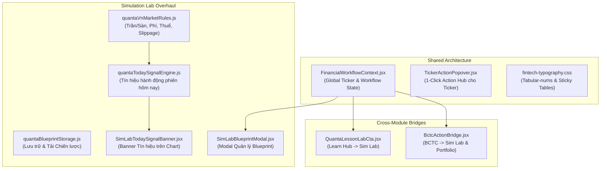

# Implementation Plan: Cải Thiện Toàn Diện Logic & UI/UX 5 Phân Hệ (Next-Gen Fintech Overhaul)

## 1. Mục Tiêu & Bối Cảnh (Overview & Objectives)
- **Mục tiêu:** Cải thiện triệt để tính đúng đắn về **Logic** (State sync, Luồng nghiệp vụ liên tab, Luật thị trường VN, Tín hiệu hôm nay, Blueprint storage) và nâng tầm **UI/UX** (Tabular numbers, Sticky table headers, 1-Click bridges, Action Popover) trên toàn bộ 5 phân hệ: `Market & Portfolio`, `Learn Hub`, `BCTC Analysis`, `News Intelligence`, và `Simulation Lab`.
- **Cam kết kỹ thuật:** 100% file tạo mới hoặc sửa đổi **< 200 dòng/file**, 100% unit tests pass, production build sạch 0 lỗi, tuân thủ nghiêm ngặt guidelines của Vercel & Hallmark Fintech Design.

---

## 2. Kiến Trúc Phân Rã & Tác Động File (Architecture & File Impacts)

### Chi tiết các file (Tất cả < 200 dòng):

#### Component 1: Shared Core & Workflow Bridge
- **`frontend/src/shared/context/FinancialWorkflowContext.jsx`** [NEW] (< 130 dòng):
  - State điều phối toàn cục: `activeTicker`, `selectedPeriod`, `selectedInterval`, `preloadedStrategyCode`, `activeTab`.
  - Cung cấp hook `useFinancialWorkflow()` và hàm `navigateToLabWithStrategy(ticker, code)`.
- **`frontend/src/shared/components/TickerActionPopover.jsx`** [NEW] (< 120 dòng):
  - Menu mini 1-click xuất hiện khi tương tác với bất kỳ mã CK nào: Backtest định lượng, Soi BCTC, Đặt lệnh ảo, Xem tin tức.
- **`frontend/src/shared/styles/fintech-typography.css`** [NEW] (< 80 dòng):
  - CSS tokens: `.tabular-nums`, `.align-numeric-right`, `.sticky-th`, `.sticky-first-col`, hairline borders.

#### Component 2: Simulation Lab - Financial Rigor & Actionable Today Signal
- **`frontend/src/features/simulation-lab/utils/quantaVnMarketRules.js`** [NEW] (< 120 dòng):
  - Biên độ trần/sàn HOSE ($\pm7\%$), HNX ($\pm10\%$), UPCOM ($\pm15\%$).
  - Bộ lọc bẫy thanh khoản thấp (< 50k cp/phiên).
  - Thuế bán 0.1%, phí giao dịch 0.15%, bước giá làm tròn chuẩn VN, trượt giá slippage 0.1-0.2%.
- **`frontend/src/features/simulation-lab/utils/quantaTodaySignalEngine.js`** [NEW] (< 130 dòng):
  - Phân tích nến mới nhất: sinh trạng thái `BUY` (MUA MỚI), `SELL` (CHỐT LỜI/CẮT LỖ), `HOLD` (NẮM GIỮ).
  - Xuất mức giá Stop-Loss, Take-Profit, Tỷ lệ R:R và điểm tin cậy Confidence Score.
- **`frontend/src/features/simulation-lab/services/quantaBlueprintStorage.js`** [NEW] (< 110 dòng):
  - LocalStorage service: Save, Load, Delete, Export bản thiết kế chiến lược cá nhân.
- **`frontend/src/features/simulation-lab/pages/components/SimLabTodaySignalBanner.jsx`** [NEW] (< 130 dòng):
  - Banner nổi bật trên biểu đồ nến thông báo tín hiệu phiên hôm nay kèm nút đặt lệnh mô phỏng.
- **`frontend/src/features/simulation-lab/pages/components/SimLabBlueprintModal.jsx`** [NEW] (< 140 dòng):
  - Modal quản lý các chiến lược đã lưu: Tải lại, xem thông số KPI, sao chép code.
- **`frontend/src/features/simulation-lab/utils/quantaBacktestSimulator.js`** [MODIFY] (< 190 dòng):
  - Tích hợp `quantaVnMarketRules` và xuất `todaySignal` trong kết quả backtest.
- **`frontend/src/features/simulation-lab/pages/components/SimLabHeader.jsx`** [MODIFY] (< 180 dòng):
  - Nút Mở Blueprint Modal và nút Save Blueprint nhanh.
- **`frontend/src/features/simulation-lab/pages/SimulationLabWorkspace.jsx`** [MODIFY] (< 180 dòng):
  - Tích hợp `useFinancialWorkflow()` và hiển thị `SimLabTodaySignalBanner`.

#### Component 3: Learn Hub & BCTC Bridges
- **`frontend/src/features/learn-hub/pages/components/QuantaLessonLabCta.jsx`** [NEW] (< 85 dòng):
  - Widget CTA "Thử nghiệm chiến lược này trong Quanta Studio" đặt cuối bài học lý thuyết.
- **`frontend/src/features/learn-hub/pages/QuantaLessonReader.jsx`** [MODIFY] (< 175 dòng):
  - Gắn `QuantaLessonLabCta`.
- **`frontend/src/features/bctc/components/BctcActionBridge.jsx`** [NEW] (< 100 dòng):
  - Thanh hành động gắn dưới bảng DuPont/F-Score: "Backtest mã này trong Lab", "Thêm vào Watchlist".
- **`frontend/src/features/bctc/pages/BctcLabPage.jsx`** [MODIFY] (< 190 dòng):
  - Gắn `BctcActionBridge` và bổ sung class sticky header.

---

## 3. Checklist Các Bước Triển Khai Tuần Tự (Execution Phases)

### Phase 1: Shared Core & Financial Context (Nền tảng luồng nghiệp vụ)
- [ ] 1.1: Tạo `fintech-typography.css` với các rule `tabular-nums`, alignment, sticky table.
- [ ] 1.2: Tạo `FinancialWorkflowContext.jsx` cung cấp state đồng bộ giữa các phân hệ.
- [ ] 1.3: Tạo `TickerActionPopover.jsx` hỗ trợ menu thao tác nhanh cho mã CK.
- [ ] 1.4: Đăng ký Context trong `AppShell.jsx` hoặc root app.

### Phase 2: Engine Khớp Lệnh Việt Nam & Tín Hiệu Hôm Nay (Quanta Engine)
- [ ] 2.1: Tạo `quantaVnMarketRules.js` mô phỏng trần/sàn, thanh khoản, phí, thuế, trượt giá.
- [ ] 2.2: Tạo `quantaTodaySignalEngine.js` tính toán trạng thái hành động phiên hiện tại.
- [ ] 2.3: Nâng cấp `quantaBacktestSimulator.js` kết nối luật VN và sinh `todaySignal`.
- [ ] 2.4: Viết unit tests kiểm thử logic tại `frontend/src/__tests__/quantaVnRulesAndWorkflow.test.js`.

### Phase 3: Quản Trị Chiến Lược & UI Simulation Lab
- [ ] 3.1: Tạo `quantaBlueprintStorage.js` quản lý lưu trữ chiến lược cá nhân.
- [ ] 3.2: Tạo `SimLabTodaySignalBanner.jsx` hiển thị tín hiệu phiên này trên đỉnh biểu đồ.
- [ ] 3.3: Tạo `SimLabBlueprintModal.jsx` cho phép lưu, mở và quản lý danh sách chiến lược.
- [ ] 3.4: Nâng cấp `SimLabHeader.jsx` và `SimulationLabWorkspace.jsx`.

### Phase 4: Cầu Nối Learn Hub & BCTC Analysis
- [ ] 4.1: Tạo `QuantaLessonLabCta.jsx` và tích hợp vào `QuantaLessonReader.jsx`.
- [ ] 4.2: Tạo `BctcActionBridge.jsx` và tích hợp vào `BctcLabPage.jsx`.
- [ ] 4.3: Áp dụng `tabular-nums` và sticky table headers cho các bảng số liệu BCTC.

### Phase 5: Verification & Quality Gate (Kiểm Thử & Nghiệm Thu)
- [ ] 5.1: Chạy toàn bộ test suite: `npm run test:unit` (yêu cầu 100% tests PASS).
- [ ] 5.2: Chạy kiểm tra bundle build: `npm run build` (yêu cầu 0 lỗi).
- [ ] 5.3: Dùng browser subagent kiểm tra trực quan các tương tác liên tab trên trình duyệt.

---

## 4. Tiêu Chuẩn Nghiệm Thu & Đánh Giá Phản Hồi (Feedback Loop)
1. **Kiểm thử tự động:** Mọi module đều có unit test đi kèm, test suite chạy pass 100%.
2. **Kiểm tra trực quan bằng Browser:**
   - Click vào bài học trong Learn Hub $\rightarrow$ 1-click chuyển mượt sang Lab với đúng code và mã CK.
   - Click vào mã CK trong BCTC $\rightarrow$ 1-click chuyển sang Lab.
   - Banner `Tín hiệu hôm nay` hiển thị rõ ràng trên biểu đồ Candora (BUY/SELL/HOLD kèm giá cắt lỗ, chốt lời).
   - Modal lưu trữ chiến lược hoạt động trơn tru (Lưu chiến lược cá nhân, mở lại nguyên vẹn).
   - Số liệu trong các bảng tài chính không bị rung lắc, chuẩn `tabular-nums` căn phải.
